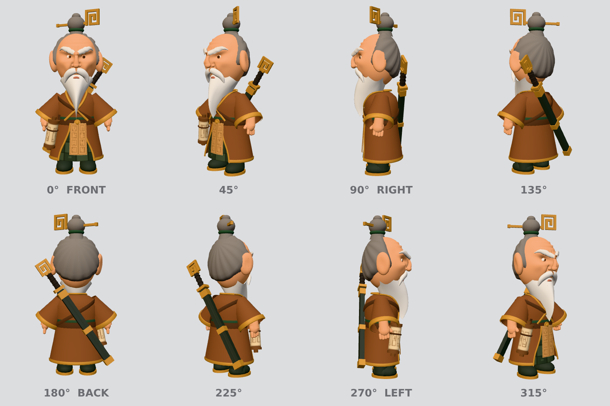

# Sun Tzu — mascote-guia 3D do KingdomOps

Modelo 3D estilizado (chibi, "cômico") do Sun Tzu, o estrategista velho e ranzinza que guia o
usuário no KingdomOps. Ele é gerado **100% por código** (three.js, geometria procedural) a partir
da folha de turnaround fornecida pelo dono (`reference-turnaround.png`).



## Arquivos

| Arquivo | O que é |
|---|---|
| `suntzu.glb` | Asset final (glTF binário): malhas, materiais, 3 texturas pequenas e 3 animações |
| `build-model.mjs` | Gerador reprodutível: constrói o modelo, exporta o `.glb` e renderiza os PNGs |
| `viewer.html` | Visualizador para celular (OrbitControls, botões idle/talk/grumble, fallback PNG) |
| `poster.png` | 512×512, fundo transparente, vista 3/4 frontal (fallback estático) |
| `turnaround.png` | 8 vistas do modelo (0°…315°), mesmo layout da referência |
| `comparison.png` | Referência × modelo em 0° e 90° |
| `face-closeup.png` | Rosto de frente e a 35° |
| `reference-turnaround.png` | Folha de referência fornecida pelo dono |

## Números (build atual)

- **19.376 triângulos** (orçamento: ≤ 25k)
- **`suntzu.glb`: 498.376 bytes ≈ 487 KiB** (orçamento: ≤ 500 KB)
- 49 malhas, 20 materiais `MeshStandardMaterial` foscos (rugosidade ≥ 0,6), 3 texturas canvas
  (xadrez da saia 64², glifos do avental 128×256, pergaminho 128×64)
- Altura 1,005 (origem nos pés, +Y para cima, olhando para +Z)
- Animações: `idle` (2,0 s, loop de respiração), `talk` (1,0 s: aceno + barba/bigode),
  `grumble` (1,2 s: sobrancelhas descem + cabeça balança — reação a resposta errada/vazia)
- Morph target `scowl` em `brows_L`/`brows_R` (usado em `grumble`, um pouco em `talk`/`idle`);
  o resto das animações é por transformações de nós.

Hierarquia de nós (nomes estáveis para usar no código do site):
`root › body › head › face, nose, ear_L/R, eyes_L/R, brows_L/R, hair, hair_bun › hairpin, beard, moustache, mouth`;
`body › robe, sleeves_L/R › hands_L/R, scroll, sword, strap`; `root › legs › legs_L/R › boots_L/R`.
"L/R" são do ponto de vista dele (L = +X = lado direito da tela na vista frontal).

## Como regenerar

Não há dependência nova no repositório. Instale o three.js numa pasta temporária fora do repo e
aponte para ela; o Playwright/Chromium já usados pelo `apps/web` fazem a renderização headless:

```sh
mkdir -p /tmp/mascot && (cd /tmp/mascot && npm i three@0.170.0)
THREE_DIR=/tmp/mascot/node_modules/three node design/mascot/suntzu/build-model.mjs
# variáveis opcionais:
#   PLAYWRIGHT_MODULE=/caminho/para/node_modules/@playwright/test   (padrão: apps/web/node_modules/@playwright/test)
#   CHROMIUM_PATH=/opt/pw-browsers/chromium
# flag: --no-render  (gera só o suntzu.glb)
```

O script abre um Chromium headless, constrói o modelo no navegador (o canvas é necessário para as
texturas e para o `GLTFExporter`), grava `suntzu.glb` e depois **recarrega o próprio `.glb`** para
renderizar `turnaround.png`, `comparison.png`, `face-closeup.png` e `poster.png` — ou seja, os PNGs
mostram exatamente o que foi exportado. O resultado é determinístico (o ruído usa semente fixa).

Para ver no celular: sirva a pasta (ex.: `npx serve design/mascot/suntzu`) e abra `viewer.html`.
O viewer carrega three.js 0.170.0 do jsDelivr.

## Como foi construído

- **Rosto (prioridade):** uma malha de crânio subdividida (grade mais densa na frente e na faixa
  dos olhos) esculpida por deslocamento de vértices: arco superciliar pesado em "V", glabela
  franzida com dois sulcos verticais, órbitas fundas, bolsas sob os olhos, maçãs largas, sulcos
  nasolabiais profundos, boca virada para baixo, rugas na testa e entradas no cabelo. Nariz grande
  e carnudo, orelhas grandes, pálpebras superiores pesadas e inclinadas (canto interno mais
  baixo), íris castanhas olhando de lado, sobrancelhas grossas cinza descendo para o nariz.
- **Cabelo:** casca com polo apontado para o coque, de modo que as mechas "penteadas para trás"
  convergem naturalmente no coque alto com faixa verde e grampo dourado com meandro.
- **Barba:** varredura de seção elíptica cujo topo abraça a mandíbula e afina até uma ponta no
  peito; bigode farto em duas mechas caídas; lábio inferior emburrado aparecendo entre os dois.
- **Roupa e acessórios:** robe marrom de gola cruzada com acabamento dourado (gola, punhos, barra
  e bordas da abertura), mangas largas e curtas, cinto escuro com fivela redonda, faixa verde,
  avental bege com dois painéis de glifos, saia verde xadrez, calça e botas verde-escuras com sola
  dourada, pergaminho no quadril direito dele, espada embainhada nas costas na diagonal com punho e
  meandro acima do ombro esquerdo, alça marrom cruzando as costas.

## Diferenças conhecidas em relação à referência

- Estilo "toy/clay" liso: sem fios individuais de cabelo/barba, sem textura de pele, sem
  sombreamento de oclusão pintado. As rugas existem na geometria mas são sutis com luz frontal.
- O rosto é mais oval e o crânio careca um pouco maior que na arte; o nariz começa entre as
  sobrancelhas (lê bem como carranca, mas é mais "de massinha" que na referência).
- A barba é um pouco mais larga no topo e a boca aparece como um biquinho estilizado.
- As mãos são luvas simplificadas (4 dedos gordinhos + polegar), braços um pouco mais abertos.
- O grampo do coque fica girado ~30° para ler bem tanto de frente quanto de lado (na arte ele
  muda de orientação entre vistas).
- A alça é uma só faixa em diagonal (ombro direito → quadril esquerdo); a arte sugere duas alças.
- Glifos do avental/pergaminho são marcas abstratas originais, não caracteres reais.
- Cores ajustadas para albedo + tone mapping neutro; podem variar conforme a iluminação do site.

## Licença e procedência

- O **modelo 3D** e o gerador são **originais**, feitos proceduralmente para o KingdomOps (primitivas,
  tornos, varreduras e deslocamento de vértices escritos à mão). **Não derivam de nenhum asset de
  jogo** — nada da arte da Lilith Games / Rise of Kingdoms foi usado, rastreado ou importado. O
  mascote não deve ser decalcado/rastreado a partir da arte do Sun Tzu do jogo, e futuras edições
  devem seguir a mesma regra.
- A **folha de referência** (`reference-turnaround.png`) foi **gerada pelo próprio dono (Victor)
  com uma ferramenta de IA (Codex, da OpenAI)**, conforme confirmado por ele em 13/10/2026; não foi
  tirada de nenhum asset de jogo. Antes de uso público, vale conferir os termos de uso da
  ferramenta para imagens geradas.
- O nome "Sun Tzu" refere-se à figura histórica (domínio público).

## Uso no site

- **Carregar sob demanda:** só nas páginas que mostram o mascote, via `import()` dinâmico do
  three.js + `GLTFLoader` e do `suntzu.glb`. **Nunca** incluir no orçamento de JS da primeira visita
  nem no bundle principal. Sugestão: carregar quando o card do mascote entrar na viewport
  (`IntersectionObserver`) e o navegador estiver ocioso.
- **Fallback:** mostrar `poster.png` (512×512, transparente) imediatamente; trocar pelo 3D só se
  houver WebGL **e** o usuário não pedir movimento reduzido (`prefers-reduced-motion: reduce`).
  Com movimento reduzido, manter o PNG (ou o 3D parado, animando só por ação explícita).
- **Animações:** `idle` em loop quando visível (pausar fora da viewport / aba oculta);
  `talk` quando o guia "fala" uma dica; `grumble` para resposta errada ou vazia. Ver `viewer.html`
  como exemplo de `AnimationMixer` com transição curta (fadeIn/fadeOut 0,15 s).
- Use `renderer.setPixelRatio(Math.min(devicePixelRatio, 2))` e limite o canvas ao tamanho do card
  para economizar bateria em celular.
