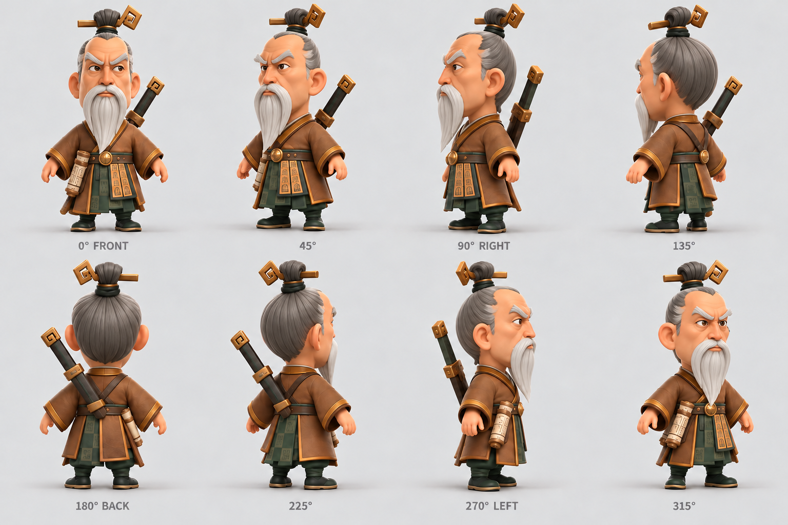

# Sun Tzu — mascote-guia do KingdomOps (vídeo)

O Sun Tzu é o estrategista velho, ranzinza e cômico que guia o usuário no KingdomOps (questionário
em formato de chat e leitura dos guias). **O mascote aparece em vídeos curtos**, não em 3D
interativo (decisão E19 em `produto/decisoes-autonomas.md`).

## Arquivos

| Arquivo | O que é |
|---|---|
| `reference-turnaround.png` | Folha de referência do personagem fornecida pelo dono (visual oficial) |

O modelo 3D procedural anterior (`suntzu.glb`, gerador e visualizador) foi removido; está no
histórico do git no commit `25b37f0` se for preciso recuperar.

## Vídeos: o que ainda falta decidir (dono)

- Quais clipes existem. Sugestão mínima: `idle` (parado/respirando, em loop), `talk` (falando uma
  dica), `grumble` (reação a resposta errada ou vazia).
- Ferramenta de geração e quem produz os arquivos.

## Regras técnicas para usar vídeo no site

- **Hospedar junto com o site** (pasta `public/`). Nada de YouTube/Vimeo/CDN de terceiros em tempo
  de execução.
- **Sem fundo transparente, se possível:** o personagem dentro de um card com fundo próprio
  permite um único arquivo MP4 (H.264), que roda em todos os navegadores. Transparência exige dois
  arquivos (WebM VP9 com alfa para Chrome/Firefox e HEVC com alfa para Safari).
- **Sem áudio:** o texto da fala fica no balão do chat, que é o que leitores de tela leem. O
  vídeo é decorativo (`aria-hidden="true"`).
- Atributos: `muted playsinline loop` (sem `muted` + `playsinline` o iPhone não toca sozinho),
  `preload="none"` ou `"metadata"` e um `poster` (quadro parado em imagem).
- **Movimento reduzido** (`prefers-reduced-motion: reduce`): mostrar só o `poster`, sem tocar.
- Pausar fora da tela (`IntersectionObserver`) e com a aba oculta.
- **Peso:** clipes curtos (2–4 s), largura 480–720 px; alvo de algumas centenas de KB por clipe.
  Vídeo não conta no orçamento de 200 KB de JS, mas pesa no celular.

## Licença e procedência

- A folha de referência foi **gerada pelo dono (Victor) com uma ferramenta de IA (Codex, da
  OpenAI)**, conforme confirmado por ele em 13/10/2026; não foi tirada de nenhum asset de jogo.
  Antes de uso público, conferir os termos de uso da ferramenta (vale também para os vídeos).
- Nada da arte da Lilith Games / Rise of Kingdoms pode ser usado, rastreado ou decalcado.
- O nome "Sun Tzu" refere-se à figura histórica (domínio público).
