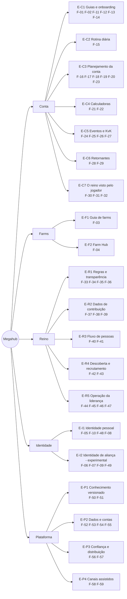

# Árvore de funcionalidades

Produto → **5 áreas** → **20 épicos** → **59 funcionalidades** (F-01..F-10 do Victor + F-11..F-59 novas) → histórias de usuário.

Cada funcionalidade é rastreável até os **passos** dos mapas de processo (`processos/conta.md`: `CJ/CD/CS/CE/CK/CR/CF`; `processos/reino.md`: `RL`, `Wn-m`), as **dores** (`D-xxxx`) e os **fatos/contexto** (IDs de fichas ou packs). O backlog (`produto/backlog-sistema.md`) tem a mesma lista em forma de tabela.

## 1. Como a prioridade foi calculada

Fórmula do método: **(gravidade × frequência da dor) × alcance ÷ esforço**, com F2P e início de reino na frente. Parâmetros concretos usados:

| Termo | Definição | Valores |
|---|---|---|
| **D** — dor (gravidade × frequência) | Faixa de score do índice de cada dor (score = freq × peso de gravidade), **dentro de cada coletor** porque as escalas diferem. Jogadores: ≥300 → 3; 100–299 → 2; <100 → 1. Líderes: ≥20 → 3; 10–19 → 2; <10 → 1. D = maior faixa entre as dores ligadas + 0,5 por dor adicional de faixa ≥2 (máx. +1). | 1 a 4 |
| **A** — alcance | Passos/atores cobertos: 1 = 1–2 passos de um ator; 2 = 3–5 passos ou 2 atores; 3 = ≥6 passos ou jogador + líder | 1 a 3 |
| **P** — foco | 1,5 = público principal é F2P/low em reino novo (dia 0 → KvK1) ou liderança de reino novo; 1,2 = todos os perfis/estágios incluindo F2P; 1,0 = só pós-KvK1/SoC ou só liderança tardia | 1,0 / 1,2 / 1,5 |
| **E** — esforço | S = 1, M = 2, L = 3 (S ≈ conteúdo/página estática ou calculadora; M ≈ estado do usuário ou lógica de regras; L ≈ rede/moderação/IA) | 1 / 2 / 3 |
| **Ev** — evidência (extensão do método) | **forte** = dor principal `validada` e faixa 3; **média** = `validada` faixa ≤2, ou `bruto` faixa 3, ou premissa central não testada; **fraca** = só dores `bruto` faixa ≤2 ou inferidas; **sem evidência** = nenhuma dor/passo ligado | 1,0 / 0,8 / 0,5 / 0,3 |

**Score = D × A × P ÷ E × Ev** (máximo teórico 18). O fator Ev não está no método original; foi acrescentado para que funcionalidades "sem evidência" não subam só por serem baratas. A coluna "Cálculo" mostra `D·A·P/E·Ev`.

**Habilitadores** (área Plataforma) não têm dor própria: herdam a prioridade da funcionalidade mais bem pontuada que depende deles e entram na release em que ela entra.

## 2. Diagrama (áreas → épicos)

| Área | Épicos | Funcionalidades |
|---|---:|---:|
| Conta | 7 | 24 |
| Farms | 2 | 2 |
| Reino | 5 | 15 |
| Identidade | 2 | 8 |
| Plataforma | 4 | 10 |
| **Total** | **20** | **59** |

## 3. A árvore

Legenda das colunas: **Passos** (mapas de processo) · **Dores** · **Fatos/contexto** · **Apoio** (Inf/Calc/Plan/Acomp/Coord/Ident) · **Evid.** · **Esf.** · **Depende de** · **Cálculo** (`D·A·P/E·Ev`) · **Score**. ★ = ideia do Victor (decisão do dono; mantida mesmo com evidência fraca).

### Área CONTA

#### E-C1 Guias e onboarding

| ID | Funcionalidade | Passos | Dores | Fatos / contexto | Apoio | Evid. | Esf. | Depende de | Cálculo | Score |
|---|---|---|---|---|---|---|---|---|---|---|
| F-01 ★ | **Account Setup Questionnaire → Personalized Guide** (Guide Builder) | CJ-01, CJ-02, CJ-05, CR-04, conta §7 | D-0006, D-0001, D-0030, D-0031 | `perfis.md`; I-05 (backlog-ideias); A05-0008, A14-0003 | Inf, Plan | forte | M | F-51, F-02 (conteúdo), F-50 | 4·3·1,5/2·1,0 | **9,0** |
| F-02 ★ | **F2P Base Guide + Spend Deltas** (Low → Medium → High → Whale → Kraken) | CJ-01..CJ-13, CD-*, conta §7 e §8 | D-0001, D-0006, D-0030, D-0031 | packs `f2p-early-progression`, `daily-routine`, `early-kingdom-timeline-and-events`, `f2p-economy-gems-vip-speedups`, `f2p-commanders-equipment`, `spending-tiers-baseline` | Inf, Plan | forte | M (base F2P + Low); cada delta Medium+ = M | F-50, F-51; T0 Q1, Q4, Q6, Q16; pesquisa Medium+ | 4·3·1,5/2·1,0 | **9,0** |
| F-11 | **First 30 Days Path** | CJ-02, CJ-03, CJ-05, CJ-07, CE-01 | D-0030, D-0006, D-0041 | A01-0001, A05-0008, C04-0005, A11-0510 (baixa) | Inf, Plan, Acomp | média | S | F-51; T0 Q4, Q9 | 3,5·2·1,5/1·0,8 | **8,4** |
| F-12 | **New Kingdom Start Guide** (+ Day-1 Survival) | CJ-01, CJ-03, CJ-04, RL-01 | D-0018, D-0037, D-0041 | C04-0026, C04-0033, B01-0506 (baixa), A09-0007 | Inf, Plan | forte | S | F-51 | 3,5·2·1,5/1·1,0 | **10,5** |
| F-13 | **Zeroed Recovery Playbook + Risk Checklist** | CJ-04, CD-14, CF-07, CK-07 | D-0003, D-0041 | A03-0007, A03-0030, A13-0005 | Inf, Acomp | forte | S | custos de escudo (lacuna) | 3·2·1,5/1·1,0 | **9,0** |
| F-14 | **Budget Reality Check** | CJ-01, CJ-05, CJ-09, conta §7 | D-0001, D-0018, D-0034 | A04-0001, A04-0006 (derivado), A12-0001, A12-0002, B01-0700 (baixa) | Inf, Calc, Plan | forte | S | T0 Q1, Q12, Q16 | 3,5·2·1,5/1·1,0 | **10,5** |

Histórias:
- **F-01**
  - As a new F2P player, I want to answer about 8 questions (spend profile, hours/day, kingdom age, civilization, CH, role) so that I get a guide with only the steps that apply to me, with Recommended options marked.
  - As a player who used to spend, I want to state my past spending so that the guide does not treat my account as a fresh F2P.
  - As a player, I want a shareable link to my guide setup so that alliance-mates can generate theirs (shared outside the game).
- **F-02**
  - As a F2P player, I want a stage-by-stage guide from day 0 to KvK1 where every number shows its source and "verified on patch X" so that I can trust it over old Reddit advice.
  - As a low spender, I want to see only what changes for my budget (a delta over F2P) so that I don't reread a whole guide.
- **F-11**
  - As a brand-new player, I want 3–5 goals and one concept explained per day for my first 30 days so that I learn the game without drowning in its UI.
- **F-12**
  - As a F2P player starting in a fresh kingdom, I want a start strategy that assumes whales and sleepers exist (where to settle, which alliance, when to shield) so that I survive the first two weeks.
- **F-13**
  - As a player who was just zeroed, I want a recovery plan (what to rebuild first, what still counts) so that I don't quit that day.
  - As a player logging off, I want a 30-second risk checklist so that I avoid the common ways of being zeroed.
- **F-14**
  - As a F2P player, I want realistic targets for my budget (what I can and cannot reach by KvK1) so that I stop measuring myself against whales.
  - As a low spender, I want to see which purchases actually move my targets so that I don't buy on FOMO.

#### E-C2 Rotina diária

| ID | Funcionalidade | Passos | Dores | Fatos / contexto | Apoio | Evid. | Esf. | Depende de | Cálculo | Score |
|---|---|---|---|---|---|---|---|---|---|---|
| F-15 | **Time-Boxed Routine** (+ Break Mode) | CD-01..CD-14, CS-01, CF-05, CR-07, CJ-14 | D-0002, D-0026, D-0020, D-0036 | A10-0001, A10-0002, A05-0003, A09-0006, A04-0001, A01-0011 | Plan, Acomp, Inf | forte | S | F-51; **T0 §3 (minutos por tarefa)** — v0 ordena só por valor | 4·3·1,5/1·1,0 | **18,0** |

Histórias:
- **F-15**
  - As a busy F2P player, I want to say "I have 15 minutes today" and get the highest-value checklist plus a "safe to skip" list so that the game stops feeling like a second job.
  - As a player taking a break, I want a "park my account" plan (what to do before pausing, minimal weekly upkeep) so that I can step away without losing everything.
  - As a player, I want daily check-offs without punishing streaks so that the checklist doesn't become another obligation.

#### E-C3 Planejamento da conta

| ID | Funcionalidade | Passos | Dores | Fatos / contexto | Apoio | Evid. | Esf. | Depende de | Cálculo | Score |
|---|---|---|---|---|---|---|---|---|---|---|
| F-16 | **Account Snapshot** (um inventário, muitas ferramentas — X1) | CJ-07, CJ-09, CS-03, CE-03, CE-08, CR-03, CK-03 | D-0006, D-0007, D-0012, D-0010, D-0016 | X1 em `_matriz.md`; A01-0001, A05-0001 | Acomp, Calc | média | M | F-52; F-54 opcional; T0 (print do próprio perfil) | 4·3·1,5/2·0,8 | **7,2** |
| F-17 | **Next 3 Actions** | CJ-05, CJ-07, CJ-09, CD-04, CR-06 | D-0006, D-0007, D-0030 | A01-0001, A02-0500, A02-0501, A08-0500 | Plan, Inf | média | M | F-16, F-50, F-51; teste com 30 posts "what next?" | 4·3·1,5/2·0,8 | **7,2** |
| F-18 | **Milestone Benchmark** (por idade do reino e perfil) | CS-03, CJ-09, CK-03, CR-03 | D-0007, D-0012, D-0043 | B01-0700 (baixa), A01-0005 (derivado) | Acomp, Calc | média | S | T0 `kvk1-day0`, Q6; F-16 | 3,5·2·1,5/1·0,8 | **8,4** |
| F-19 | **Restart vs Continue Decision Tree** | CJ-06, CR-04 | D-0015, D-0042 | A14-0002, C04-0023, C04-0010 | Inf, Calc | média | S | F-50 | 2,5·1·1,5/1·0,8 | **3,0** |
| F-20 | **Commander Decision Checklist** (+ Shelf-life) | CJ-05, CJ-07, CJ-12, conta §8 | D-0008, D-0009, D-0029 | A06-0500, A06-0501, A06-0504, A06-0506, A06-0510, C04-0021, C04-0023 | Inf, Plan | forte | S | F-50 (vida útil por patch) | 3·2·1,5/1·1,0 | **9,0** |
| F-23 | **Path-to-T4/T5 Planner** (CH e orçamento de aceleradores) | CJ-07, CJ-09, CJ-12, CJ-13 | D-0012, D-0027 | A01-0001, A01-0005, A02-0501, A08-0500 | Calc, Plan | média | M | T0 Q6 (tempos buffados), Q12; F-16 | 2·2·1,5/2·0,8 | **2,4** |

Histórias:
- **F-16**
  - As a player, I want to enter my account state once (CH, key research, troops, speedups, gems, VIP, kingdom age) so that every planner and calculator reuses it.
  - As a player, I want "copy from last week" and an update in under 2 minutes so that keeping it current is cheap.
  - As a player, I want it stored on my device without a login so that I don't hand my data to anyone.
- **F-17**
  - As a player who doesn't know what to do next, I want my next 3 actions with the "why" and the source so that I stop asking Reddit.
  - As a player, I want the list to recompute when I mark an action done.
- **F-18**
  - As a F2P player on day 60, I want to compare my account with expected milestones for my kingdom age and budget so that I know if I'm on track for KvK1.
- **F-19**
  - As a player who regrets an early choice, I want to see what is reversible and the catch-up cost so that I don't restart for nothing.
- **F-20**
  - As a F2P player holding scarce gold heads, I want a checklist before investing (role, season shelf-life, free alternatives, respec options) so that I don't regret an irreversible choice.
  - As a player, I want each commander tagged "useful until season X, verified on patch Y" so that I know when advice expires.
- **F-23**
  - As a F2P player, I want to see how many speedups and days I need to reach CH21/T4 before KvK1 so that I know where to put my speedups.

#### E-C4 Calculadoras

| ID | Funcionalidade | Passos | Dores | Fatos / contexto | Apoio | Evid. | Esf. | Depende de | Cálculo | Score |
|---|---|---|---|---|---|---|---|---|---|---|
| F-21 | **Gem & VIP Value Table** (+ Wheel guarantees) | CJ-05, CE-05, CE-06, CD-11, CS-01 | D-0010, D-0033, D-0034 | A05-0001, A05-0004, A05-0008, A04-0009, A11-0502, C04-0022 | Calc, Inf | média | S | T0 Q1, Q8, Q14; F-50 | 2·2·1,5/1·0,8 | **4,8** |
| F-22 | **Healing Cost Calculator** | CK-03, CK-07, CF-09 | D-0012, D-0028 | A08-0502, A08-0505, A01-0008, C04-0028 | Calc | média | S | L-A08-01 (custo de cura vs retreino); F-50 | 2·2·1,2/1·0,8 | **3,8** |

Histórias:
- **F-21**
  - As a F2P player, I want a table of what each gem use is worth (VIP, speedups, keys) so that I stop wasting gems.
  - As a player, I want to see the guaranteed outcome and total cost before spinning a wheel so that I know when to stop.
- **F-22**
  - As a KvK fighter, I want the resources and healing speedups my hospital capacity implies so that I size my farms and hoard correctly.

#### E-C5 Eventos e KvK

| ID | Funcionalidade | Passos | Dores | Fatos / contexto | Apoio | Evid. | Esf. | Depende de | Cálculo | Score |
|---|---|---|---|---|---|---|---|---|---|---|
| F-24 | **Kingdom Clock & Personal Event Calendar** (X3) | CE-01, CE-04, CD-13, CS-02, CS-04, CK-06 | D-0014, D-0011, D-0042, D-0012 | A11-0512, A11-0502, A10-0005, C04-0005, B01-0500 | Acomp, Plan | média | M | T0 Q4, Q5; F-52 (notificações) | 2,5·3·1,5/2·0,8 | **4,5** |
| F-25 | **Hoard Advisor** (regras por objetivo, sem datas) | CD-08, CE-02, CE-03, CE-05, CK-05, CS-04 | D-0011, D-0012, D-0010 | A11-0501, A11-0505, A09-0007, A02-0503 | Plan, Inf | média | S | F-50; F-16 opcional | 2,5·2·1,5/1·0,8 | **6,0** |
| F-26 | **KvK Readiness Checklist** (+ Season Explainer) | CJ-09, CJ-12, CJ-13, CK-01, CK-03 | D-0012, D-0013, D-0028 | A08-0500, A08-0502, B01-0503, C04-0007 | Inf, Plan | média | S | F-50; T0 Q15 | 2·2·1,5/1·0,8 | **4,8** |
| F-27 | **Hidden Lotus Planner** | CE-07, CJ-06 | D-0042, D-0015 | lacuna (sem ficha; T0) | Plan, Calc, Ident | média | M | **T0 Hidden Lotus** (fora do protocolo hoje) | 2,5·2·1,5/2·0,8 | **3,0** |

Histórias:
- **F-24**
  - As a player, I want to set my kingdom's opening date once so that every plan shows days to KvK1 and the known event windows.
  - As a player, I want event end times in my local time with a reminder so that I don't miss windows (like the Commander Swap that ended a day early).
- **F-25**
  - As a F2P player, I want rules telling me what to save for which goal (Lohar, More Than Gems, Eve of the Crusade, KvK) so that I don't spend speedups at the wrong time.
- **F-26**
  - As a first-KvK player, I want a checklist by role and budget (CH, troops, hospital, speedups) and a plain explanation of the season so that I arrive ready.
- **F-27**
  - As a player chasing Hidden Lotus, I want a day-by-day plan with the required pace so that I know on day 2 whether I'm on track instead of restarting dozens of times.

#### E-C6 Retornantes

| ID | Funcionalidade | Passos | Dores | Fatos / contexto | Apoio | Evid. | Esf. | Depende de | Cálculo | Score |
|---|---|---|---|---|---|---|---|---|---|---|
| F-28 | **What Changed Since…** | CR-02, CJ-12 | D-0016, D-0013, D-0031 | `game-state-and-patch-timeline.md` (C04-*) | Inf | forte | S | F-50 (patch timeline mantida) | 3·2·1,2/1·1,0 | **7,2** |
| F-29 | **Returner Mode** (plano de 14 dias + ficar/migrar/recomeçar) | CR-01..CR-07 | D-0016, D-0015, D-0019 | B06-0003, C04-0008, C04-0023 | Plan, Inf, Calc | forte | M | F-28, F-31, F-16, F-17 | 4·3·1,2/2·1,0 | **7,2** |

Histórias:
- **F-28**
  - As a returning player, I want to pick the date I stopped and see what changed, grouped by impact, so that I catch up in minutes.
- **F-29**
  - As a returning player, I want a 14-day catch-up plan and a clear stay/migrate/restart recommendation so that I don't quit again in the first week.

#### E-C7 O reino visto pelo jogador

| ID | Funcionalidade | Passos | Dores | Fatos / contexto | Apoio | Evid. | Esf. | Depende de | Cálculo | Score |
|---|---|---|---|---|---|---|---|---|---|---|
| F-30 | **My Requirements Tracker** | CK-02, CK-08, CK-09, CS-05, W1-3 | D-0004, D-0501, D-0005 | B08-0001, B08-0002 | Acomp, Calc | forte | S | F-34 (import do card) ou entrada manual; F-54 opcional | 3,5·2·1,5/1·1,0 | **10,5** |
| F-31 | **Migration Eligibility & Passport Checker** | CJ-11, CK-10, CR-04, W5-3 | D-0016, D-0019, D-0509 | B06-0001, B06-0002, B06-0003, C04-0008 | Calc, Inf | forte | S | F-50 (regras por patch); notas oficiais 1.1.10–1.1.12 | 4·3·1,2/1·1,0 | **14,4** |
| F-32 | **Play It Safe FAQ** (+ Account Safety) | CR-01, CJ-14, CJ-01 | D-0021, D-0023, D-0017, D-0024, D-0022, D-0035 | C02-0002, C02-0005, C02-0010, C04-0006 | Inf | média | S | F-56 | 3·1·1,2/1·0,8 | **2,9** |

Histórias:
- **F-30**
  - As a first-KvK player, I want to enter my kingdom's requirement and track my own kills and deads against it so that I know where I stand before the purge list.
  - As a player, I want the DKP formula explained in plain language so that a "250% of power" mail makes sense.
- **F-31**
  - As a player, I want to enter my account age, power and target kingdom and get "eligible / not eligible, and why" for the current patch so that I don't waste passports.
  - As a migration officer, I want to send applicants a link that runs this check so that I stop explaining rules by hand.
- **F-32**
  - As a player, I want to know what gets accounts banned (bots, Discord links in chat, account selling) and how to protect mine so that I don't lose it.

### Área FARMS

| ID | Funcionalidade | Passos | Dores | Fatos / contexto | Apoio | Evid. | Esf. | Depende de | Cálculo | Score |
|---|---|---|---|---|---|---|---|---|---|---|
| F-03 ★ | **Farm Guide** (variantes: geral, recurso único, pares que fizerem sentido; + transfer calculator) — épico E-F1 | CJ-08, CF-01..CF-06 | D-0020 | A13-0001..A13-0010, A03-0021, A03-0024, A03-0028, A03-0029, A03-0030 | Inf, Calc | média (pares = hipótese) | S | T0 Q10, Q13; L-A13-01 (rendimento/dia) | 3·2·1,5/1·0,8 | **7,2** |
| F-04 ★ | **Farm Hub** (Farm Board: cadastro, metas, checklist 1 toque, total enviado, alerta de ociosa) — épico E-F2 | CF-04..CF-10, CD-09 | D-0020, D-0002 | A03-0024, A03-0026, A13-0005 | Acomp, Plan, Calc | forte | M | F-03; F-52 (local) → F-53 (sync); teste 5 usuários × 1 semana | 3,5·2·1,5/2·1,0 | **5,3** |

Histórias:
- **F-03**
  - As a F2P player, I want to know whether I need a farm, which variant fits my main's current bottleneck, and to what CH and Trading Post level to raise it so that the farm pays back its time.
  - As a player, I want a transfer calculator (tax, capacity per trip, storehouse protection) so that I know what actually arrives at my main.
- **F-04**
  - As a player with farms, I want one board showing each farm's state and when it needs me (one tap per farm) so that I need fewer logins.
  - As a player, I want an idle-farm alert and running totals shipped vs my KvK target so that I know if my farms are worth it.
  - Guardrail: manual only; the hub never automates gathering or transfers (ToS 17.1.18).

### Área REINO

#### E-R1 Regras e transparência

| ID | Funcionalidade | Passos | Dores | Fatos / contexto | Apoio | Evid. | Esf. | Depende de | Cálculo | Score |
|---|---|---|---|---|---|---|---|---|---|---|
| F-33 | **Kingdom Rules Page & Charter** | RL-01, RL-02, W1-1, W5-1, W5-5, W6-1, W10-1 | D-0513, D-0518, D-0525, D-0527 | B03-0004 (baixa), B07-0004, B08-0001 | Coord, Inf | forte | S | F-50, F-56, F-57; teste como Google Doc com 3–5 líderes | 4·3·1,5/1·1,0 | **18,0** |
| F-34 | **Requirements Card & Formula Sandbox** (M18 aplicado) | W1-1, W1-3, W3-2, CK-02, conta §8 | D-0501, D-0004, D-0502 | B08-0001, B08-0002 | Calc, Coord, Inf | forte | S | F-50 (presets); classificar 15–20 fórmulas reais | 3,5·3·1,5/1·1,0 | **15,8** |
| F-35 | **MGE Ledger** (+ applications) | W6-1..W6-4, W3-4, CE-02 | D-0506, D-0505, D-0522 | B05-0002, B05-0003, B05-0004 | Coord, Acomp | forte | S (v0 template) → M (estado compartilhado) | F-53 para v1; teste em planilha com 3–5 líderes | 4·2·1,2/1·1,0 | **9,6** |
| F-36 | **Decision Log & Pact Registry** (Ledger, M17) | RL-02, RL-03, RL-10, W2-4, W3-3, W3-4, W4-3, W4-4, W10-1, W10-3, CK-09 | D-0513, D-0507, D-0525, D-0521 | B09-0001 (baixa), B03-0005 | Coord | média | M | F-53, F-55 (assinaturas verificadas) | 4·3·1,2/2·0,8 | **5,8** |

Histórias:
- **F-33**
  - As a council member of a new kingdom, I want a charter template (leadership, decision process, MGE/DKP policy, conflict rules) that all R5s sign so that we avoid a civil war before KvK1.
  - As a newcomer, I want one page with the kingdom's rules in my language so that I don't break unwritten rules.
- **F-34**
  - As a council, I want to pick a DKP formula from versioned presets, test it on sample accounts and publish a requirements card so that members see fair, explained targets.
  - As a member, I want to import the card into my tracker (F-30) so that I follow my own progress.
- **F-35**
  - As a council, I want a public ledger of who got which MGE slot and why so that "hoarding" accusations become checkable facts.
  - As a member, I want to apply for an MGE slot and see the queue so that the rotation is predictable.
- **F-36**
  - As a king, I want each decision (purge, exception, MGE) logged with the rule applied, the author and the date so that I can prove legitimacy.
  - As a small alliance, I want agreements recorded with both signatures so that coercion leaves a trace.

#### E-R2 Dados de contribuição

| ID | Funcionalidade | Passos | Dores | Fatos / contexto | Apoio | Evid. | Esf. | Depende de | Cálculo | Score |
|---|---|---|---|---|---|---|---|---|---|---|
| F-37 | **Data Intake** (import CSV/xlsx de scanners/exports, mapeamento de colunas, join por governor ID — M19) | W1-2, W2-3, W3-1 | D-0500, D-0504, D-0503 | B08-0003, B08-0004, C01-0017, C01-0021, C02-0007, C02-0016 | Coord, Calc | forte | M | **L-B08-01 (ROK Toolkit)**; F-56 (atestado + opt-out); F-53 | 4·3·1,2/2·1,0 | **7,2** |
| F-38 | **DKP Sheet Doctor** (deltas por estágio, log de exceções, alt↔main, flags de anomalia, tiers) | W2-3, W2-4, W3-1..W3-3, W4-1, CF-08, CF-10 | D-0500, D-0503, D-0522, D-0502 | B08-0001, B08-0002, B08-0006 | Calc, Acomp, Coord | forte | M | F-37, F-34 | 4·3·1,2/2·1,0 | **7,2** |
| F-39 | **Seed Simulator** | W1-5, RL-09, RL-10, CJ-13 | D-0520 | B08-0008, B03-0007 | Calc | média | S | F-50 (fórmula oficial); F-37 opcional | 3·1·1,0/1·0,8 | **2,4** |

Histórias:
- **F-37**
  - As a data officer, I want to upload the scanner export my kingdom already uses, map columns once and join by governor ID so that I stop doing hours of spreadsheet work per event.
  - As a member, I want to opt out of having my data displayed so that my consent is respected.
- **F-38**
  - As a data officer, I want stage deltas, an exception log (zeroed days, trades) and alt merges applied to the imported data so that the ranking is defensible.
  - As a data officer, I want flags for negative deltas and missing IDs so that OCR errors don't reach the published ranking.
- **F-39**
  - As a king, I want to simulate our seed from the top-300 power tiers and see the effect of Vacation Permits so that we stop zeroing our own players to drop a seed.

#### E-R3 Fluxo de pessoas

| ID | Funcionalidade | Passos | Dores | Fatos / contexto | Apoio | Evid. | Esf. | Depende de | Cálculo | Score |
|---|---|---|---|---|---|---|---|---|---|---|
| F-40 | **Exit Notice Kit** (+ appeal, critério do Lost Kingdom) | W4-1..W4-3, W3-4, W1-6 | D-0507, D-0514, D-0524 | B06-0005, B03-0005, B02-0002 | Coord, Inf | forte | M | F-38 (tiers), F-36 | 3,5·2·1,2/2·1,0 | **4,2** |
| F-41 | **Migration Application Pipeline** | W5-1, W5-2, W5-4 | D-0508, D-0509, D-0518 | B06-0004, B07-0001 | Coord, Calc | média | M | F-31, F-53, F-54 (prints do candidato, com consentimento) | 3·2·1,0/2·0,8 | **2,4** |

Histórias:
- **F-40**
  - As a council, I want to send a standard exit notice citing the published rule, with a deadline and a redemption option, so that purges are predictable and less vengeful.
  - As a member on the list, I want to appeal with evidence so that mistakes can be corrected.
- **F-41**
  - As a migration officer, I want applicants to fill a form that checks game eligibility and our requirements so that I only review viable candidates.

#### E-R4 Descoberta e recrutamento

| ID | Funcionalidade | Passos | Dores | Fatos / contexto | Apoio | Evid. | Esf. | Depende de | Cálculo | Score |
|---|---|---|---|---|---|---|---|---|---|---|
| F-42 | **Open Roles Board** (+ recruitment post generator) | RL-05, W1-4, W5-1, CR-05 | D-0510, D-0016, D-0037 | B06-0004, C04-0025 | Coord, Ident | média | S | F-57 (divulgação fora do jogo) | 4·2·1,2/1·0,8 | **7,7** |
| F-43 | **Kingdom Directory** (M16) | CJ-03, CJ-11, CK-10, CR-05, RL-05, W5-1 | D-0018, D-0016, D-0037, D-0510, D-0025 | lacuna de mercado (`competitors-and-constraints.md`) | Coord, Inf, Ident | forte | L | F-33 (páginas), F-55, F-53, moderação; cold start | 4·3·1,5/3·1,0 | **6,0** |

Histórias:
- **F-42**
  - As an R4, I want to publish open roles (rally lead, garrison, returners welcome) and generate a recruitment post for Reddit/Discord so that I recruit for gaps, not just power.
- **F-43**
  - As a casual F2P or returning player, I want to filter kingdoms by language, playstyle, requirements and whether they accept returners so that I find one that fits.

#### E-R5 Operação da liderança

| ID | Funcionalidade | Passos | Dores | Fatos / contexto | Apoio | Evid. | Esf. | Depende de | Cálculo | Score |
|---|---|---|---|---|---|---|---|---|---|---|
| F-44 | **Availability & Role Roster** (slots UTC) | CK-04, CK-06, W1-4, W2-1, W9-1, W9-2 | D-0517, D-0526 | B07-0001, B04-0005 | Coord, Acomp | média | M | F-53; F-58 (lembretes) | 2,5·2·1,2/2·0,8 | **2,4** |
| F-45 | **Activity Definition & Check-in** | W8-1, W8-3, RL-01 | D-0511, D-0512 | B04-0002, B08-0005 (baixa) | Acomp, Coord | média | S | não duplicar Quick Checks/Notes (B04-0002) | 2·1·1,5/1·0,8 | **2,4** |
| F-46 | **Leadership Weekly Cockpit** | RL-11, W7-2, W8-2, todos os W | D-0519, D-0040 | B04-0007, B03-0003 | Acomp, Plan, Coord | forte | M | agrega F-33..F-45 | 3·3·1,2/2·1,0 | **5,4** |
| F-47 | **KvK Timeline Template** — **congelada** | W1-7 | D-0516 (baixa, possivelmente obsoleta) | B02-0005 | Plan | fraca | S | verificar se o calendário oficial de KvK saiu | 1·1·1,2/1·0,5 | **0,6** |

Histórias:
- **F-44**
  - As an event R4, I want members to declare roles and UTC availability once and see coverage per time slot so that Ark/KvK sign-ups stop living in Forms.
- **F-45**
  - As an alliance leader, I want to publish what "active" means and keep a private, dated history so that kicks aren't contested (in-game Alliance Notes are public to members).
- **F-46**
  - As a king or R5, I want one weekly view of pending decisions, deadlines and who covers which timezone so that leadership is less of a second job and can be handed over.
- **F-47**
  - As a council, I want a gate/pass timeline anchored to our KvK start so that we plan fights — only if the official calendar does not cover it.

### Área IDENTIDADE

#### E-I1 Identidade pessoal (evidência forte para identidade pessoal)

| ID | Funcionalidade | Passos | Dores | Fatos / contexto | Apoio | Evid. | Esf. | Depende de | Cálculo | Score |
|---|---|---|---|---|---|---|---|---|---|---|
| F-05 ★ | **Player Profile** (nome, governor ID opcional, civ, função, perfil de gasto, aliança) | CJ-15; liga F-04, F-16, F-30 | D-0043, D-0038, D-0042 | `_indice-players.md` §Identity | Ident | média | M | F-53 (backend + auth); privacidade por padrão | 2,5·3·1,2/2·0,8 | **3,6** |
| F-10 ★ | **Shareable Profile Card** (com motivo de civilização, arte original) | CJ-15, CJ-01 | D-0007, D-0038, D-0043, D-0044 | `_indice-players.md` §Identity; S-D-0038 | Ident | média | S | F-57; arte original (sem assets Lilith); client-side, sem login | 3,5·2·1,2/1·0,8 | **6,7** |
| F-48 | **Journey Timeline** | CJ-15, CS-03 | D-0007, D-0043 | `_indice-players.md` (≈88 posts de diário) | Ident, Acomp | média | M | F-16, F-05 | 3·2·1,2/2·0,8 | **2,9** |
| F-08 ★ | **In-Game Avatar PNG Export** (tamanho, recorte, área segura) | CJ-15 | D-0044 (indireto) | I-07 (T3/T4 sobre upload de avatar) | Ident | **fraca** (viabilidade não confirmada) | S | **T0 avatar** (5 perguntas da I-07); F-10 ou F-07 | 1·1·1,2/1·0,5 | **0,6** |

Histórias:
- **F-05**
  - As a player, I want a profile that links my planner, farms and kingdom so that I enter things once.
  - As a player, I want my profile private by default so that I control what others see.
- **F-10**
  - As a player proud of my account, I want a card with my civilization (including "heart" civs not in the game), role, account age and milestones that I can post on Reddit/Discord so that I show my journey.
- **F-48**
  - As a long-time player, I want a dated timeline of my milestones (CH, KvKs, skins) so that I can tell my "day 500" story.
- **F-08**
  - As a player, I want to download my card or crest as a PNG in the exact size and safe area of the in-game avatar so that it looks right in the game.

#### E-I2 Identidade de aliança — **experimental** (sem evidência pública de demanda)

| ID | Funcionalidade | Passos | Dores | Fatos / contexto | Apoio | Evid. | Esf. | Depende de | Cálculo | Score |
|---|---|---|---|---|---|---|---|---|---|---|
| F-06 ★ | **Alliance Page & Leadership Verification** (membros, cargos R1–R5, tag, cor, brasão) | RL-05, W5-1 (indireto) | branding: nenhuma; verificação: D-0514, D-0515 | I-06; `_indice-players.md` §Identity ("no meaningful public evidence") | Ident, Coord | **fraca** | L | F-05, F-53, F-55 (T0 do código), moderação | 2·2·1,2/3·0,5 | **0,8** |
| F-07 ★ | **Alliance-Aligned Avatar** (borda na cor, logo/brasão, tag) | — | nenhuma (D-0044 fraca, indireta) | I-06 | Ident | **sem evidência** | M | F-05, F-06, F-08 | 1·1·1,2/2·0,3 | **0,2** |
| F-09 ★ | **Crest Editor** (arte original) | — | nenhuma (D-0044 indireta) | I-06; ToS 17.1.9, §8 | Ident | **sem evidência** | M | arte original; revisão visual | 1·1·1,2/2·0,3 | **0,2** |
| F-49 | **Verified Official Channels** (anti-impersonação) | W5-1, RL-05 | D-0514, D-0515 | S-D-0514 | Ident, Coord | fraca | S | F-55, F-06 | 2,5·1·1,2/1·0,5 | **1,5** |

Histórias:
- **F-06**
  - As an R5, I want to claim my alliance page by placing a short code in the in-game alliance announcement so that nobody can impersonate us.
  - As an R4, I want to invite members to the alliance page so that our roster and roles live in one place.
- **F-07**
  - As an alliance member, I want my avatar framed in my alliance's color with our crest and tag so that I show which alliance I belong to.
- **F-09**
  - As an R4, I want to design an original crest from shapes, colors and symbols so that our alliance has an identity without using game art.
- **F-49**
  - As a member, I want to check my alliance's verified official channels before clicking any link so that scammers can't impersonate leaders.

### Área PLATAFORMA (habilitadores)

| ID | Funcionalidade | Épico | Serve | Dores (indiretas) | Fatos / contexto | Esf. | Depende de | Prioridade |
|---|---|---|---|---|---|---|---|---|
| F-50 | **Rules & Formula Library** — "verified on patch X" (M18/X2) | E-P1 | F-02, F-17, F-20, F-21, F-25, F-28, F-31, F-34, F-39 | D-0031, D-0032, D-0009, D-0509, D-0501 | X2 (`_matriz.md`, a ideia mais forte); lacunas G2/G5 em `competitors-and-constraints.md` | M | pipeline `facts/` com patch e data por número; cadência de revisão por patch | **habilitador crítico** (herda 18,0) |
| F-51 | **Content Block Engine** (blocos com tags perfil/função/estágio/horas/retornante/recommended_para — I-05/X7) | E-P1 | F-01, F-02, F-11, F-12, F-15, F-17, F-29 | D-0006, D-0031 | I-05 | M | F-50 | herda 18,0 |
| F-52 | **App Shell** (PWA mobile-first, local-first, sem login) | E-P2 | todas da Conta | D-0032 | G9 em `competitors-and-constraints.md` | M | — | herda 18,0 |
| F-53 | **Accounts & Sync** (backend, auth, estado compartilhado) | E-P2 | F-04, F-05, F-35..F-46 | D-0519 | I-06 (arquitetura) | M | F-56 | herda 9,6 (F-35) |
| F-54 | **Own-Screenshot OCR** (só telas do próprio usuário; apaga a imagem) | E-P2 | F-16, F-30, F-41 | D-0032 | C02-0007, `competitors-and-constraints.md` (decisão de dados) | M | **T0: qualidade do OCR em prints próprios** | herda 10,5 (F-30) |
| F-55 | **Verification Code** (código curto, sem URL, no anúncio da aliança/perfil, conferido por print — X6) | E-P2 | F-06, F-36, F-43, F-49 | D-0514, D-0515 | X6; D-0022 | S | **T0: campo editável e código não dispara o filtro** | herda 6,0 (F-43) |
| F-56 | **Trust & Privacy Center** (como respeitamos o ToS, consentimento, opt-out, LGPD/GDPR, aviso de não afiliação) | E-P3 | todas; obrigatório antes de F-37 | D-0022, D-0021 | C02-0002..C02-0011, C02-0018 | S | revisão jurídica antes de cobrar | herda 18,0 |
| F-57 | **Share & Discovery Kit** (imagens OG, links, páginas para busca; nunca link no chat do jogo) | E-P3 | F-01, F-10, F-33, F-42, F-43 | D-0022 | restrição de distribuição em `_matriz.md` | S | — | herda 18,0 |
| F-58 | **Discord Companion Bot** (lembretes, consultas, roster) | E-P4 | F-24, F-44 | D-0014, D-0517 | C01-0009, C01-0011 (concorrentes) | M | F-53 | score 2,4 (2,5·2·1,2/2·0,8) |
| F-59 | **Ask-with-Context Assistant** (Q&A com citações da base e do snapshot) | E-P4 | F-16, F-50 | D-0006, D-0030 | M12; S-D-0006 ideia 3 | L | F-50 maduro, F-16; custo de LLM | score 4,2 (3,5·3·1,5/3·0,8) |

Histórias (habilitadores):
- **F-50**: As a player, I want every number to show its source, date and the patch it was verified on so that I know whether advice is still valid.
- **F-51**: As a content editor, I want to write a recommendation once with tags so that it appears in every guide, routine and plan it applies to.
- **F-52**: As a mobile player, I want the hub to work on my phone without installing anything or logging in.
- **F-53**: As a council member, I want our rules, ledgers and imports stored once and shared with the other officers.
- **F-54**: As a player, I want to upload a screenshot of my own profile or inventory and have the numbers filled in, with the image deleted afterwards.
- **F-55**: As a leader, I want to prove I lead my alliance without giving anyone my password.
- **F-56**: As a player, I want a plain-language page on what the hub does and never does (no bots, no passwords, no scanning) so that I trust it.
- **F-57**: As a player, I want to share my guide, card or kingdom page on Reddit/Discord with a good preview, since links can't go in game chat.
- **F-58**: As an alliance, I want reminders and quick lookups in our Discord so that members don't need to open another site.
- **F-59**: As a player, I want to ask a free question and get an answer that knows my account and cites sources.

## 4. O que **não** construir

| Item | Motivo |
|---|---|
| Fila/bot de títulos (D-0523) | Reserva de títulos com autoaprovação no jogo desde 1.0.91 (B03-0002); dor **descartada**. |
| Coordenação de combate ao vivo | Army Groups, marcadores, Quick Checks, voz (B04-0005, B04-0002). |
| Roster/Watchlist do Lost Kingdom | Oficial (B02-0001, B02-0002); o hub só publica **critérios** (F-40). |
| Notas de membros como cópia das Alliance Notes | Notes já existem; diferencial é privacidade e histórico (F-45). |
| Scanner próprio, leitura de cliente/tráfego, automação de farm, login de terceiros | ToS 17.1.6/17.1.7/17.1.12/17.1.15/17.1.18; Conduct Score (C04-0006). |
| Venda/"avaliação para venda" de conta (D-0036) | §4.5/§12.2 do ToS; só Break Mode (F-15). |
| Crashes, suporte, bots do jogo (D-0039, D-0023, D-0021) | Fora de escopo; só informação (F-32). |

## 5. Ranking completo

| # | ID | Funcionalidade | Área | Score | Evid. | Esf. | Release |
|---:|---|---|---|---:|---|---|---|
| 1 | F-15 | Time-Boxed Routine | Conta | 18,0 | forte | S | **MVP** |
| 2 | F-33 | Kingdom Rules Page & Charter | Reino | 18,0 | forte | S | R1 |
| 3 | F-34 | Requirements Card & Formula Sandbox | Reino | 15,8 | forte | S | R1 |
| 4 | F-31 | Migration Eligibility & Passport Checker | Conta | 14,4 | forte | S | R1 |
| 5 | F-12 | New Kingdom Start Guide | Conta | 10,5 | forte | S | **MVP** |
| 6 | F-14 | Budget Reality Check | Conta | 10,5 | forte | S | **MVP** |
| 7 | F-30 | My Requirements Tracker | Conta | 10,5 | forte | S | R1 |
| 8 | F-35 | MGE Ledger | Reino | 9,6 | forte | S→M | R2 (teste em planilha no R1) |
| 9 | F-01 ★ | Account Setup Questionnaire → Personalized Guide | Conta | 9,0 | forte | M | **MVP** |
| 10 | F-02 ★ | F2P Base Guide + Spend Deltas | Conta | 9,0 | forte | M | **MVP** (F2P); R2 (Low/Medium); R3 (High+) |
| 11 | F-20 | Commander Decision Checklist | Conta | 9,0 | forte | S | **MVP** |
| 12 | F-13 | Zeroed Recovery Playbook | Conta | 9,0 | forte | S | R1 |
| 13 | F-11 | First 30 Days Path | Conta | 8,4 | média | S | R1 |
| 14 | F-18 | Milestone Benchmark | Conta | 8,4 | média | S | R1 |
| 15 | F-42 | Open Roles Board | Reino | 7,7 | média | S | R2 |
| 16 | F-03 ★ | Farm Guide | Farms | 7,2 | média | S | R1 (após T0 do Trading Post) |
| 17 | F-16 | Account Snapshot | Conta | 7,2 | média | M | R1 |
| 18 | F-17 | Next 3 Actions | Conta | 7,2 | média | M | R1 |
| 19 | F-28 | What Changed Since… | Conta | 7,2 | forte | S | R1 |
| 20 | F-29 | Returner Mode | Conta | 7,2 | forte | M | R2 |
| 21 | F-37 | Data Intake | Reino | 7,2 | forte | M | R2 |
| 22 | F-38 | DKP Sheet Doctor | Reino | 7,2 | forte | M | R2 |
| 23 | F-10 ★ | Shareable Profile Card | Identidade | 6,7 | média | S | R1 |
| 24 | F-25 | Hoard Advisor | Conta | 6,0 | média | S | R1 |
| 25 | F-43 | Kingdom Directory | Reino | 6,0 | forte | L | R3 |
| 26 | F-36 | Decision Log & Pact Registry | Reino | 5,8 | média | M | R2 |
| 27 | F-46 | Leadership Weekly Cockpit | Reino | 5,4 | forte | M | R3 |
| 28 | F-04 ★ | Farm Hub | Farms | 5,3 | forte | M | R2 |
| 29 | F-21 | Gem & VIP Value Table | Conta | 4,8 | média | S | R1 |
| 30 | F-26 | KvK Readiness Checklist | Conta | 4,8 | média | S | R1 |
| 31 | F-24 | Kingdom Clock & Personal Event Calendar | Conta | 4,5 | média | M | R1 |
| 32 | F-40 | Exit Notice Kit | Reino | 4,2 | forte | M | R2 |
| 33 | F-59 | Ask-with-Context Assistant | Plataforma | 4,2 | média | L | R3 |
| 34 | F-22 | Healing Cost Calculator | Conta | 3,8 | média | S | R1 |
| 35 | F-05 ★ | Player Profile | Identidade | 3,6 | média | M | R2 |
| 36 | F-19 | Restart vs Continue Decision Tree | Conta | 3,0 | média | S | R2 |
| 37 | F-27 | Hidden Lotus Planner | Conta | 3,0 | média | M | R2 |
| 38 | F-32 | Play It Safe FAQ | Conta | 2,9 | média | S | R1 |
| 39 | F-48 | Journey Timeline | Identidade | 2,9 | média | M | R2 |
| 40 | F-23 | Path-to-T4/T5 Planner | Conta | 2,4 | média | M | R2 |
| 41 | F-39 | Seed Simulator | Reino | 2,4 | média | S | R3 |
| 42 | F-41 | Migration Application Pipeline | Reino | 2,4 | média | M | R2 |
| 43 | F-44 | Availability & Role Roster | Reino | 2,4 | média | M | R2 |
| 44 | F-45 | Activity Definition & Check-in | Reino | 2,4 | média | S | R2 |
| 45 | F-58 | Discord Companion Bot | Plataforma | 2,4 | média | M | R3 |
| 46 | F-49 | Verified Official Channels | Identidade | 1,5 | fraca | S | R3 |
| 47 | F-06 ★ | Alliance Page & Leadership Verification | Identidade | 0,8 | fraca | L | R3, **condicionada à validação** |
| 48 | F-08 ★ | In-Game Avatar PNG Export | Identidade | 0,6 | fraca | S | R2, **se o T0 confirmar upload** |
| 49 | F-47 | KvK Timeline Template | Reino | 0,6 | fraca | S | congelada |
| 50 | F-07 ★ | Alliance-Aligned Avatar | Identidade | 0,2 | sem evidência | M | R3, **condicionada à validação** |
| 51 | F-09 ★ | Crest Editor | Identidade | 0,2 | sem evidência | M | R3, **condicionada à validação** |

Habilitadores (F-50..F-57) não entram no ranking; ver §3 e §6.

**Leitura:** 13 das 14 primeiras são conteúdo estruturado, calculadora ou página gerada, sem backend (a exceção é F-35 na versão compartilhada). Na camada de reino, o topo é **transparência** (Charter, Requirements Card, MGE Ledger), não cálculo de DKP (mercado lotado). O checador de migração sobe porque serve três atores (novato, retornante, oficial de migração).

## 6. MVP e releases

### MVP — "F2P Early Kingdom Companion" (estático, sem backend, sem login)

Menor conjunto que entrega valor contra as dores de topo do F2P em reino novo: D-0001 (P2W), D-0008 (comandantes), D-0018 (reino novo dominado), D-0002 (tempo), D-0006 (o que fazer).

| Entra | Dores de topo atendidas |
|---|---|
| F-01 Questionnaire → Guide (com F-14 Budget Reality Check como seção do resultado) | D-0006, D-0001, D-0030, D-0031 |
| F-02 F2P Base Guide (dia 0 → KvK1; sem deltas ainda) | D-0001, D-0006 |
| F-15 Time-Boxed Routine + Break Mode | D-0002, D-0026, D-0020 |
| F-12 New Kingdom Start Guide + Day-1 Survival | D-0018, D-0041 |
| F-20 Commander Decision Checklist | D-0008, D-0009 |
| Habilitadores: F-51 Content Block Engine, F-50 v0 (selos de fonte/patch), F-52 App Shell, F-56 Trust page, F-57 Share Kit | — |

Por quê: cobre 6 das 8 dores de jogador de maior score (D-0001, D-0008, D-0018, D-0002, D-0006, D-0026; ficam para o R1 D-0016 retornante e D-0003 zeragem), tudo é conteúdo + filtro (blocos em JSON, I-05), e testa a hipótese central (jogadores usam um guia filtrado por perfil) antes de qualquer backend. Distribuição fora do jogo (Reddit, Discord, busca).

Critério de saída do MVP: T0 com cronômetro de 7 dias feito (F-15 ganha minutos), e sinal de uso (retorno D7) medido nos canais externos.

### R1 — "Até o KvK1" (ainda sem backend; estado no navegador)

- **Trilha jogador:** F-11, F-13, F-16, F-17, F-18, F-21, F-22, F-24, F-25, F-26, F-28, F-30, F-31, F-32, F-03 (assim que o T0 medir o Trading Post), F-10.
- **Kit do conselho (páginas geradas, publicadas fora do jogo):** F-33 Charter/Rules Page, F-34 Requirements Card & Formula Sandbox. F-30 importa o card de F-34 por link/código, sem servidor.
- **Plataforma:** F-50 completo (patch timeline e regras de migração versionadas), teste T0 de F-55.
- **Testes paralelos:** MGE Ledger e Charter como Google Sheet/Doc com 3–5 líderes; kit de aliança "concierge" (ver §7).

### R2 — "Estado compartilhado" (entra o backend)

- **Plataforma:** F-53 Accounts & Sync, F-54 Own-Screenshot OCR.
- **Reino:** F-35 MGE Ledger, F-36 Decision Log & Pact Registry, F-37 Data Intake, F-38 DKP Sheet Doctor, F-40 Exit Notice Kit, F-41 Migration Application Pipeline, F-42 Open Roles Board, F-44 Availability Roster, F-45 Activity Check-in.
- **Conta e farms:** F-04 Farm Hub (sync), F-29 Returner Mode, F-19, F-23, F-27, F-02 deltas Low/Medium.
- **Identidade:** F-05 Player Profile, F-48 Journey Timeline, F-08 (só se o T0 confirmar upload de avatar).

### R3 — "Rede e escala"

F-43 Kingdom Directory, F-46 Leadership Weekly Cockpit, F-39 Seed Simulator, F-58 Discord Bot, F-59 Assistant, F-49 Verified Channels, F-02 deltas High/Whale/Kraken; **F-06, F-07, F-09 somente se a validação do §7 passar**. F-47 continua congelada salvo se o calendário oficial não existir.

**Decisão para o Victor:** I-06 propunha Identity como o primeiro módulo com backend. Pela evidência, o primeiro backend deveria ser puxado pelo **estado compartilhado do reino** (F-35/F-36/F-37) e pelo sync de farms. Identidade pessoal entrega valor antes, no cliente (F-10). F-05..F-09 continuam no backlog como decisões do dono.

## 7. Ideias do Victor com evidência fraca — como validar barato

| Funcionalidade | Evidência hoje | Teste barato (antes de construir) | Critério para construir |
|---|---|---|---|
| **F-06** Alliance Page & Leadership Verification | fraca: nenhuma evidência pública de branding de aliança; verificação liga a D-0514/D-0515 (fracas) | (1) **Fake door** no F-10: botão "Make one for my alliance" com contador e e-mail opcional. (2) T0 do código de verificação (F-55). | CTR ≥ 5% de quem cria card **e** código passa no T0 |
| **F-07** Alliance-Aligned Avatar | sem evidência | **Kit concierge**: fazer à mão (arte original) kits de avatar para 3–5 alianças recrutadas no Reddit/Discord; após 7 dias, o R4 envia print da lista de membros. | ≥ 2 de 5 alianças com ≥ 30% dos membros usando o avatar, e pedido espontâneo de atualização |
| **F-09** Crest Editor | sem evidência | Mesmo kit concierge, oferecendo 3 brasões prontos vs "quero editar o meu"; contar quem pede edição. | ≥ 2 alianças pedem edição própria |
| **F-08** In-Game Avatar PNG Export | fraca: o upload de avatar custom não está confirmado | **T0 de 30 min** na conta do Victor: as 5 perguntas da I-07 (existe upload? exige VIP/CH/custo? formato/tamanho/recorte? moderação? área segura da moldura? cooldown?). Não está no protocolo T0 atual. | Upload existe sem paywall relevante → constrói ligado ao F-10 (pessoal) primeiro |
| **F-05** Player Profile | média (identidade pessoal forte; ninguém pede "página de perfil") | Medir no R1 quantos usuários de F-10/F-16 pedem "salvar/sincronizar" (botão que avisa "em breve"). | ≥ 20% dos usuários recorrentes clicam |
| **F-10** Shareable Profile Card | média | Já é barato (S, client-side): lançar no R1 e contar cards postados em threads de showcase (fora do jogo). | uso orgânico em ≥ 10 posts em 30 dias |

## 8. Dependências críticas

### Medições T0 (`research/protocolos/t0-medicao.md`)

| Medição | Bloqueia |
|---|---|
| Q2 — minutos por tarefa (cronômetro, 7 dias) | F-15 com "valor por minuto" (v0 sai sem), F-04 |
| Q1, Q12, Q16 — renda de gemas/aceleradores; preços da loja | F-14, F-21, F-02 (delta Low) |
| Q4, Q5 — primeira ocorrência de eventos; Chronicles | F-11, F-24, F-25 |
| Q6, Q9 — tempos buffados; desbloqueios iniciais | F-02, F-18, F-23 |
| Q10, Q13 + L-A13-01 — Trading Post (ouro, capacidade), nós, rendimento de farm | F-03, F-04 |
| `kvk1-day0` — estado F2P no 1º dia do KvK1 | F-18 |
| Q15 — entrada no Lost Kingdom, Eve | F-26 |

**Não estão no protocolo T0 e precisam ser acrescentados** (pedido aos sub-admins CONTA/REINO):
1. Upload de avatar custom (I-07) → F-08.
2. Código curto no anúncio/descrição da aliança: editável, visível em print, não dispara o filtro anti-"third party" → F-55, F-06, F-36, F-49.
3. Qualidade de OCR em prints do **próprio** perfil e inventário → F-54, F-16, F-30.
4. Conteúdo e exportação do **ROK Toolkit** quando o reino entrar no Season 1 (L-B08-01) → F-37, F-38. Se ele exportar stats por governador, F-37 vira "import do Toolkit" e o esforço cai.
5. Requisito e prazo do Hidden Lotus → F-27.
6. Custo e regras de escudo → F-13.

### Dados e conteúdo

- **F-50 é o caminho crítico**: cada número com fonte, data e patch (pipeline `facts/`), patch timeline mantida (F-28) e regras de migração versionadas (F-31; última mudança mar/2026; notas oficiais 1.1.10–1.1.12 ainda faltam).
- Presets de fórmula de DKP: hoje só 3 verificados (B08-0001); coletar 15–20 para F-34.
- Perfis Medium+ não pesquisados → deltas de F-02 em R2/R3.

### Backend

- Nenhum até o fim do R1 (local-first). F-53 entra no R2, puxado por F-35/F-36/F-37 e pelo sync de F-04.

### Jurídico e confiança

- F-56 antes de qualquer dado de terceiros (F-37): atestado da liderança, opt-out do membro, LGPD/GDPR (ToS 17.1.13).
- Arte 100% original (F-09, F-10, F-07); marca sem "Rise of Kingdoms"/Lilith no nome (C02-0009).

### Distribuição

- Nada depende de link no chat do jogo (D-0022). Aquisição via Reddit, Discord, busca e YouTube (F-57). F-42/F-43 sofrem cold start: só no R2/R3, depois de haver páginas de reino (F-33) publicadas.

### Risco de absorção pela Lilith

- ROK Toolkit (F-37/F-38), calendário de KvK (F-47), Quick Checks/Notes (F-45). Valor durável = planejar, explicar, registrar e coordenar o que o jogo não faz.

## 9. Rastreabilidade inversa (dores sem funcionalidade)

| Dor | Situação |
|---|---|
| D-0039 crashes | fora de escopo |
| D-0023 suporte, D-0021 bots, D-0022 bans | só informação (F-32) |
| D-0024 toxicidade | só informação (F-32) e normas do próprio hub (F-56); sem funcionalidade dedicada |
| D-0523 títulos | descartada (absorvida pelo jogo) |

Das 72 dores (D-0001..D-0044, D-0500..D-0527), só D-0039 (fora de escopo) e D-0523 (descartada) ficam sem funcionalidade; D-0021..D-0024 têm apenas apoio informativo. As demais 66 têm ao menos uma funcionalidade ligada.
