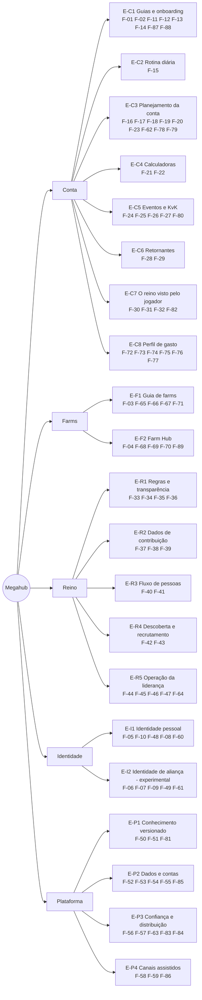
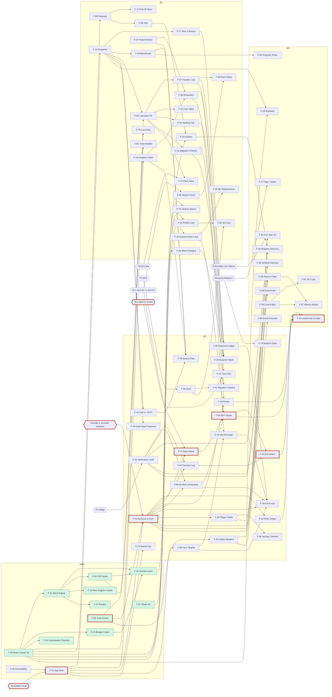

# Árvore de funcionalidades

Produto → **5 áreas** → **21 épicos** → **89 funcionalidades** (F-01..F-10 do Victor + F-11..F-59 da primeira árvore + F-60..F-64 de 3D + F-65..F-89 do enriquecimento) → histórias de usuário.

Cada funcionalidade é rastreável até os **passos** dos mapas de processo (`processos/conta.md`: `CJ/CD/CS/CE/CK/CR/CF`; `processos/reino.md`: `RL`, `Wn-m`), as **dores** (`D-xxxx`) e os **fatos/contexto** (IDs de fichas ou packs). O backlog (`produto/backlog-sistema.md`) tem a mesma lista em forma de tabela.

**Ficha de cada funcionalidade** (critérios de aceite, métrica de sucesso, entradas de dados, integrações, risco de ToS/privacidade e status de construção): `produto/arvore-funcionalidades-detalhe.md`. Este arquivo é a visão geral.

**Status de construção** (conferido no repositório em 2026-10-13):
- `construindo`: há código ou conteúdo em `packages/`, `guides/` ou `content/`. São F-01 (lógica em `packages/core`), F-02 (base F2P: `guides/data/blocks.f2p.json`, 43 blocos), F-12 (`guides/data/blocks.newkingdom.json`), F-14, F-15 e F-20 (dados em `packages/planner/data/`, lógica em andamento), F-50 v0 (`packages/data`), F-51 (`packages/core/src/blocks.ts`), F-56 (`content/legal/`) e F-57 (`content/share/`).
- `backlog`: especificação suficiente; espera a release.
- `especificar`: falta dado (T0, pesquisa), validação com usuários ou decisão do dono.
- F-60 e F-61 têm protótipo visual em `prototipos/`, mas nenhum código de produto.

## 1. Como a prioridade foi calculada

Fórmula do método: **(gravidade × frequência da dor) × alcance ÷ esforço**, com F2P e início de reino na frente. Parâmetros concretos usados:

| Termo | Definição | Valores |
|---|---|---|
| **D** — dor (gravidade × frequência) | Faixa de score do índice de cada dor (score = freq × peso de gravidade), **dentro de cada coletor** porque as escalas diferem. Jogadores: ≥300 → 3; 100–299 → 2; <100 → 1. Líderes: ≥20 → 3; 10–19 → 2; <10 → 1. D = maior faixa entre as dores ligadas + 0,5 por dor adicional de faixa ≥2 (máx. +1). | 1 a 4 |
| **A** — alcance | Passos/atores cobertos: 1 = 1–2 passos de um ator; 2 = 3–5 passos ou 2 atores; 3 = ≥6 passos ou jogador + líder | 1 a 3 |
| **P** — foco | 1,5 = público principal é F2P/low em reino novo (dia 0 → KvK1) ou liderança de reino novo; 1,2 = todos os perfis/estágios incluindo F2P; 1,0 = só pós-KvK1/SoC ou só liderança tardia | 1,0 / 1,2 / 1,5 |
| **E** — esforço | S = 1, M = 2, L = 3 (S ≈ conteúdo/página estática ou calculadora; M ≈ estado do usuário ou lógica de regras; L ≈ rede/moderação/IA) | 1 / 2 / 3 |
| **Ev** — evidência (extensão do método) | **forte** = dor principal `validada` e faixa 3; **média** = `validada` faixa ≤2, ou `bruto` faixa 3, ou premissa central não testada; **fraca** = só dores `bruto` faixa ≤2 ou inferidas; **sem evidência** = nenhuma dor/passo ligado | 1,0 / 0,8 / 0,5 / 0,3 |

**Score = D × A × P ÷ E × Ev** (máximo teórico 18). O fator Ev não está no método original; foi acrescentado para que funcionalidades "sem evidência" não subam só por serem baratas. A coluna "Cálculo" mostra `D·A·P/E·Ev`.

**Habilitadores** (área Plataforma) não têm dor própria: herdam a prioridade da funcionalidade mais bem pontuada que depende deles e entram na release em que ela entra.

**Recálculo de 2026-10-13.** A fórmula não mudou. Os scores de F-01..F-59 foram mantidos: nenhuma evidência nova mudou a dor, o alcance ou o esforço deles. As funcionalidades novas (F-60..F-89) foram pontuadas com a mesma fórmula. Funcionalidades "guarda-chuva" (F-03 e F-04, ideias do Victor) mantêm o score e são entregues pelas filhas (F-65..F-71, F-89).

## 2. Diagrama (áreas → épicos)

| Área | Épicos | Funcionalidades | Novas nesta versão |
|---|---:|---:|---|
| Conta | 8 | 37 | F-62 (3D), F-72..F-80, F-82, F-87, F-88; épico novo E-C8 |
| Farms | 2 | 10 | F-65..F-71, F-89 |
| Reino | 5 | 16 | F-64 (3D) |
| Identidade | 2 | 10 | F-60, F-61 (3D) |
| Plataforma | 4 | 16 | F-63 (3D), F-81, F-83..F-86 |
| **Total** | **21** | **89** | **30** (5 de 3D + 25 do enriquecimento) |

## 3. A árvore

Legenda das colunas: **Passos** (mapas de processo) · **Dores** · **Fatos/contexto** · **Apoio** (Inf/Calc/Plan/Acomp/Coord/Ident) · **Evid.** · **Esf.** · **Depende de** · **Cálculo** (`D·A·P/E·Ev`) · **Score**. ★ = ideia do Victor (decisão do dono; mantida mesmo com evidência fraca).

### Área CONTA

#### E-C1 Guias e onboarding

| ID | Funcionalidade | Passos | Dores | Fatos / contexto | Apoio | Evid. | Esf. | Depende de | Cálculo | Score |
|---|---|---|---|---|---|---|---|---|---|---|
| F-01 ★ | **Account Setup Questionnaire → Personalized Guide** (Guide Builder) | CJ-01, CJ-02, CJ-05, CR-04, conta §7 | D-0006, D-0001, D-0030, D-0031 | `perfis.md`; I-05 (backlog-ideias); A05-0008, A14-0003 | Inf, Plan | forte | M | F-51, F-02 (conteúdo), F-50 | 4·3·1,5/2·1,0 | **9,0** |
| F-02 ★ | **F2P Base Guide + Spend Deltas** (Low → Medium → High → Whale → Kraken) | CJ-01..CJ-13, CD-*, conta §7 e §8 | D-0001, D-0006, D-0030, D-0031 | packs `f2p-early-progression`, `daily-routine`, `early-kingdom-timeline-and-events`, `f2p-economy-gems-vip-speedups`, `f2p-commanders-equipment`, `spending-tiers-baseline` | Inf, Plan | forte | M (base F2P + Low); cada delta Medium+ = M | F-50, F-51; T0 Q1, Q4, Q6, Q16; pesquisa Medium+ | 4·3·1,5/2·1,0 | **9,0** |
| F-11 | **First 30 Days Path** | CJ-02, CJ-03, CJ-05, CJ-07, CE-01 | D-0030, D-0006, D-0041 | A01-0001, A05-0008, C04-0005, A11-0510 (baixa) | Inf, Plan, Acomp | média | S | F-51; T0 Q4, Q9 | 3,5·2·1,5/1·0,8 | **8,4** |
| F-12 | **New Kingdom Start Guide** (+ Day-1 Survival) | CJ-01, CJ-03, CJ-04, RL-01 | D-0018, D-0037, D-0041 | C04-0026, C04-0033, B01-0506 (baixa), A09-0007 | Inf, Plan | forte | S | F-51 | 3,5·2·1,5/1·1,0 | **10,5** |
| F-13 | **Zeroed Recovery Playbook + Risk Checklist** | CJ-04, CD-14, CF-07, CK-07 | D-0003, D-0041 | A03-0007, A03-0030, A13-0005 | Inf, Acomp | forte | S | custos de escudo (lacuna) | 3·2·1,5/1·1,0 | **9,0** |
| F-14 | **Budget Reality Check** | CJ-01, CJ-05, CJ-09, conta §7 | D-0001, D-0018, D-0034 | A04-0001, A04-0006 (derivado), A12-0001, A12-0002, B01-0700 (baixa) | Inf, Calc, Plan | forte | S | T0 Q1, Q12, Q16 | 3,5·2·1,5/1·1,0 | **10,5** |
| F-87 | **"What This Game Actually Is" Primer** (+ quiz "é para você?") | CJ-01, CJ-02 | D-0035, D-0030 | S-D-0021 ideia 2; packs `daily-routine`, `spending-tiers-baseline` | Inf | média | S | F-14, F-15 (números), F-57 | 2·1·1,5/1·0,8 | **2,4** |
| F-88 | **RoK Glossary & Concept Cards** (dicas em todo o hub) | CJ-02, CJ-05, CK-01, CK-02, CR-02, CE-05, W1-3 | D-0030, D-0013 | C04-0007, B08-0001, B01-0503; CK-02 ("muitos não sabem o que é DKP") | Inf | média | S | F-50 | 2·3·1,5/1·0,8 | **7,2** |

Histórias:
- **F-01**
  - As a new F2P player, I want to answer about 8 questions (spend profile, hours/day, kingdom age, civilization, CH, role) so that I get a guide with only the steps that apply to me, with Recommended options marked.
  - As a player who used to spend, I want to state my past spending so that the guide does not treat my account as a fresh F2P.
  - As a player, I want a shareable link to my guide setup so that alliance-mates can generate theirs (shared outside the game).
- **F-02**
  - As a F2P player, I want a stage-by-stage guide from day 0 to KvK1 where every number shows its source and "verified on patch X" so that I can trust it over old Reddit advice.
  - As a low spender, I want to see only what changes for my budget (a delta over F2P) so that I don't reread a whole guide.
- **F-11**
  - As a brand-new player, I want 3–5 goals and one concept explained per day for my first 30 days so that I learn the game without drowning in its UI.
- **F-12**
  - As a F2P player starting in a fresh kingdom, I want a start strategy that assumes whales and sleepers exist (where to settle, which alliance, when to shield) so that I survive the first two weeks.
- **F-13**
  - As a player who was just zeroed, I want a recovery plan (what to rebuild first, what still counts) so that I don't quit that day.
  - As a player logging off, I want a 30-second risk checklist so that I avoid the common ways of being zeroed.
- **F-14**
  - As a F2P player, I want realistic targets for my budget (what I can and cannot reach by KvK1) so that I stop measuring myself against whales.
  - As a low spender, I want to see which purchases actually move my targets so that I don't buy on FOMO.
- **F-87**
  - As someone who installed after an ad, I want a plain page on what the game really demands (time, PvP, money) and a 1-minute quiz so that I know if it fits me before I sink weeks into it.
- **F-88**
  - As a new player, I want to tap any term (DKP, MGE, MTG, seed, T4) and get a 2-line definition with its source so that guides and kingdom mails make sense.

Nota: os deltas do F-02 por perfil de gasto viraram funcionalidades próprias no épico E-C8 (F-75 Low, F-76 Medium, F-77 High/Whale/Kraken), cada uma com release e status próprios. O F-02 segue como guarda-chuva e decisão do dono.

#### E-C2 Rotina diária

| ID | Funcionalidade | Passos | Dores | Fatos / contexto | Apoio | Evid. | Esf. | Depende de | Cálculo | Score |
|---|---|---|---|---|---|---|---|---|---|---|
| F-15 | **Time-Boxed Routine** (+ Break Mode) | CD-01..CD-14, CS-01, CF-05, CR-07, CJ-14 | D-0002, D-0026, D-0020, D-0036 | A10-0001, A10-0002, A05-0003, A09-0006, A04-0001, A01-0011 | Plan, Acomp, Inf | forte | S | F-51; **T0 §3 (minutos por tarefa)** — v0 ordena só por valor | 4·3·1,5/1·1,0 | **18,0** |

Histórias:
- **F-15**
  - As a busy F2P player, I want to say "I have 15 minutes today" and get the highest-value checklist plus a "safe to skip" list so that the game stops feeling like a second job.
  - As a player taking a break, I want a "park my account" plan (what to do before pausing, minimal weekly upkeep) so that I can step away without losing everything.
  - As a player, I want daily check-offs without punishing streaks so that the checklist doesn't become another obligation.

#### E-C3 Planejamento da conta

| ID | Funcionalidade | Passos | Dores | Fatos / contexto | Apoio | Evid. | Esf. | Depende de | Cálculo | Score |
|---|---|---|---|---|---|---|---|---|---|---|
| F-16 | **Account Snapshot** (um inventário, muitas ferramentas — X1) | CJ-07, CJ-09, CS-03, CE-03, CE-08, CR-03, CK-03 | D-0006, D-0007, D-0012, D-0010, D-0016 | X1 em `_matriz.md`; A01-0001, A05-0001 | Acomp, Calc | média | M | F-52; F-54 opcional; T0 (print do próprio perfil) | 4·3·1,5/2·0,8 | **7,2** |
| F-17 | **Next 3 Actions** | CJ-05, CJ-07, CJ-09, CD-04, CR-06 | D-0006, D-0007, D-0030 | A01-0001, A02-0500, A02-0501, A08-0500 | Plan, Inf | média | M | F-16, F-50, F-51; teste com 30 posts "what next?" | 4·3·1,5/2·0,8 | **7,2** |
| F-18 | **Milestone Benchmark** (por idade do reino e perfil) | CS-03, CJ-09, CK-03, CR-03 | D-0007, D-0012, D-0043 | B01-0700 (baixa), A01-0005 (derivado) | Acomp, Calc | média | S | T0 `kvk1-day0`, Q6; F-16 | 3,5·2·1,5/1·0,8 | **8,4** |
| F-19 | **Restart vs Continue Decision Tree** | CJ-06, CR-04 | D-0015, D-0042 | A14-0002, C04-0023, C04-0010 | Inf, Calc | média | S | F-50 | 2,5·1·1,5/1·0,8 | **3,0** |
| F-20 | **Commander Decision Checklist** (+ Shelf-life) | CJ-05, CJ-07, CJ-12, conta §8 | D-0008, D-0009, D-0029 | A06-0500, A06-0501, A06-0504, A06-0506, A06-0510, C04-0021, C04-0023 | Inf, Plan | forte | S | F-50 (vida útil por patch) | 3·2·1,5/1·1,0 | **9,0** |
| F-23 | **Path-to-T4/T5 Planner** (CH e orçamento de aceleradores) | CJ-07, CJ-09, CJ-12, CJ-13 | D-0012, D-0027 | A01-0001, A01-0005, A02-0501, A08-0500 | Calc, Plan | média | M | T0 Q6 (tempos buffados), Q12; F-16 | 2·2·1,5/2·0,8 | **2,4** |
| F-62 | **Progress Tower** (3D; um andar por faixa de CH) | CS-03, CJ-15 | D-0007 (a parte 3D não tem evidência) | `ideias-3d.md` | Acomp, Ident | sem evidência | M | F-16, F-18; critérios de 3D (lazy, fallback 2D) | 3·1·1,5/2·0,3 | **0,7** |
| F-78 | **Gold-Head Budget Projection** (renda de cabeças por perfil de gasto → orçamento de comandantes) | CJ-07, CJ-12, conta §7 | D-0008, D-0029 | S-D-0008 ideia 2; A05-0006, fichas A06 | Calc, Plan | média | M | F-16, F-81; T0 (renda de cabeças) | 3·2·1,5/2·0,8 | **3,6** |
| F-79 | **Day-0 → KvK1 Season Plan** (14 semanas ancoradas na abertura do reino; lacuna G7) | CJ-05, CJ-07, CJ-09, CJ-10, CE-03, CS-04, CK-03 | D-0006, D-0007, D-0012 | B01-0500, B01-0505, C04-0005, A11-0501, A11-0502, A11-0505, A09-0007; G7 em `competitors-and-constraints.md` | Plan, Acomp | média | M | F-16, F-18, F-23, F-24, F-25; T0 Q4, Q5, Q6 | 4·3·1,5/2·0,8 | **7,2** |

Histórias:
- **F-16**
  - As a player, I want to enter my account state once (CH, key research, troops, speedups, gems, VIP, kingdom age) so that every planner and calculator reuses it.
  - As a player, I want "copy from last week" and an update in under 2 minutes so that keeping it current is cheap.
  - As a player, I want it stored on my device without a login so that I don't hand my data to anyone.
- **F-17**
  - As a player who doesn't know what to do next, I want my next 3 actions with the "why" and the source so that I stop asking Reddit.
  - As a player, I want the list to recompute when I mark an action done.
- **F-18**
  - As a F2P player on day 60, I want to compare my account with expected milestones for my kingdom age and budget so that I know if I'm on track for KvK1.
- **F-19**
  - As a player who regrets an early choice, I want to see what is reversible and the catch-up cost so that I don't restart for nothing.
- **F-20**
  - As a F2P player holding scarce gold heads, I want a checklist before investing (role, season shelf-life, free alternatives, respec options) so that I don't regret an irreversible choice.
  - As a player, I want each commander tagged "useful until season X, verified on patch Y" so that I know when advice expires.
- **F-23**
  - As a F2P player, I want to see how many speedups and days I need to reach CH21/T4 before KvK1 so that I know where to put my speedups.
- **F-62**
  - As a player, I want to see my account as a tower that gains a floor per City Hall band, and tap a floor to see what is missing, so that progress feels tangible (only kept if it beats the 2D view in an A/B test).
- **F-78**
  - As a F2P or low spender, I want to know how many gold heads I will have by the next KvK so that I commit them to 1–3 commanders instead of spreading them thin.
- **F-79**
  - As a F2P player in a new kingdom, I want a week-by-week plan from opening day to KvK1 (CH targets, what to hoard for Pelagius, MTG, Lohar and Eve) so that I plan beyond the 4 days the in-game calendar shows.

#### E-C4 Calculadoras

| ID | Funcionalidade | Passos | Dores | Fatos / contexto | Apoio | Evid. | Esf. | Depende de | Cálculo | Score |
|---|---|---|---|---|---|---|---|---|---|---|
| F-21 | **Gem & VIP Value Table** (+ Wheel guarantees) | CJ-05, CE-05, CE-06, CD-11, CS-01 | D-0010, D-0033, D-0034 | A05-0001, A05-0004, A05-0008, A04-0009, A11-0502, C04-0022 | Calc, Inf | média | S | T0 Q1, Q8, Q14; F-50 | 2·2·1,5/1·0,8 | **4,8** |
| F-22 | **Healing Cost Calculator** | CK-03, CK-07, CF-09 | D-0012, D-0028 | A08-0502, A08-0505, A01-0008, C04-0028 | Calc | média | S | L-A08-01 (custo de cura vs retreino); F-50 | 2·2·1,2/1·0,8 | **3,8** |

Histórias:
- **F-21**
  - As a F2P player, I want a table of what each gem use is worth (VIP, speedups, keys) so that I stop wasting gems.
  - As a player, I want to see the guaranteed outcome and total cost before spinning a wheel so that I know when to stop.
- **F-22**
  - As a KvK fighter, I want the resources and healing speedups my hospital capacity implies so that I size my farms and hoard correctly.

#### E-C5 Eventos e KvK

| ID | Funcionalidade | Passos | Dores | Fatos / contexto | Apoio | Evid. | Esf. | Depende de | Cálculo | Score |
|---|---|---|---|---|---|---|---|---|---|---|
| F-24 | **Kingdom Clock & Personal Event Calendar** (X3) | CE-01, CE-04, CD-13, CS-02, CS-04, CK-06 | D-0014, D-0011, D-0042, D-0012 | A11-0512, A11-0502, A10-0005, C04-0005, B01-0500 | Acomp, Plan | média | M | T0 Q4, Q5; F-52 (notificações) | 2,5·3·1,5/2·0,8 | **4,5** |
| F-25 | **Hoard Advisor** (regras por objetivo, sem datas) | CD-08, CE-02, CE-03, CE-05, CK-05, CS-04 | D-0011, D-0012, D-0010 | A11-0501, A11-0505, A09-0007, A02-0503 | Plan, Inf | média | S | F-50; F-16 opcional | 2,5·2·1,5/1·0,8 | **6,0** |
| F-26 | **KvK Readiness Checklist** (+ Season Explainer) | CJ-09, CJ-12, CJ-13, CK-01, CK-03 | D-0012, D-0013, D-0028 | A08-0500, A08-0502, B01-0503, C04-0007 | Inf, Plan | média | S | F-50; T0 Q15 | 2·2·1,5/1·0,8 | **4,8** |
| F-27 | **Hidden Lotus Planner** | CE-07, CJ-06 | D-0042, D-0015 | lacuna (sem ficha; T0) | Plan, Calc, Ident | média | M | **T0 Hidden Lotus** (fora do protocolo hoje) | 2,5·2·1,5/2·0,8 | **3,0** |
| F-80 | **Event Rotation Forecast** (30–60 dias com probabilidade; lacuna G7) | CE-01, CE-03, CS-04 | D-0012, D-0011, D-0014 | S-D-0011 ideia 3; A11-0512, A11-0513 | Plan, Inf | média | L | diário T0; registros de usuários (opt-in); F-53 | 2·2·1,2/3·0,8 | **1,3** |

Histórias:
- **F-24**
  - As a player, I want to set my kingdom's opening date once so that every plan shows days to KvK1 and the known event windows.
  - As a player, I want event end times in my local time with a reminder so that I don't miss windows (like the Commander Swap that ended a day early).
- **F-25**
  - As a F2P player, I want rules telling me what to save for which goal (Lohar, More Than Gems, Eve of the Crusade, KvK) so that I don't spend speedups at the wrong time.
- **F-26**
  - As a first-KvK player, I want a checklist by role and budget (CH, troops, hospital, speedups) and a plain explanation of the season so that I arrive ready.
- **F-27**
  - As a player chasing Hidden Lotus, I want a day-by-day plan with the required pace so that I know on day 2 whether I'm on track instead of restarting dozens of times.
- **F-80**
  - As a player, I want a 30–60 day forecast of likely events, labelled with probability and sample size, so that I know what to hoard for even when the in-game calendar shows only a few days.

#### E-C6 Retornantes

| ID | Funcionalidade | Passos | Dores | Fatos / contexto | Apoio | Evid. | Esf. | Depende de | Cálculo | Score |
|---|---|---|---|---|---|---|---|---|---|---|
| F-28 | **What Changed Since…** | CR-02, CJ-12 | D-0016, D-0013, D-0031 | `game-state-and-patch-timeline.md` (C04-*) | Inf | forte | S | F-50 (patch timeline mantida) | 3·2·1,2/1·1,0 | **7,2** |
| F-29 | **Returner Mode** (plano de 14 dias + ficar/migrar/recomeçar) | CR-01..CR-07 | D-0016, D-0015, D-0019 | B06-0003, C04-0008, C04-0023 | Plan, Inf, Calc | forte | M | F-28, F-31, F-16, F-17 | 4·3·1,2/2·1,0 | **7,2** |

Histórias:
- **F-28**
  - As a returning player, I want to pick the date I stopped and see what changed, grouped by impact, so that I catch up in minutes.
- **F-29**
  - As a returning player, I want a 14-day catch-up plan and a clear stay/migrate/restart recommendation so that I don't quit again in the first week.

#### E-C7 O reino visto pelo jogador

| ID | Funcionalidade | Passos | Dores | Fatos / contexto | Apoio | Evid. | Esf. | Depende de | Cálculo | Score |
|---|---|---|---|---|---|---|---|---|---|---|
| F-30 | **My Requirements Tracker** | CK-02, CK-08, CK-09, CS-05, W1-3 | D-0004, D-0501, D-0005 | B08-0001, B08-0002 | Acomp, Calc | forte | S | F-34 (import do card) ou entrada manual; F-54 opcional | 3,5·2·1,5/1·1,0 | **10,5** |
| F-31 | **Migration Eligibility & Passport Checker** | CJ-11, CK-10, CR-04, W5-3 | D-0016, D-0019, D-0509 | B06-0001, B06-0002, B06-0003, C04-0008 | Calc, Inf | forte | S | F-50 (regras por patch); notas oficiais 1.1.10–1.1.12 | 4·3·1,2/1·1,0 | **14,4** |
| F-32 | **Play It Safe FAQ** (+ Account Safety) | CR-01, CJ-14, CJ-01 | D-0021, D-0023, D-0017, D-0024, D-0022, D-0035 | C02-0002, C02-0005, C02-0010, C04-0006 | Inf | média | S | F-56 | 3·1·1,2/1·0,8 | **2,9** |
| F-82 | **Support Ticket & Report Builder** (texto pronto para o canal oficial; nada salvo nem enviado pelo hub) | CR-01, CJ-14 | D-0021, D-0017, D-0023, D-0022 | S-D-0021 ideias 1 e 3; C02-0005 | Inf | média | S | F-32 | 3·1·1,2/1·0,8 | **2,9** |

Histórias:
- **F-30**
  - As a first-KvK player, I want to enter my kingdom's requirement and track my own kills and deads against it so that I know where I stand before the purge list.
  - As a player, I want the DKP formula explained in plain language so that a "250% of power" mail makes sense.
- **F-31**
  - As a player, I want to enter my account age, power and target kingdom and get "eligible / not eligible, and why" for the current patch so that I don't waste passports.
  - As a migration officer, I want to send applicants a link that runs this check so that I stop explaining rules by hand.
- **F-32**
  - As a player, I want to know what gets accounts banned (bots, Discord links in chat, account selling) and how to protect mine so that I don't lose it.
- **F-82**
  - As a player who lost access, got muted or met a bot, I want a ready-to-send ticket with exactly the fields support asks for so that I get an answer, without the hub storing anything about me or the other player.

#### E-C8 Perfil de gasto (deltas Low → Kraken) — **épico novo**

Base: `research/perfis.md` (6 perfis; guias como **delta** sobre o F2P; gasto acumulado importa tanto quanto o mensal) e `research/context/spending-tiers-baseline.md` (só Low tem pesquisa, de confiança média e com fontes que vendem recarga). Medium+ não foi pesquisado, por isso F-76 e F-77 ficam com score baixo e status `especificar`.

| ID | Funcionalidade | Passos | Dores | Fatos / contexto | Apoio | Evid. | Esf. | Depende de | Cálculo | Score |
|---|---|---|---|---|---|---|---|---|---|---|
| F-72 | **Lifetime Spend Adjustment** (perfil efetivo a partir do gasto acumulado) | CJ-01, CR-04, conta §7 | D-0001, D-0031 | `perfis.md` (limitação 1); conta §7 "ex-gastador hoje F2P"; `packages/core/NOTES.md` (`lifetimeSpendUsd` só gera aviso hoje) | Inf, Plan | média | S | F-01; limiares como "regra de produto" em F-50 | 3·2·1,2/1·0,8 | **5,8** |
| F-73 | **Pack Value Advisor** (gemas/$ e VIP/$ por pacote; "pular" como padrão; sem link de compra) | CJ-05, CE-05, CE-06, conta §7 | D-0001, D-0010, D-0034 | A12-0001 (~5.400 gemas/$), A12-0002 (~1.950 gemas/$), A12-0004 (VIP/$ cai em recargas maiores, baixa), A12-0005, A05-0004 | Calc, Inf | média | S | **T0 Q16** (prints da loja, sem comprar); F-81 | 3,5·2·1,5/1·0,8 | **8,4** |
| F-74 | **Monthly Spend Cap & Purchase Log** (teto declarado, registro manual, aviso neutro) | CE-05, CE-06, CJ-14 | D-0026, D-0034 | S-D-0010 ideia 3 | Acomp, Plan | média | M | F-52 (local); F-53 opcional | 3·2·1,2/2·0,8 | **2,9** |
| F-75 | **Low Delta Guide** (sub-perfis pass-only ~$5–25 e low pleno ~$25–100; `blocks.low.json`) | CJ-05, CE-05, CE-06 | D-0001, D-0031 | `spending-tiers-baseline.md`; A12-0001, A12-0002, A12-0005, A11-0502 | Inf, Plan | média | M | F-02, F-51 (o núcleo já faz Low → F2P); T0 Q16 | 3·2·1,5/2·0,8 | **3,6** |
| F-76 | **Medium Delta Guide** | CJ-07, CJ-09, CK-03 | D-0031 (achado 7: gastadores também acham os guias enviesados) | **lacuna** (Medium não pesquisado) | Inf, Plan | média | M | pesquisa Medium (onda futura) | 1·2·1,0/2·0,8 | **0,8** |
| F-77 | **High / Whale / Kraken Delta Guides** | CJ-12, CK-* | D-0031 | **lacuna** | Inf, Plan | média | M | pesquisa High+ | 1·1·1,0/2·0,8 | **0,4** |

Histórias:
- **F-72**
  - As a player who spent a lot in the past and is F2P now, I want the guide to treat my account by what it has, not by what I spend today, so that I don't get beginner advice.
- **F-73**
  - As a low spender, I want to see gems and VIP per dollar for the few packs that matter, with "skip" as the default, so that I spend my $10 once and well instead of chasing bundles.
- **F-74**
  - As a player worried about spending, I want to set a monthly cap and log purchases so that I get a neutral warning before I go over it.
- **F-75**
  - As a pass-only spender, I want only what changes for me over the F2P guide (Growth Fund early, then the gem supply) so that I don't reread everything.
- **F-76 / F-77**
  - As a medium, high or whale spender, I want a delta that tells me which bottlenecks disappear and which priorities flip so that guides stop assuming I'm F2P.

### Área FARMS

Base: `research/context/farms.md` e subprocesso CF de `processos/conta.md`. Era a área mais rala (2 funcionalidades); agora tem 10. Dor principal D-0020 (score 326, validada, faixa 3). **Guardrail:** só farms do próprio jogador, operadas à mão; nada de automação de coleta ou transporte (ToS 17.1.18/17.1.15, Conduct Score C04-0006); o hub não incentiva farm para inflar MGE ou poder (D-0522).

**Variantes de farm e o que a evidência sustenta** (vale para F-03 e F-65):

| Variante | Evidência (`farms.md`) | Como aparece no produto |
|---|---|---|
| Geral (todos os recursos) | suportada (T3, baixa–média; A13-0007, A13-0009) | recomendação padrão |
| Recurso único (uma farm por recurso) | fraca (AllClash 2019, "só para quem tem muito tempo"; limite de ~2 cidades por reino) | aparece com aviso de evidência fraca, só para quem declara muito tempo |
| Ouro | contestada (ouro é transferível, A03-0027, mas guias mandam coletar ouro na principal, A13-0004) | não recomendada para F2P até o T0 confirmar envio e rendimento |
| Par de recursos | **nenhuma fonte**; só a hipótese derivada alimento + madeira | **oculta** até o T0 testar (L-A13-03); nenhum outro par |

#### E-F1 Guia de farms

| ID | Funcionalidade | Passos | Dores | Fatos / contexto | Apoio | Evid. | Esf. | Depende de | Cálculo | Score |
|---|---|---|---|---|---|---|---|---|---|---|
| F-03 ★ | **Farm Guide** (guarda-chuva: F-65 + F-66 + F-67 + F-71) | CJ-08, CF-01..CF-06 | D-0020 | A13-0001..A13-0010, A03-0021, A03-0024, A03-0028, A03-0029, A03-0030 | Inf, Calc | média (pares = hipótese) | S | T0 Q10, Q13; L-A13-01 (rendimento/dia) | 3·2·1,5/1·0,8 | **7,2** |
| F-65 | **Farm Variant Picker** (precisa de farm? quantas? qual variante, pela tabela acima) | CJ-08, CF-01, CF-02, CF-03 | D-0020 | A13-0001, A13-0004, A13-0009, A13-0010, A03-0021, A03-0027, A03-0028, A03-0029 | Inf, Calc | média | S | T0 Q10, Q13, L-A13-03 (só para o par) | 3·2·1,5/1·0,8 | **7,2** |
| F-66 | **Farm Setup Path** (civ; CH11 → CH17 → CH22; TP ≥ 15; Goldmine para TP10+; comandante de coleta nível 37; pesquisas por recurso) | CF-03, CF-04, CJ-08 | D-0020 | A13-0002, A13-0003, A03-0023, A03-0024 (alta), A03-0017, A03-0028, A03-0029, A03-0030 | Inf, Plan | forte | S | — (desbloqueio do TP contestado CH10 vs CH12: exibido como tal) | 3·2·1,5/1·1,0 | **9,0** |
| F-67 | **Trading Post Transfer Calculator** (taxa 35% → 21% → 10% → 8%; bruto = líquido ÷ (1 − taxa); capacidade por viagem; proteção do armazém; viagens e marchas) | CF-06, CF-07, CF-09, CD-14 | D-0020, D-0028 | A03-0024 (alta; tabela em `packages/data/generated/tables/A03-trading-post.json`), A03-0025, A03-0026, A03-0027, A03-0030 (alta) | Calc | forte | S | F-81; T0 Q10 (ouro, capacidade L1–L24: até lá, "contestado") | 3·2·1,5/1·1,0 | **9,0** |
| F-71 | **Farm ROI Calculator** (vale outra farm? recursos/semana × minutos/dia) | CF-01, CJ-08 | D-0020 | S-D-0020 ideia 3 | Calc | média | S | **L-A13-01** (rendimento e minutos por farm); F-67 | 3·1·1,5/1·0,8 | **3,6** |

#### E-F2 Farm Hub

| ID | Funcionalidade | Passos | Dores | Fatos / contexto | Apoio | Evid. | Esf. | Depende de | Cálculo | Score |
|---|---|---|---|---|---|---|---|---|---|---|
| F-04 ★ | **Farm Hub** (guarda-chuva: F-68 + F-69 + F-70 + F-89) | CF-04..CF-10, CD-09 | D-0020, D-0002 | A03-0024, A03-0026, A13-0005 | Acomp, Plan, Calc | forte | M | F-03; F-52 (local) → F-53 (sync); teste 5 usuários × 1 semana | 3,5·2·1,5/2·1,0 | **5,3** |
| F-68 | **Farm Daily Targets & One-Tap Checklist** (cadastro; "coletando até HH:MM" em 1 toque; meta diária; entra no orçamento do F-15) | CF-05, CD-09, CD-01 | D-0020, D-0002 | A03-0009, A03-0013, A03-0016, A13-0007 (baixa); S-D-0020 ideia 1 | Acomp, Plan | média | M | F-52; F-15; teste 5 × 1 semana (premissa P1) | 3,5·2·1,5/2·0,8 | **4,2** |
| F-69 | **Farm-to-Main Shipment Ledger** (cada envio: bruto e líquido; total semanal vs meta de cura; resumo exportável para o reino) | CF-06, CF-09, CF-10, W3-1 | D-0020, D-0522 | A03-0024; B08-0006 | Acomp, Calc, Coord | média | M | F-67, F-22 | 3,5·3·1,2/2·0,8 | **5,0** |
| F-70 | **Idle Farm Reminder** (1 lembrete por farm por ciclo; silêncio e limite diário) | CF-05, CD-09 | D-0020, D-0002 | S-D-0020 (premissa P3: A/B de 2 semanas) | Acomp | média | M | F-68, F-86 (ICS no R1, Web Push no R2) | 3,5·1·1,5/2·0,8 | **2,1** |
| F-89 | **Alt↔Main Self-Declaration** (o dono declara as próprias farms ao conselho, com prova por código) | CF-10, W3-1, W4-1 | D-0522, D-0503 | B08-0006; S-D-0500 | Coord, Ident | média | M | F-55 (T0 do código), F-53, F-54 | 2,5·3·1,2/2·0,8 | **3,6** |

Histórias:
- **F-03**
  - As a F2P player, I want to know whether I need a farm, which variant fits my main's current bottleneck, and to what CH and Trading Post level to raise it so that the farm pays back its time.
  - As a player, I want a transfer calculator (tax, capacity per trip, storehouse protection) so that I know what actually arrives at my main.
- **F-65**
  - As a F2P player at CH11, I want a recommendation of 0, 1 or 2 farms and which variant, with how strong the evidence is, so that I don't build a single-resource farm I don't have time for.
- **F-66**
  - As a player creating a farm, I want the build order (civ, CH17, Trading Post 15, gathering commander) so that the farm starts paying back as early as possible.
- **F-67**
  - As a player with a farm, I want to type the net amount my main needs and get how much to send and how many trips, so that tax and storehouse protection don't surprise me.
- **F-71**
  - As a player with two farms, I want to see the marginal return of one more farm against the minutes it costs so that I stop before farms become a second job.
- **F-04**
  - As a player with farms, I want one board showing each farm's state and when it needs me (one tap per farm) so that I need fewer logins.
  - As a player, I want an idle-farm alert and running totals shipped vs my KvK target so that I know if my farms are worth it.
  - Guardrail: manual only; the hub never automates gathering or transfers (ToS 17.1.18).
- **F-68**
  - As a player with farms, I want to tap "gathering until 18:40" per farm and see which one needs me next so that I log in only when it matters.
- **F-69**
  - As a player, I want a log of what each farm shipped (gross and net) against my healing target so that I can prove my farms' worth and declare them to my kingdom.
- **F-70**
  - As a player, I want at most one reminder per idle farm, with quiet hours, so that I don't lose gathering time without being nagged.
- **F-89**
  - As a player, I want to declare my own farms to my council with proof so that their DKP and power are counted fairly and I am not accused of hiding alts.
  - As a data officer, I want self-declared alt↔main links so that I can merge farms into mains without guessing.

### Área REINO

#### E-R1 Regras e transparência

| ID | Funcionalidade | Passos | Dores | Fatos / contexto | Apoio | Evid. | Esf. | Depende de | Cálculo | Score |
|---|---|---|---|---|---|---|---|---|---|---|
| F-33 | **Kingdom Rules Page & Charter** | RL-01, RL-02, W1-1, W5-1, W5-5, W6-1, W10-1 | D-0513, D-0518, D-0525, D-0527 | B03-0004 (baixa), B07-0004, B08-0001 | Coord, Inf | forte | S | F-50, F-56, F-57; teste como Google Doc com 3–5 líderes | 4·3·1,5/1·1,0 | **18,0** |
| F-34 | **Requirements Card & Formula Sandbox** (M18 aplicado) | W1-1, W1-3, W3-2, CK-02, conta §8 | D-0501, D-0004, D-0502 | B08-0001, B08-0002 | Calc, Coord, Inf | forte | S | F-50 (presets); classificar 15–20 fórmulas reais | 3,5·3·1,5/1·1,0 | **15,8** |
| F-35 | **MGE Ledger** (+ applications) | W6-1..W6-4, W3-4, CE-02 | D-0506, D-0505, D-0522 | B05-0002, B05-0003, B05-0004 | Coord, Acomp | forte | S (v0 template) → M (estado compartilhado) | F-53 para v1; teste em planilha com 3–5 líderes | 4·2·1,2/1·1,0 | **9,6** |
| F-36 | **Decision Log & Pact Registry** (Ledger, M17) | RL-02, RL-03, RL-10, W2-4, W3-3, W3-4, W4-3, W4-4, W10-1, W10-3, CK-09 | D-0513, D-0507, D-0525, D-0521 | B09-0001 (baixa), B03-0005 | Coord | média | M | F-53, F-55 (assinaturas verificadas) | 4·3·1,2/2·0,8 | **5,8** |

Histórias:
- **F-33**
  - As a council member of a new kingdom, I want a charter template (leadership, decision process, MGE/DKP policy, conflict rules) that all R5s sign so that we avoid a civil war before KvK1.
  - As a newcomer, I want one page with the kingdom's rules in my language so that I don't break unwritten rules.
- **F-34**
  - As a council, I want to pick a DKP formula from versioned presets, test it on sample accounts and publish a requirements card so that members see fair, explained targets.
  - As a member, I want to import the card into my tracker (F-30) so that I follow my own progress.
- **F-35**
  - As a council, I want a public ledger of who got which MGE slot and why so that "hoarding" accusations become checkable facts.
  - As a member, I want to apply for an MGE slot and see the queue so that the rotation is predictable.
- **F-36**
  - As a king, I want each decision (purge, exception, MGE) logged with the rule applied, the author and the date so that I can prove legitimacy.
  - As a small alliance, I want agreements recorded with both signatures so that coercion leaves a trace.

#### E-R2 Dados de contribuição

| ID | Funcionalidade | Passos | Dores | Fatos / contexto | Apoio | Evid. | Esf. | Depende de | Cálculo | Score |
|---|---|---|---|---|---|---|---|---|---|---|
| F-37 | **Data Intake** (import CSV/xlsx de scanners/exports, mapeamento de colunas, join por governor ID — M19) | W1-2, W2-3, W3-1 | D-0500, D-0504, D-0503 | B08-0003, B08-0004, C01-0017, C01-0021, C02-0007, C02-0016 | Coord, Calc | forte | M | **L-B08-01 (ROK Toolkit)**; F-56 (atestado + opt-out); F-53 | 4·3·1,2/2·1,0 | **7,2** |
| F-38 | **DKP Sheet Doctor** (deltas por estágio, log de exceções, alt↔main, flags de anomalia, tiers) | W2-3, W2-4, W3-1..W3-3, W4-1, CF-08, CF-10 | D-0500, D-0503, D-0522, D-0502 | B08-0001, B08-0002, B08-0006 | Calc, Acomp, Coord | forte | M | F-37, F-34 | 4·3·1,2/2·1,0 | **7,2** |
| F-39 | **Seed Simulator** | W1-5, RL-09, RL-10, CJ-13 | D-0520 | B08-0008, B03-0007 | Calc | média | S | F-50 (fórmula oficial); F-37 opcional | 3·1·1,0/1·0,8 | **2,4** |

Histórias:
- **F-37**
  - As a data officer, I want to upload the scanner export my kingdom already uses, map columns once and join by governor ID so that I stop doing hours of spreadsheet work per event.
  - As a member, I want to opt out of having my data displayed so that my consent is respected.
- **F-38**
  - As a data officer, I want stage deltas, an exception log (zeroed days, trades) and alt merges applied to the imported data so that the ranking is defensible.
  - As a data officer, I want flags for negative deltas and missing IDs so that OCR errors don't reach the published ranking.
- **F-39**
  - As a king, I want to simulate our seed from the top-300 power tiers and see the effect of Vacation Permits so that we stop zeroing our own players to drop a seed.

#### E-R3 Fluxo de pessoas

| ID | Funcionalidade | Passos | Dores | Fatos / contexto | Apoio | Evid. | Esf. | Depende de | Cálculo | Score |
|---|---|---|---|---|---|---|---|---|---|---|
| F-40 | **Exit Notice Kit** (+ appeal, critério do Lost Kingdom) | W4-1..W4-3, W3-4, W1-6 | D-0507, D-0514, D-0524 | B06-0005, B03-0005, B02-0002 | Coord, Inf | forte | M | F-38 (tiers), F-36 | 3,5·2·1,2/2·1,0 | **4,2** |
| F-41 | **Migration Application Pipeline** | W5-1, W5-2, W5-4 | D-0508, D-0509, D-0518 | B06-0004, B07-0001 | Coord, Calc | média | M | F-31, F-53, F-54 (prints do candidato, com consentimento) | 3·2·1,0/2·0,8 | **2,4** |

Histórias:
- **F-40**
  - As a council, I want to send a standard exit notice citing the published rule, with a deadline and a redemption option, so that purges are predictable and less vengeful.
  - As a member on the list, I want to appeal with evidence so that mistakes can be corrected.
- **F-41**
  - As a migration officer, I want applicants to fill a form that checks game eligibility and our requirements so that I only review viable candidates.

#### E-R4 Descoberta e recrutamento

| ID | Funcionalidade | Passos | Dores | Fatos / contexto | Apoio | Evid. | Esf. | Depende de | Cálculo | Score |
|---|---|---|---|---|---|---|---|---|---|---|
| F-42 | **Open Roles Board** (+ recruitment post generator) | RL-05, W1-4, W5-1, CR-05 | D-0510, D-0016, D-0037 | B06-0004, C04-0025 | Coord, Ident | média | S | F-57 (divulgação fora do jogo) | 4·2·1,2/1·0,8 | **7,7** |
| F-43 | **Kingdom Directory** (M16) | CJ-03, CJ-11, CK-10, CR-05, RL-05, W5-1 | D-0018, D-0016, D-0037, D-0510, D-0025 | lacuna de mercado (`competitors-and-constraints.md`) | Coord, Inf, Ident | forte | L | F-33 (páginas), F-55, F-53, moderação; cold start | 4·3·1,5/3·1,0 | **6,0** |

Histórias:
- **F-42**
  - As an R4, I want to publish open roles (rally lead, garrison, returners welcome) and generate a recruitment post for Reddit/Discord so that I recruit for gaps, not just power.
- **F-43**
  - As a casual F2P or returning player, I want to filter kingdoms by language, playstyle, requirements and whether they accept returners so that I find one that fits.

#### E-R5 Operação da liderança

| ID | Funcionalidade | Passos | Dores | Fatos / contexto | Apoio | Evid. | Esf. | Depende de | Cálculo | Score |
|---|---|---|---|---|---|---|---|---|---|---|
| F-44 | **Availability & Role Roster** (slots UTC) | CK-04, CK-06, W1-4, W2-1, W9-1, W9-2 | D-0517, D-0526 | B07-0001, B04-0005 | Coord, Acomp | média | M | F-53; F-58 (lembretes) | 2,5·2·1,2/2·0,8 | **2,4** |
| F-45 | **Activity Definition & Check-in** | W8-1, W8-3, RL-01 | D-0511, D-0512 | B04-0002, B08-0005 (baixa) | Acomp, Coord | média | S | não duplicar Quick Checks/Notes (B04-0002) | 2·1·1,5/1·0,8 | **2,4** |
| F-46 | **Leadership Weekly Cockpit** | RL-11, W7-2, W8-2, todos os W | D-0519, D-0040 | B04-0007, B03-0003 | Acomp, Plan, Coord | forte | M | agrega F-33..F-45 | 3·3·1,2/2·1,0 | **5,4** |
| F-47 | **KvK Timeline Template** — **congelada** | W1-7 | D-0516 (baixa, possivelmente obsoleta) | B02-0005 | Plan | fraca | S | verificar se o calendário oficial de KvK saiu | 1·1·1,2/1·0,5 | **0,6** |
| F-64 | **KvK Planning Map 2.5D/3D** (mapa esquemático **original** para planejar antes do KvK; não é coordenação ao vivo) | W1-7, W2-1, W1-4 | D-0516, D-0526, D-0517 | `ideias-3d.md`; B04-0005 (o jogo já tem Army Groups e marcadores) | Plan, Coord | fraca (precisa de entrevistas) | L | ≥ 5 entrevistas com líderes; F-53; arte própria (§8) | 2,5·2·1,2/3·0,5 | **1,0** |

Histórias:
- **F-44**
  - As an event R4, I want members to declare roles and UTC availability once and see coverage per time slot so that Ark/KvK sign-ups stop living in Forms.
- **F-45**
  - As an alliance leader, I want to publish what "active" means and keep a private, dated history so that kicks aren't contested (in-game Alliance Notes are public to members).
- **F-46**
  - As a king or R5, I want one weekly view of pending decisions, deadlines and who covers which timezone so that leadership is less of a second job and can be handed over.
- **F-47**
  - As a council, I want a gate/pass timeline anchored to our KvK start so that we plan fights — only if the official calendar does not cover it.
- **F-64**
  - As a council, I want an original schematic map where each alliance marks targets, routes and UTC times before KvK so that planning meetings stop living in screenshots and Discord threads.

### Área IDENTIDADE

#### E-I1 Identidade pessoal (evidência forte para identidade pessoal)

| ID | Funcionalidade | Passos | Dores | Fatos / contexto | Apoio | Evid. | Esf. | Depende de | Cálculo | Score |
|---|---|---|---|---|---|---|---|---|---|---|
| F-05 ★ | **Player Profile** (nome, governor ID opcional, civ, função, perfil de gasto, aliança) | CJ-15; liga F-04, F-16, F-30 | D-0043, D-0038, D-0042 | `_indice-players.md` §Identity | Ident | média | M | F-53 (backend + auth); privacidade por padrão | 2,5·3·1,2/2·0,8 | **3,6** |
| F-10 ★ | **Shareable Profile Card** (com motivo de civilização, arte original) | CJ-15, CJ-01 | D-0007, D-0038, D-0043, D-0044 | `_indice-players.md` §Identity; S-D-0038 | Ident | média | S | F-57; arte original (sem assets Lilith); client-side, sem login | 3,5·2·1,2/1·0,8 | **6,7** |
| F-48 | **Journey Timeline** | CJ-15, CS-03 | D-0007, D-0043 | `_indice-players.md` (≈88 posts de diário) | Ident, Acomp | média | M | F-16, F-05 | 3·2·1,2/2·0,8 | **2,9** |
| F-08 ★ | **In-Game Avatar PNG Export** (tamanho, recorte, área segura) | CJ-15 | D-0044 (indireto) | I-07 (T3/T4 sobre upload de avatar) | Ident | **fraca** (viabilidade não confirmada) | S | **T0 avatar** (5 perguntas da I-07); F-10 ou F-07 | 1·1·1,2/1·0,5 | **0,6** |
| F-60 | **3D Profile Card** (inclinação + brilho holográfico; **raridade v2 por City Hall**) | CJ-15 | D-0043, D-0007, D-0038, D-0044 | `ideias-3d.md` (raridade v2); protótipo `prototipos/cartao-perfil-3d.html` | Ident | média | S | F-10; F-54 + T0 de OCR para o selo Verified | 3,5·1·1,2/1·0,8 | **3,4** |

**Regra de raridade v2 do F-60** (decisão do Victor; substitui a v1 de vários marcos):

| Raridade | City Hall | Significado no jogo | Base |
|---|---|---|---|
| Common | 1–16 | construindo a conta | — |
| Rare | 17–21 | pronto para o primeiro KvK | KvK1 exige CH17 (`early-kingdom-timeline-and-events.md`) |
| Epic | 22–24 | fim de jogo | farms param em CH22 (A13) |
| Legendary | 25 | Prefeitura máxima, pronto para Season of Conquest | SoC exige CH25 (C04) |

- Prova: 1 print da Prefeitura dá o selo **Verified**; sem print, **Self-reported**. Como o OCR (F-54) só chega no R2, **no R1 todo cartão sai Self-reported**.
- Contas F2P recebem a marca **F2P Achiever**; como o perfil de gasto é declarado, a marca também é autodeclarada.
- Trade-off aceito: mede progresso, não habilidade; quem gasta chega antes, mas todos podem chegar ao Legendary. Textos do cartão não usam linguagem de "rank" (cuidado com D-0001).

Histórias:
- **F-05**
  - As a player, I want a profile that links my planner, farms and kingdom so that I enter things once.
  - As a player, I want my profile private by default so that I control what others see.
- **F-10**
  - As a player proud of my account, I want a card with my civilization (including "heart" civs not in the game), role, account age and milestones that I can post on Reddit/Discord so that I show my journey.
- **F-48**
  - As a long-time player, I want a dated timeline of my milestones (CH, KvKs, skins) so that I can tell my "day 500" story.
- **F-08**
  - As a player, I want to download my card or crest as a PNG in the exact size and safe area of the in-game avatar so that it looks right in the game.
- **F-60**
  - As a player who just reached CH17, I want my card to turn Rare with a holographic tilt effect so that I have something worth posting when I'm ready for KvK1.
  - As a F2P player, I want the F2P Achiever mark on my card so that my progress reads as an achievement, not as being behind.

#### E-I2 Identidade de aliança — **experimental** (sem evidência pública de demanda)

| ID | Funcionalidade | Passos | Dores | Fatos / contexto | Apoio | Evid. | Esf. | Depende de | Cálculo | Score |
|---|---|---|---|---|---|---|---|---|---|---|
| F-06 ★ | **Alliance Page & Leadership Verification** (membros, cargos R1–R5, tag, cor, brasão) | RL-05, W5-1 (indireto) | branding: nenhuma; verificação: D-0514, D-0515 | I-06; `_indice-players.md` §Identity ("no meaningful public evidence") | Ident, Coord | **fraca** | L | F-05, F-53, F-55 (T0 do código), moderação | 2·2·1,2/3·0,5 | **0,8** |
| F-07 ★ | **Alliance-Aligned Avatar** (borda na cor, logo/brasão, tag) | — | nenhuma (D-0044 fraca, indireta) | I-06 | Ident | **sem evidência** | M | F-05, F-06, F-08 | 1·1·1,2/2·0,3 | **0,2** |
| F-09 ★ | **Crest Editor** (arte original) | — | nenhuma (D-0044 indireta) | I-06; ToS 17.1.9, §8 | Ident | **sem evidência** | M | arte original; revisão visual | 1·1·1,2/2·0,3 | **0,2** |
| F-49 | **Verified Official Channels** (anti-impersonação) | W5-1, RL-05 | D-0514, D-0515 | S-D-0514 | Ident, Coord | fraca | S | F-55, F-06 | 2,5·1·1,2/1·0,5 | **1,5** |
| F-61 | **3D Alliance Crest** (o brasão do F-09 em relevo, girável; exporta PNG para o F-08) | — | nenhuma (D-0044 indireta) | `ideias-3d.md`; protótipo `prototipos/brasao-3d.html` | Ident | **sem evidência** | M | F-09, F-08; validação do §7 | 1·1·1,2/2·0,3 | **0,2** |

Histórias:
- **F-06**
  - As an R5, I want to claim my alliance page by placing a short code in the in-game alliance announcement so that nobody can impersonate us.
  - As an R4, I want to invite members to the alliance page so that our roster and roles live in one place.
- **F-07**
  - As an alliance member, I want my avatar framed in my alliance's color with our crest and tag so that I show which alliance I belong to.
- **F-09**
  - As an R4, I want to design an original crest from shapes, colors and symbols so that our alliance has an identity without using game art.
- **F-49**
  - As a member, I want to check my alliance's verified official channels before clicking any link so that scammers can't impersonate leaders.
- **F-61**
  - As an R4, I want our crest as a metallic 3D shield I can rotate and export at a chosen angle so that our avatar and Discord art look premium (only if the alliance identity test passes).

### Área PLATAFORMA (habilitadores)

| ID | Funcionalidade | Épico | Serve | Dores (indiretas) | Fatos / contexto | Esf. | Depende de | Prioridade |
|---|---|---|---|---|---|---|---|---|
| F-50 | **Rules & Formula Library** — "verified on patch X" (M18/X2) | E-P1 | F-02, F-17, F-20, F-21, F-25, F-28, F-31, F-34, F-39 | D-0031, D-0032, D-0009, D-0509, D-0501 | X2 (`_matriz.md`, a ideia mais forte); lacunas G2/G5 em `competitors-and-constraints.md` | M | pipeline `facts/` com patch e data por número; cadência de revisão por patch | **habilitador crítico** (herda 18,0) |
| F-51 | **Content Block Engine** (blocos com tags perfil/função/estágio/horas/retornante/recommended_para — I-05/X7) | E-P1 | F-01, F-02, F-11, F-12, F-15, F-17, F-29 | D-0006, D-0031 | I-05 | M | F-50 | herda 18,0 |
| F-52 | **App Shell** (PWA mobile-first, local-first, sem login) | E-P2 | todas da Conta | D-0032 | G9 em `competitors-and-constraints.md` | M | — | herda 18,0 |
| F-53 | **Accounts & Sync** (backend, auth, estado compartilhado) | E-P2 | F-04, F-05, F-35..F-46 | D-0519 | I-06 (arquitetura) | M | F-56 | herda 9,6 (F-35) |
| F-54 | **Own-Screenshot OCR** (só telas do próprio usuário; apaga a imagem) | E-P2 | F-16, F-30, F-41 | D-0032 | C02-0007, `competitors-and-constraints.md` (decisão de dados) | M | **T0: qualidade do OCR em prints próprios** | herda 10,5 (F-30) |
| F-55 | **Verification Code** (código curto, sem URL, no anúncio da aliança/perfil, conferido por print — X6) | E-P2 | F-06, F-36, F-43, F-49 | D-0514, D-0515 | X6; D-0022 | S | **T0: campo editável e código não dispara o filtro** | herda 6,0 (F-43) |
| F-56 | **Trust & Privacy Center** (como respeitamos o ToS, consentimento, opt-out, LGPD/GDPR, aviso de não afiliação) | E-P3 | todas; obrigatório antes de F-37 | D-0022, D-0021 | C02-0002..C02-0011, C02-0018 | S | revisão jurídica antes de cobrar | herda 18,0 |
| F-57 | **Share & Discovery Kit** (imagens OG, links, páginas para busca; nunca link no chat do jogo) | E-P3 | F-01, F-10, F-33, F-42, F-43 | D-0022 | restrição de distribuição em `_matriz.md` | S | — | herda 18,0 |
| F-58 | **Discord Companion Bot** (lembretes, consultas, roster) | E-P4 | F-24, F-44 | D-0014, D-0517 | C01-0009, C01-0011 (concorrentes) | M | F-53 | score 2,4 (2,5·2·1,2/2·0,8) |
| F-59 | **Ask-with-Context Assistant** (Q&A com citações da base e do snapshot) | E-P4 | F-16, F-50 | D-0006, D-0030 | M12; S-D-0006 ideia 3 | L | F-50 maduro, F-16; custo de LLM | score 4,2 (3,5·3·1,5/3·0,8) |
| F-63 | **3D Landing Hero** ("mesa de guerra" original; opcional) | E-P3 | F-57 (primeira impressão) | nenhuma (sem valor funcional) | `ideias-3d.md` | S–M | critérios de 3D (lazy, fallback estático) | score 0,2 (1·1·1,2/2·0,3) — **sem evidência** |
| F-81 | **Calculator Kit** (inventário compartilhado do F-16 + selo de patch do F-50 + link + offline) | E-P1 | F-21, F-22, F-23, F-31, F-34, F-39, F-67, F-71, F-73, F-78 | D-0032, D-0031 | lacunas **G2** (calculadoras isoladas e sem versão), G6, G9 em `competitors-and-constraints.md` | M | F-16, F-50 | herda 15,8 (F-34) |
| F-83 | **Community Safety Baseline** (denúncia, moderação de nomes e imagens, sem DM entre desconhecidos, política de idade) | E-P3 | F-05, F-06, F-36, F-42, F-43, F-80 | D-0024 | S-D-0021 ideia 3 | M | F-56, F-53 | herda 7,7 (F-42); obrigatório antes de qualquer conteúdo de usuário |
| F-84 | **Multilingual Content & Docs (i18n)** (conteúdo traduzido no build com revisão humana; documentos de reino sob demanda com "o original prevalece") | E-P3 | F-02, F-33, F-40, F-42, F-88 | D-0025, D-0527 | viés de idioma do corpus (`_indice-players.md`); `apis-integracoes.md` §3.5 | M | F-51, F-88 (glossário fixo) | herda 18,0 (F-33) |
| F-85 | **Accessibility & Performance Budget** (WCAG 2.2 AA, movimento reduzido, alternativa em texto para 3D, orçamento de JS no CI) | E-P2 | todas as telas | D-0032, D-0030 | G9; critérios de `ideias-3d.md` | S | F-52 | herda 18,0 (F-15); requisito das telas do MVP |
| F-86 | **Reminder Service** (ICS no aparelho → feed ICS e Web Push → webhooks do Discord; silêncio, limite, sem culpa) | E-P4 | F-11, F-15, F-24, F-25, F-35, F-44, F-70, F-79 | D-0014, D-0517, D-0026 | `apis-integracoes.md` §3.7; caso Commander Swap (achado 6) | M | F-52 (ICS); F-53 (push) | herda 9,6 (F-35) |

Histórias (habilitadores):
- **F-50**: As a player, I want every number to show its source, date and the patch it was verified on so that I know whether advice is still valid.
- **F-51**: As a content editor, I want to write a recommendation once with tags so that it appears in every guide, routine and plan it applies to.
- **F-52**: As a mobile player, I want the hub to work on my phone without installing anything or logging in.
- **F-53**: As a council member, I want our rules, ledgers and imports stored once and shared with the other officers.
- **F-54**: As a player, I want to upload a screenshot of my own profile or inventory and have the numbers filled in, with the image deleted afterwards.
- **F-55**: As a leader, I want to prove I lead my alliance without giving anyone my password.
- **F-56**: As a player, I want a plain-language page on what the hub does and never does (no bots, no passwords, no scanning) so that I trust it.
- **F-57**: As a player, I want to share my guide, card or kingdom page on Reddit/Discord with a good preview, since links can't go in game chat.
- **F-58**: As an alliance, I want reminders and quick lookups in our Discord so that members don't need to open another site.
- **F-59**: As a player, I want to ask a free question and get an answer that knows my account and cites sources.
- **F-63**: As a first-time visitor, I want a memorable landing that loads fast on my phone, so that the hub looks trustworthy (kept only if it wins an A/B test).
- **F-81**: As a player, I want every calculator to reuse the inventory I already typed and show which patch its numbers come from, so that I never retype and never trust stale math.
- **F-83**: As a parent or young player, I want every social page of the hub to have reporting, moderation and no DMs from strangers, so that the hub is not another toxic channel.
- **F-84**: As a player in a non-English kingdom, I want the guides and my kingdom's rules in my language, labelled when machine-translated, so that orders reach every language group.
- **F-85**: As a player on a low-end phone with the game open, I want light, accessible screens with no forced animation, so that the hub doesn't fight the game for my battery.
- **F-86**: As a player, I want reminders in my calendar or phone with quiet hours and no guilt, so that I don't miss event windows without the hub becoming a nag.

## 4. O que **não** construir

| Item | Motivo |
|---|---|
| Fila/bot de títulos (D-0523) | Reserva de títulos com autoaprovação no jogo desde 1.0.91 (B03-0002); dor **descartada**. |
| Coordenação de combate ao vivo | Army Groups, marcadores, Quick Checks, voz (B04-0005, B04-0002). |
| Roster/Watchlist do Lost Kingdom | Oficial (B02-0001, B02-0002); o hub só publica **critérios** (F-40). |
| Notas de membros como cópia das Alliance Notes | Notes já existem; diferencial é privacidade e histórico (F-45). |
| Scanner próprio, leitura de cliente/tráfego, automação de farm, login de terceiros | ToS 17.1.6/17.1.7/17.1.12/17.1.15/17.1.18; Conduct Score (C04-0006). |
| Venda/"avaliação para venda" de conta (D-0036) | §4.5/§12.2 do ToS; só Break Mode (F-15). |
| Crashes, suporte, bots do jogo (D-0039, D-0023, D-0021) | Fora de escopo; só informação (F-32) e o modelo de ticket para o canal oficial (F-82). |
| Lista pública de "bots/cheaters" com nomes de jogadores (D-0021) | Dado de terceiros sem consentimento (17.1.13), risco de difamação e de "caça às bruxas". A denúncia vai do jogador para a Lilith (F-82). |
| Moderar o chat do jogo ou "classificar reinos tóxicos" (D-0024) | O hub não vê nem controla o chat. Só cuidamos das nossas superfícies (F-83). |
| Link de compra, afiliado de recarga ou venda de gemas | Conflito com a postura anti-FOMO (D-0034) e com §8/17.1.10; o F-73 só compara valor. |
| Lembrete que "lembra de logar" a cada hora, sequência diária com perda | Reforça D-0002/D-0026; o F-86 tem limite e silêncio. |
| Cópia do mapa do jogo para o planejamento de KvK | Lilith Content (§8); o F-64 usa mapa esquemático próprio. |

## 5. Ranking completo

Mesma fórmula do §1. **Nova** = funcionalidade acrescentada em 2026-10-13 (3D ou enriquecimento). Empates mantêm a ordem por ID dentro do grupo de score.

| # | ID | Funcionalidade | Área | Score | Evid. | Esf. | Release | Status |
|---:|---|---|---|---:|---|---|---|---|
| 1 | F-15 | Time-Boxed Routine | Conta | 18,0 | forte | S | **MVP** | construindo |
| 2 | F-33 | Kingdom Rules Page & Charter | Reino | 18,0 | forte | S | R1 | backlog |
| 3 | F-34 | Requirements Card & Formula Sandbox | Reino | 15,8 | forte | S | R1 | especificar |
| 4 | F-31 | Migration Eligibility & Passport Checker | Conta | 14,4 | forte | S | R1 | especificar |
| 5 | F-12 | New Kingdom Start Guide | Conta | 10,5 | forte | S | **MVP** | construindo |
| 6 | F-14 | Budget Reality Check | Conta | 10,5 | forte | S | **MVP** | construindo |
| 7 | F-30 | My Requirements Tracker | Conta | 10,5 | forte | S | R1 | backlog |
| 8 | F-35 | MGE Ledger | Reino | 9,6 | forte | S→M | R2 (teste em planilha no R1) | especificar |
| 9 | F-01 ★ | Account Setup Questionnaire → Personalized Guide | Conta | 9,0 | forte | M | **MVP** | construindo |
| 10 | F-02 ★ | F2P Base Guide + Spend Deltas | Conta | 9,0 | forte | M | **MVP** (base F2P); deltas em F-75..F-77 | construindo |
| 11 | F-20 | Commander Decision Checklist | Conta | 9,0 | forte | S | **MVP** | construindo |
| 12 | F-13 | Zeroed Recovery Playbook | Conta | 9,0 | forte | S | R1 | especificar |
| 13 | F-66 | Farm Setup Path — **nova** | Farms | 9,0 | forte | S | R1 | backlog |
| 14 | F-67 | Trading Post Transfer Calculator — **nova** | Farms | 9,0 | forte | S | R1 | backlog |
| 15 | F-11 | First 30 Days Path | Conta | 8,4 | média | S | R1 | backlog |
| 16 | F-18 | Milestone Benchmark | Conta | 8,4 | média | S | R1 | especificar |
| 17 | F-73 | Pack Value Advisor — **nova** | Conta | 8,4 | média | S | R1 (se o T0 Q16 sair; senão R2) | especificar |
| 18 | F-42 | Open Roles Board | Reino | 7,7 | média | S | R2 | backlog |
| 19 | F-03 ★ | Farm Guide (guarda-chuva) | Farms | 7,2 | média | S | R1 (via F-65, F-66, F-67) | especificar |
| 20 | F-65 | Farm Variant Picker — **nova** | Farms | 7,2 | média | S | R1 (par oculto até o T0) | especificar |
| 21 | F-16 | Account Snapshot | Conta | 7,2 | média | M | R1 | backlog |
| 22 | F-17 | Next 3 Actions | Conta | 7,2 | média | M | R1 | especificar |
| 23 | F-28 | What Changed Since… | Conta | 7,2 | forte | S | R1 | backlog |
| 24 | F-29 | Returner Mode | Conta | 7,2 | forte | M | R2 | backlog |
| 25 | F-37 | Data Intake | Reino | 7,2 | forte | M | R2 | especificar |
| 26 | F-38 | DKP Sheet Doctor | Reino | 7,2 | forte | M | R2 | backlog |
| 27 | F-79 | Day-0 → KvK1 Season Plan — **nova** | Conta | 7,2 | média | M | R2 | especificar |
| 28 | F-88 | RoK Glossary & Concept Cards — **nova** | Conta | 7,2 | média | S | R1 | backlog |
| 29 | F-10 ★ | Shareable Profile Card | Identidade | 6,7 | média | S | R1 | backlog |
| 30 | F-25 | Hoard Advisor | Conta | 6,0 | média | S | R1 | backlog |
| 31 | F-43 | Kingdom Directory | Reino | 6,0 | forte | L | R3 | backlog |
| 32 | F-36 | Decision Log & Pact Registry | Reino | 5,8 | média | M | R2 | backlog |
| 33 | F-72 | Lifetime Spend Adjustment — **nova** | Conta | 5,8 | média | S | R1 | especificar |
| 34 | F-46 | Leadership Weekly Cockpit | Reino | 5,4 | forte | M | R3 | backlog |
| 35 | F-04 ★ | Farm Hub (guarda-chuva) | Farms | 5,3 | forte | M | R2 (via F-68, F-69, F-70, F-89) | especificar |
| 36 | F-69 | Farm-to-Main Shipment Ledger — **nova** | Farms | 5,0 | média | M | R2 | backlog |
| 37 | F-21 | Gem & VIP Value Table | Conta | 4,8 | média | S | R1 | especificar |
| 38 | F-26 | KvK Readiness Checklist | Conta | 4,8 | média | S | R1 | backlog |
| 39 | F-24 | Kingdom Clock & Personal Event Calendar | Conta | 4,5 | média | M | R1 | backlog |
| 40 | F-68 | Farm Daily Targets & One-Tap Checklist — **nova** | Farms | 4,2 | média | M | R2 (teste local de 5 × 1 semana no R1) | especificar |
| 41 | F-40 | Exit Notice Kit | Reino | 4,2 | forte | M | R2 | backlog |
| 42 | F-59 | Ask-with-Context Assistant | Plataforma | 4,2 | média | L | R3 | especificar |
| 43 | F-22 | Healing Cost Calculator | Conta | 3,8 | média | S | R1 | especificar |
| 44 | F-05 ★ | Player Profile | Identidade | 3,6 | média | M | R2 | backlog |
| 45 | F-71 | Farm ROI Calculator — **nova** | Farms | 3,6 | média | S | R2 (após L-A13-01) | especificar |
| 46 | F-75 | Low Delta Guide — **nova** | Conta | 3,6 | média | M | R1 (pass-only); R2 (low pleno) | backlog |
| 47 | F-78 | Gold-Head Budget Projection — **nova** | Conta | 3,6 | média | M | R2 | especificar |
| 48 | F-89 | Alt↔Main Self-Declaration — **nova** | Farms | 3,6 | média | M | R2 | especificar |
| 49 | F-60 | 3D Profile Card (raridade v2) — **nova (3D)** | Identidade | 3,4 | média | S | R1 (Self-reported); Verified no R2 | backlog |
| 50 | F-19 | Restart vs Continue Decision Tree | Conta | 3,0 | média | S | R2 | backlog |
| 51 | F-27 | Hidden Lotus Planner | Conta | 3,0 | média | M | R2 | especificar |
| 52 | F-32 | Play It Safe FAQ | Conta | 2,9 | média | S | R1 | backlog |
| 53 | F-48 | Journey Timeline | Identidade | 2,9 | média | M | R2 | backlog |
| 54 | F-74 | Monthly Spend Cap & Purchase Log — **nova** | Conta | 2,9 | média | M | R2 | especificar |
| 55 | F-82 | Support Ticket & Report Builder — **nova** | Conta | 2,9 | média | S | R1 (junto do F-32) | backlog |
| 56 | F-23 | Path-to-T4/T5 Planner | Conta | 2,4 | média | M | R2 | especificar |
| 57 | F-39 | Seed Simulator | Reino | 2,4 | média | S | R3 | backlog |
| 58 | F-41 | Migration Application Pipeline | Reino | 2,4 | média | M | R2 | backlog |
| 59 | F-44 | Availability & Role Roster | Reino | 2,4 | média | M | R2 | backlog |
| 60 | F-45 | Activity Definition & Check-in | Reino | 2,4 | média | S | R2 | backlog |
| 61 | F-58 | Discord Companion Bot | Plataforma | 2,4 | média | M | R3 | backlog |
| 62 | F-87 | "What This Game Actually Is" Primer — **nova** | Conta | 2,4 | média | S | R1 (aquisição por busca) | backlog |
| 63 | F-70 | Idle Farm Reminder — **nova** | Farms | 2,1 | média | M | R2 | especificar |
| 64 | F-49 | Verified Official Channels | Identidade | 1,5 | fraca | S | R3 | especificar |
| 65 | F-80 | Event Rotation Forecast — **nova** | Conta | 1,3 | média | L | R3 | especificar |
| 66 | F-64 | KvK Planning Map 2.5D/3D — **nova (3D)** | Reino | 1,0 | fraca | L | R3, após entrevistas | especificar |
| 67 | F-06 ★ | Alliance Page & Leadership Verification | Identidade | 0,8 | fraca | L | R3, **condicionada à validação** | especificar |
| 68 | F-76 | Medium Delta Guide — **nova** | Conta | 0,8 | média | M | R2, após pesquisa Medium | especificar |
| 69 | F-62 | Progress Tower — **nova (3D)** | Conta | 0,7 | sem evidência | M | R3 | especificar |
| 70 | F-08 ★ | In-Game Avatar PNG Export | Identidade | 0,6 | fraca | S | R2, **se o T0 confirmar upload** | especificar |
| 71 | F-47 | KvK Timeline Template | Reino | 0,6 | fraca | S | congelada | backlog |
| 72 | F-77 | High / Whale / Kraken Delta Guides — **nova** | Conta | 0,4 | média | M | R3, após pesquisa | especificar |
| 73 | F-07 ★ | Alliance-Aligned Avatar | Identidade | 0,2 | sem evidência | M | R3, **condicionada à validação** | especificar |
| 74 | F-09 ★ | Crest Editor | Identidade | 0,2 | sem evidência | M | R3, **condicionada à validação** | especificar |
| 75 | F-61 | 3D Alliance Crest — **nova (3D)** | Identidade | 0,2 | sem evidência | M | junto do F-09 (R3 condicionada; R2 se o kit concierge passar no R1) | especificar |
| 76 | F-63 | 3D Landing Hero — **nova (3D)** | Plataforma | 0,2 | sem evidência | S–M | R1 opcional (só se sobrar tempo) | backlog |

Habilitadores (F-50..F-57, F-81, F-83..F-86) não entram no ranking; ver §3 (Plataforma) e §6.

**Leitura:**
- O topo não mudou: 13 das 14 primeiras são conteúdo, calculadora ou página gerada, sem backend.
- **Farms sobem.** F-66 e F-67 empatam em 9,0 com o grupo do MVP porque a dor D-0020 é validada (faixa 3) e os fatos de transporte são de confiança alta (taxa do Trading Post e proteção do armazém), com a tabela já pronta em `packages/data`. O que tinha evidência média no F-03 era só a escolha de variante (F-65) e o rendimento (F-71).
- **Gasto entra pelo valor, não pelo guia.** F-73 (8,4) sobe mais que o delta Low (F-75, 3,6) porque é S e responde direto a D-0001 e D-0010; os deltas Medium+ ficam no fim porque não há pesquisa.
- **3D fica no fim**, exceto o F-60, que herda a evidência do F-10 e custa pouco.

## 6. MVP e releases

### MVP — "F2P Early Kingdom Companion" (estático, sem backend, sem login) — **sem mudança de escopo**

Menor conjunto que entrega valor contra as dores de topo do F2P em reino novo: D-0001 (P2W), D-0008 (comandantes), D-0018 (reino novo dominado), D-0002 (tempo), D-0006 (o que fazer).

| Entra | Dores de topo atendidas | Status |
|---|---|---|
| F-01 Questionnaire → Guide (com F-14 Budget Reality Check como seção do resultado) | D-0006, D-0001, D-0030, D-0031 | construindo |
| F-02 F2P Base Guide (dia 0 → KvK1; sem deltas ainda) | D-0001, D-0006 | construindo (43 blocos) |
| F-15 Time-Boxed Routine + Break Mode | D-0002, D-0026, D-0020 | construindo |
| F-12 New Kingdom Start Guide + Day-1 Survival | D-0018, D-0041 | construindo (14 blocos) |
| F-20 Commander Decision Checklist | D-0008, D-0009 | construindo |
| Habilitadores: F-51 Content Block Engine, F-50 v0 (selos de fonte/patch), F-52 App Shell, F-56 Trust page, F-57 Share Kit | — | F-52 em backlog (aguarda identidade visual); demais construindo |
| Requisito das telas: F-85 Accessibility & Performance Budget | D-0032 (indireta) | especificar |

Por quê: cobre 6 das 8 dores de jogador de maior score (D-0001, D-0008, D-0018, D-0002, D-0006, D-0026; ficam para o R1 D-0016 retornante e D-0003 zeragem), tudo é conteúdo + filtro (blocos em JSON, I-05), e testa a hipótese central (jogadores usam um guia filtrado por perfil) antes de qualquer backend. Distribuição fora do jogo (Reddit, Discord, busca).

**Por que o MVP não muda:** nenhuma funcionalidade nova supera as do MVP em dor × alcance para o F2P no dia 0–30, e o MVP já está em construção. F-66/F-67 empatam em score, mas o Trading Post só desbloqueia no CH10–12 da farm (semanas 2–4), então cabem no R1 sem perda. F-85 entra como requisito de qualidade das telas, não como escopo novo.

Critério de saída do MVP: T0 com cronômetro de 7 dias feito (F-15 ganha minutos), e sinal de uso (retorno D7) medido nos canais externos.

### R1 — "Até o KvK1" (ainda sem backend; estado no navegador)

- **Trilha jogador:** F-11, F-13, F-16, F-17, F-18, F-21, F-22, F-24, F-25, F-26, F-28, F-30, F-31, F-32, F-10, **F-60** (cartão 3D, só Self-reported), **F-72** (perfil efetivo), **F-73** (se o T0 Q16 sair), **F-75** (delta Low pass-only), **F-82** (modelo de ticket, junto do F-32), **F-87**, **F-88**.
- **Trilha farms (novo):** **F-65**, **F-66**, **F-67** (o F-03 sai por elas). Teste local do **F-68** com 5 usuários por 1 semana, sem sync.
- **Kit do conselho (páginas geradas, publicadas fora do jogo):** F-33 Charter/Rules Page, F-34 Requirements Card & Formula Sandbox. F-30 importa o card de F-34 por link/código, sem servidor.
- **Plataforma:** F-50 completo (patch timeline e regras de migração versionadas), **F-81** Calculator Kit, **F-84** (segunda língua escolhida pelo tráfego do MVP; tradução do F-33), **F-86** (só ICS gerado no aparelho), teste T0 de F-55, **F-63** opcional.
- **Testes paralelos:** MGE Ledger e Charter como Google Sheet/Doc com 3–5 líderes; kit de aliança "concierge" (ver §7); fake door "salvar/sincronizar" (F-05).

### R2 — "Estado compartilhado" (entra o backend)

- **Plataforma:** F-53 Accounts & Sync, F-54 Own-Screenshot OCR, **F-83** Community Safety Baseline (antes de qualquer conteúdo de usuário), **F-86** com feed ICS, Web Push e webhooks do Discord.
- **Reino:** F-35 MGE Ledger, F-36 Decision Log & Pact Registry, F-37 Data Intake, F-38 DKP Sheet Doctor, F-40 Exit Notice Kit, F-41 Migration Application Pipeline, F-42 Open Roles Board, F-44 Availability Roster, F-45 Activity Check-in.
- **Farms:** F-04 por **F-68**, **F-69**, **F-70**, **F-89** (com sync); **F-71** quando o L-A13-01 existir.
- **Conta:** F-29 Returner Mode, F-19, F-23, F-27, **F-74**, **F-75** (low pleno), **F-76** (se houver pesquisa Medium), **F-78**, **F-79**.
- **Identidade:** F-05 Player Profile, F-48 Journey Timeline, F-08 (só se o T0 confirmar upload de avatar), **F-60 com selo Verified** (via F-54).

### R3 — "Rede e escala"

F-43 Kingdom Directory, F-46 Leadership Weekly Cockpit, F-39 Seed Simulator, F-58 Discord Bot, F-59 Assistant, F-49 Verified Channels, **F-77** (deltas High/Whale/Kraken, após pesquisa), **F-80** Event Rotation Forecast, **F-62** Progress Tower, **F-64** KvK Planning Map (após entrevistas); **F-06, F-07, F-09 e F-61 somente se a validação do §7 passar**. F-47 continua congelada salvo se o calendário oficial não existir.

### Mudanças de release nesta versão (e por quê)

| Item | Antes | Agora | Evidência que justifica |
|---|---|---|---|
| F-03 Farm Guide | R1 inteiro, "após T0 do Trading Post" | R1 por F-65, F-66, F-67, **sem esperar o T0** para taxa e montagem | Taxa por nível e proteção do armazém são de confiança alta (A03-0024, A03-0030) e a tabela já está em `packages/data/generated/tables/A03-trading-post.json`. O T0 só fecha ouro e capacidade L1–L24, exibidos como "pendente/contestado". O par de recursos fica oculto até o T0 (L-A13-03). |
| Delta Low do F-02 | R2 | **R1 para pass-only (F-75)**; low pleno segue R2 | `spending-tiers-baseline.md` cobre o sub-perfil pass-only com confiança média; o núcleo já faz o fallback Low → F2P (`packages/core/NOTES.md`). |
| Status do F-02 | "em pesquisa" | `construindo` (base F2P) | Guia F2P v1 pronto em `guides/data/blocks.f2p.json` (43 blocos). |
| F-60 3D Profile Card | "MVP/R1" (backlog) | R1, junto do F-10, só Self-reported; Verified no R2 | O selo Verified depende do OCR (F-54, R2). |
| F-61 3D Alliance Crest | R2 | junto do F-09 (R3 condicionada; R2 se o kit concierge passar no R1) | F-61 depende do F-09, que é R3 condicionada; antes as duas estavam desalinhadas. |
| F-62, F-64 | R3 | R3 (F-64 só após ≥ 5 entrevistas) | sem mudança de evidência. |

### Decisões do dono em aberto

1. **Primeiro backend (pendente desde a primeira árvore):** I-06 propunha **Identidade** como o primeiro módulo com backend. Pela evidência, o primeiro backend deveria ser puxado pelo **estado compartilhado do reino** (F-35/F-36/F-37) e pelo **sync de farms**. A nova área de farms reforça isso: F-68, F-69 e F-89 ganham com sync. Identidade pessoal entrega valor antes, no cliente (F-10, F-60). F-05..F-09 continuam no backlog como decisões do dono. **Decisão continua com o Victor.**
2. **Pack Value Advisor (F-73):** o hub deve comparar valor por dólar de pacotes? Recomendação: sim, com "pular" como padrão, sem link de compra e sem medir compras geradas.
3. **Arquivos de scanners de terceiros no F-37** (`apis-integracoes.md` §6, pergunta 2): aceitar com atestado e opt-out, ou só arquivos de exportação oficial?
4. **Segunda língua (F-84):** escolher pelo tráfego do MVP; PT-BR é candidata pela comunidade grande e fora do corpus.
5. **Limiares do perfil efetivo (F-72):** regra de produto, não fato do jogo; precisa do aval do Victor.
6. **Hipótese do par alimento + madeira:** manter oculta até o T0 (recomendação) ou publicar como "hipótese" rotulada?

## 7. Ideias do Victor com evidência fraca — como validar barato

| Funcionalidade | Evidência hoje | Teste barato (antes de construir) | Critério para construir |
|---|---|---|---|
| **F-06** Alliance Page & Leadership Verification | fraca: nenhuma evidência pública de branding de aliança; verificação liga a D-0514/D-0515 (fracas) | (1) **Fake door** no F-10: botão "Make one for my alliance" com contador e e-mail opcional. (2) T0 do código de verificação (F-55). | CTR ≥ 5% de quem cria card **e** código passa no T0 |
| **F-07** Alliance-Aligned Avatar | sem evidência | **Kit concierge**: fazer à mão (arte original) kits de avatar para 3–5 alianças recrutadas no Reddit/Discord; após 7 dias, o R4 envia print da lista de membros. | ≥ 2 de 5 alianças com ≥ 30% dos membros usando o avatar, e pedido espontâneo de atualização |
| **F-09** Crest Editor | sem evidência | Mesmo kit concierge, oferecendo 3 brasões prontos vs "quero editar o meu"; contar quem pede edição. | ≥ 2 alianças pedem edição própria |
| **F-08** In-Game Avatar PNG Export | fraca: o upload de avatar custom não está confirmado | **T0 de 30 min** na conta do Victor: as 5 perguntas da I-07 (existe upload? exige VIP/CH/custo? formato/tamanho/recorte? moderação? área segura da moldura? cooldown?). Não está no protocolo T0 atual. | Upload existe sem paywall relevante → constrói ligado ao F-10 (pessoal) primeiro |
| **F-05** Player Profile | média (identidade pessoal forte; ninguém pede "página de perfil") | Medir no R1 quantos usuários de F-10/F-16 pedem "salvar/sincronizar" (botão que avisa "em breve"). | ≥ 20% dos usuários recorrentes clicam |
| **F-10** Shareable Profile Card | média | Já é barato (S, client-side): lançar no R1 e contar cards postados em threads de showcase (fora do jogo). | uso orgânico em ≥ 10 posts em 30 dias |
| **F-60** 3D Profile Card (não é do Victor, mas depende do F-10) | média (herdada do F-10); efeito 3D sem evidência própria | A/B no R1: metade gera o cartão plano (F-10), metade o 3D com raridade v2. | o 3D é mantido se gerar ≥ 20% mais cartões compartilhados |
| **F-61** 3D Alliance Crest | sem evidência | Entra no mesmo kit concierge do F-09: oferecer a versão 3D exportada em PNG. | só constrói se o F-09 passar **e** ≥ 2 alianças escolherem a versão 3D |

## 8. Dependências críticas

### Medições T0 (`research/protocolos/t0-medicao.md`)

| Medição | Bloqueia |
|---|---|
| Q2 — minutos por tarefa (cronômetro, 7 dias) | F-15 com "valor por minuto" (v0 sai sem), F-04 |
| Q1, Q12, Q16 — renda de gemas/aceleradores; preços da loja | F-14, F-21, F-02, **F-73** (sem Q16, vai para o R2), **F-75** |
| Q4, Q5 — primeira ocorrência de eventos; Chronicles | F-11, F-24, F-25 |
| Q6, Q9 — tempos buffados; desbloqueios iniciais | F-02, F-18, F-23 |
| Q10, Q13 — Trading Post (ouro, capacidade L1–L24), nós | **F-65** (ouro), **F-67** (só os rótulos "pendente/contestado"; a taxa já é alta) |
| L-A13-01 — minutos/dia e rendimento/dia por farm | **F-71**, F-15 (farms no orçamento de minutos), F-68 |
| L-A13-03 — teste do par alimento + madeira | **F-65** (o par fica oculto até lá) |
| `kvk1-day0` — estado F2P no 1º dia do KvK1 | F-18 |
| Q15 — entrada no Lost Kingdom, Eve | F-26 |

**Não estão no protocolo T0 e precisam ser acrescentados** (pedido aos sub-admins CONTA/REINO):
1. Upload de avatar custom (I-07) → F-08.
2. Código curto no anúncio/descrição da aliança: editável, visível em print, não dispara o filtro anti-"third party" → F-55, F-06, F-36, F-49.
3. Qualidade de OCR em prints do **próprio** perfil e inventário → F-54, F-16, F-30.
4. Conteúdo e exportação do **ROK Toolkit** quando o reino entrar no Season 1 (L-B08-01) → F-37, F-38. Se ele exportar stats por governador, F-37 vira "import do Toolkit" e o esforço cai.
5. Requisito e prazo do Hidden Lotus → F-27.
6. Custo e regras de escudo → F-13.
7. Renda real de cabeças/esculturas por fonte (VIP shop, eventos, MGE) → F-78.
8. Calendário de eventos registrado a cada 3 dias por mais de um reino (opt-in) → F-80.

### Dados e conteúdo

- **F-50 é o caminho crítico**: cada número com fonte, data e patch (pipeline `facts/`), patch timeline mantida (F-28) e regras de migração versionadas (F-31; última mudança mar/2026; notas oficiais 1.1.10–1.1.12 ainda faltam).
- Presets de fórmula de DKP: hoje só 3 verificados (B08-0001); coletar 15–20 para F-34.
- Perfis Medium+ não pesquisados → F-76 (R2) e F-77 (R3) ficam em `especificar` até a pesquisa.
- Limiares do perfil efetivo (F-72) e teto de gasto (F-74) são regras de produto: guardar em F-50 com fonte "regra de produto".
- Glossário (F-88) antes da tradução (F-84): os termos de RoK não podem variar entre línguas.

### Backend

- Nenhum até o fim do R1 (local-first). F-53 entra no R2, puxado por F-35/F-36/F-37 e pelo sync de F-04 (F-68, F-69, F-89). Qual módulo puxa o backend é a **decisão 1 do Victor** (§6).
- Stack do backend: o ADR 0001 deixa C#/.NET como opção a rever no R2; `apis-integracoes.md` recomenda Supabase. Decidir junto da decisão 1.

### Interface

- **F-52 está bloqueado pela identidade visual** (`research/STATUS.md`). Hoje é o gargalo de tudo que tem tela: a lógica do MVP pode ficar pronta antes da interface.

### Jurídico e confiança

- F-56 antes de qualquer dado de terceiros (F-37): atestado da liderança, opt-out do membro, LGPD/GDPR (ToS 17.1.13).
- Arte 100% original (F-09, F-10, F-07, F-60..F-64); marca sem "Rise of Kingdoms"/Lilith no nome (C02-0009).
- F-83 antes de qualquer conteúdo de usuário (F-05, F-06, F-36, F-42, F-43).
- F-73/F-74 tocam em dinheiro: tom anti-FOMO, sem link de compra, revisão do Victor.

### Distribuição

- Nada depende de link no chat do jogo (D-0022). Aquisição via Reddit, Discord, busca e YouTube (F-57). F-42/F-43 sofrem cold start: só no R2/R3, depois de haver páginas de reino (F-33) publicadas.

### Risco de absorção pela Lilith

- ROK Toolkit (F-37/F-38), calendário de KvK (F-47), Quick Checks/Notes (F-45). Valor durável = planejar, explicar, registrar e coordenar o que o jogo não faz.

## 9. Rastreabilidade inversa (dores sem funcionalidade)

| Dor | Situação |
|---|---|
| D-0039 crashes | fora de escopo |
| D-0021 bots/cheaters, D-0022 bans opacos, D-0023 suporte | informação (F-32) **+ F-82** (modelo de ticket e de denúncia para o canal oficial; nada guardado pelo hub). Punir bots e responder tickets é da Lilith. |
| D-0024 toxicidade e segurança infantil | **F-83** (o hub não vira mais um canal tóxico: denúncia, moderação, sem DM entre desconhecidos, política de idade). O chat do jogo segue fora de alcance. |
| D-0523 títulos | descartada (absorvida pelo jogo) |

**D-0021..D-0024: por que estas duas funcionalidades e nada além.** O que seria "resolver" essas dores (punir bots, moderar o chat, responder suporte) só a Lilith pode fazer. Ideias como lista pública de cheaters ou ranking de reinos tóxicos foram recusadas (§4): expõem dados de terceiros (17.1.13) e criam risco de difamação. O que é legal e útil é (a) ajudar o jogador a usar bem o canal oficial (F-82) e (b) garantir que o hub não reproduza o problema (F-83).

Das 72 dores (D-0001..D-0044, D-0500..D-0527), só D-0039 (fora de escopo) e D-0523 (descartada) ficam sem funcionalidade. D-0021..D-0024 passam de "só informação" para funcionalidades próprias, ainda que limitadas. As demais 66 têm ao menos uma funcionalidade ligada; D-0020 (farms) passa de 2 para 10 funcionalidades.

## 10. Grafo de dependências e caminho crítico

Seta `A --> B` = B depende de A. Hexágonos são bloqueios externos (T0, pesquisa, decisão, identidade visual). Contorno grosso = **caminho crítico**; preenchido = `construindo`. Funcionalidades sem dependência relevante (F-19, F-26, F-32, F-39, F-42, F-45, F-47, F-87) foram omitidas para manter o grafo legível; as dependências completas estão na coluna "Depende de" do §3 e do backlog.

**Caminho crítico** (a cadeia mais longa; define quando o R3 do reino fica pronto):

`[identidade visual] → F-52 → F-53 (exige F-56 e a decisão 1) → F-37 (exige o T0 L-B08-01) → F-38 → F-40 → F-46`

Em paralelo corre a trilha de lógica do MVP, `F-50 v0 → F-51 → F-01/F-02`, que já está em construção e por isso não é o gargalo.

- **Gargalo de hoje:** F-52, bloqueado pela identidade visual. Tudo que tem tela espera por ele; a lógica (F-01, F-14, F-15, F-20) pode avançar antes.
- **Gargalo do R2:** a decisão 1 do Victor (qual módulo puxa o backend) e o T0 do ROK Toolkit (define se o F-37 é "import do Toolkit", de esforço menor, ou um importador genérico).
- **Caminho do jogador** (mais curto, sem backend): `F-52 → F-16 → F-81 → calculadoras (F-21, F-22, F-31, F-67, F-73)` e `F-16 → F-17 → F-29`. O F-16 (snapshot) é o nó com mais dependentes do R1: atrasá-lo atrasa F-17, F-18, F-23, F-78, F-79 e F-81.
- **Caminho das farms:** `F-81 → F-67 → F-69 → F-04` (com sync do F-53); o F-66 e o F-65 não dependem de backend.

## 11. Índice de jobs-to-be-done

Para cada ator: os jobs mais importantes (no formato "quando…, quero…, para…"), as dores e as funcionalidades que servem cada job. ★ = ideia do Victor; **negrito** = funcionalidade do MVP ou `construindo`.

### Jogador F2P (reino novo, dia 0 → KvK1)

| Job | Dores | Funcionalidades |
|---|---|---|
| Quando abro o jogo com pouco tempo, quero saber o que fazer hoje e o que posso pular, para o jogo não virar segundo emprego. | D-0002, D-0026, D-0006 | **F-15**, F-17, F-11, F-86 |
| Quando começo num reino novo, quero um caminho para meu perfil e meu tempo, para não seguir conselho de whale nem de 2020. | D-0006, D-0018, D-0031, D-0030 | **F-01** ★, **F-02** ★, **F-12**, F-11, F-88, F-87 |
| Quando vejo whales na frente, quero metas realistas para meu orçamento, para não sentir que meu esforço é inútil. | D-0001, D-0034 | **F-14**, F-72, F-75, F-73, F-60 (marca F2P Achiever) |
| Antes de gastar cabeças, gemas ou aceleradores, quero saber se é a hora e o alvo certos, para não me arrepender de algo irreversível. | D-0008, D-0010, D-0011, D-0029 | **F-20**, F-78, F-21, F-25, F-79 |
| Quando o KvK1 se aproxima, quero saber se estou no caminho e o que falta, para chegar pronto. | D-0007, D-0012, D-0028 | F-18, F-79, F-23, F-26, F-22 |
| Quando sou atacado ou zerado, quero sobreviver e me recuperar, para não largar o jogo. | D-0041, D-0003 | **F-12**, F-13 |
| Quando o reino publica requisitos, quero entender e acompanhar minha meta, para não entrar na lista de expurgo. | D-0004, D-0005, D-0501 | F-30, F-34, F-88 |

### Jogador retornante

| Job | Dores | Funcionalidades |
|---|---|---|
| Quando volto depois de meses, quero ver o que mudou e o que importa agora, para recuperar o atraso em minutos. | D-0016, D-0013, D-0031 | F-28, F-88 |
| Quando minha conta parece defasada, quero decidir entre ficar, migrar ou recomeçar com regras atuais, para não perder passaportes nem meses. | D-0016, D-0019, D-0015 | F-29, F-31, F-19, F-18 |
| Quando decido migrar, quero achar um reino que aceite retornantes, para não ser recusado em todo lugar. | D-0016, D-0037 | F-43, F-42, F-41 |
| Quando perco acesso à conta, quero o caminho certo no suporte oficial, para não depender de terceiros. | D-0017, D-0023 | F-32, F-82 |
| Quando retomo, quero uma rotina leve de 14 dias, para não queimar de novo. | D-0002, D-0026 | F-29, **F-15** |

### Jogador com farms

| Job | Dores | Funcionalidades |
|---|---|---|
| Quando a principal chega ao CH11, quero saber se preciso de farm, quantas e de qual tipo, para não criar trabalho que não paga. | D-0020, D-0002 | F-65, F-71, F-03 ★ |
| Quando crio a farm, quero a ordem de montagem até CH17 e TP15, para ela render cedo. | D-0020 | F-66 |
| Quando envio recursos, quero saber quanto chega depois da taxa e da proteção do armazém, para não errar a meta. | D-0020, D-0028 | F-67, F-69 |
| Quando opero várias farms, quero ver qual precisa de mim agora com 1 toque, para logar menos. | D-0020, D-0002 | F-68, F-70, F-04 ★, **F-15** |
| Quando o reino pede, quero declarar minhas farms com prova e mostrar o que enviaram, para não ser acusado de esconder alts. | D-0522, D-0503 | F-89, F-69 |
| Quando há evento de kill, quero proteger a farm, para não perder o estoque. | D-0003 | F-13, F-67 (excedente acima da proteção) |

### R4/R5 (oficiais de aliança)

| Job | Dores | Funcionalidades |
|---|---|---|
| Quando falta rally lead ou guarnição, quero publicar vagas por papel fora do jogo, para recrutar pelo que falta e não só por poder. | D-0510 | F-42, F-84 |
| Quando monto Ark/KvK, quero inscrições por papel e fuso com lembretes, para largar Forms e planilhas. | D-0517, D-0526 | F-44, F-86, F-58 |
| Quando preciso remover inativos, quero uma definição publicada e um histórico privado, para o kick não ser contestado. | D-0511, D-0512 | F-45 |
| Quando alguém se passa por líder, quero provar quem lidera sem dar senha, para proteger os membros. | D-0514, D-0515 | F-55, F-49, F-06 ★ |
| Quando a aliança mistura línguas, quero regras e avisos traduzidos com o original valendo, para todos entenderem. | D-0025, D-0527 | F-84, F-33 |

### Rei / conselho

| Job | Dores | Funcionalidades |
|---|---|---|
| Quando o reino abre, quero uma carta de regras assinada pelos R5, para evitar guerra civil antes do KvK1. | D-0513, D-0518, D-0525 | F-33, F-36 |
| Antes do KvK, quero requisitos justos e explicados, testados em contas de exemplo, para que os membros aceitem. | D-0501, D-0502, D-0004 | F-34, F-30 |
| Depois do KvK, quero calcular DKP a partir dos dados que já temos, sem escanear, para parar horas de planilha. | D-0500, D-0503, D-0504, D-0522 | F-37, F-38, F-89 |
| Quando distribuo MGE, quero um registro público de quem pegou e por quê, para acabar com a acusação de "hoarding". | D-0506, D-0505 | F-35, F-36 |
| Quando faço expurgos e migração, quero avisos padrão com prazo e recurso, e triagem automática de elegibilidade, para reduzir vingança e trabalho manual. | D-0507, D-0508, D-0509, D-0524 | F-40, F-31, F-41 |
| Na SoC, quero simular o seed, para não zerar nossos próprios jogadores. | D-0520 | F-39 |
| Toda semana, quero uma visão única do que está pendente e um plano de KvK compartilhável, para a liderança não ser um segundo emprego. | D-0519, D-0040, D-0516 | F-46, F-64 |

## 12. Registro de mudanças (2026-10-13, enriquecimento)

- **F-60..F-64 (3D)** integradas às áreas e épicos certos, com rastreabilidade, score e release: F-60 em E-I1 (com a **regra de raridade v2 por City Hall**), F-61 em E-I2, F-62 em E-C3, F-63 em E-P3, F-64 em E-R5.
- **Farms:** de 2 para 10 funcionalidades (F-65..F-71, F-89). Variantes só com o nível de evidência do `farms.md`; par de recursos oculto até o T0.
- **Perfil de gasto:** épico novo E-C8 (F-72..F-77); F-78 (projeção de cabeças) em E-C3.
- **Lacunas de concorrência:** G2 → F-81 (inventário compartilhado e selo de patch em todas as calculadoras); G7 → F-79 (plano de longo prazo) e F-80 (previsão com probabilidade).
- **Dores só informativas (D-0021..D-0024):** F-82 e F-83; o resto foi recusado com motivo (§4, §9).
- **Transversais ligadas a dor ou passo:** F-84 (idiomas: D-0025, D-0527), F-85 (acessibilidade e desempenho: G9, D-0032), F-86 (lembretes: D-0014, D-0517), F-87 e F-88 (onboarding: D-0035, D-0030, D-0013). Offline/PWA continua dentro do F-52 (sem dor própria).
- **Toda funcionalidade** tem agora critérios de aceite, métrica, entradas, integrações, risco de ToS/privacidade e status em `produto/arvore-funcionalidades-detalhe.md`.
- **Scores** de F-01..F-59 mantidos; F-60..F-89 pontuados com a mesma fórmula. **MVP sem mudança de escopo.** Mudanças de release explicadas no §6.
- Novo: grafo de dependências com caminho crítico (§10) e índice de jobs-to-be-done (§11).
