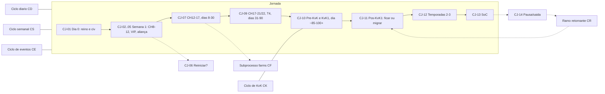

# Mapa de processo — Conta

Mapa do que um jogador faz, decide e precisa saber do dia 0 até as temporadas seguintes. É a base da árvore de funcionalidades (`produto/arvore-funcionalidades.md`). Cada passo tem ID estável (`CJ-`, `CD-`, `CS-`, `CE-`, `CK-`, `CR-`, `CF-`), que a árvore e o backlog citam.

## Como ler

**Campos de cada passo** (método, etapa 1): ator · gatilho/frequência · decisão · informação necessária · dores (`D-xxxx`) · fatos/contexto (IDs de fichas ou pack) · como é feito hoje.

**Apoio do sistema** (método, etapa 2). Abreviações usadas na coluna "Apoio":

| Sigla | Tipo de apoio |
|---|---|
| **Inf** | Informar: guia, explicação, "por quê" |
| **Calc** | Calcular: calculadora, simulação |
| **Plan** | Planejar: plano/cronograma personalizado, metas |
| **Acomp** | Acompanhar: histórico, progresso, alertas e lembretes |
| **Coord** | Coordenar: entre jogadores, aliança e reino |
| **Ident** | Identidade/social: perfil, reputação, compartilhamento |

**Coluna "F-xx"**: funcionalidades da árvore que atendem o passo.

**Restrição fixa:** nenhum apoio envolve automação no jogo, leitura de arquivos/tráfego, credenciais ou assets da Lilith. Dados = entrada manual, print do próprio jogador (OCR nosso), import de exports de ferramentas existentes (`research/context/competitors-and-constraints.md`). Divulgação do hub acontece **fora do chat do jogo** (D-0022: link de Discord no chat gera mute/ban).

**O que o jogo já faz e não vamos duplicar:** painel de filas no CH8 (A01-0011), auto-peacekeeping (A09-0008), reserva de títulos (B03-0002), calendário in-game de poucos dias (A11-0512), Quick Checks/Alliance Notes (B04-0002), Vacation Permit (B03-0007). O hub trabalha **em volta** disso: decide, planeja e lembra; não executa.

## Visão geral

## 1. Jornada (dia 0 → KvK1 → temporadas seguintes)

Ator padrão: jogador F2P em reino novo. Deltas por perfil e função nas seções 7 e 8.

| ID | Passo | Ator | Gatilho / freq. | Decisão | Informação necessária | Dores | Fatos / contexto | Como é hoje | Apoio | F-xx |
|---|---|---|---|---|---|---|---|---|---|---|
| CJ-01 | Escolher reino e civilização (dia 0) | novo jogador (todos os perfis) | instalação; uma vez | começar em reino novo ou antigo; qual civilização | estado do reino (jumpers/sleepers/whales), perks de civ e comandante inicial; não existe mais Beginner's Immigration | D-0018, D-0035, D-0030, D-0038 | A14-0001, A14-0003, C04-0026, C04-0033, B01-0506 | reino sugerido pelo jogo; anúncio; Reddit | Inf, Plan, Ident | F-01, F-12, F-10 |
| CJ-02 | Tutorial e primeiros CH (CH1→~CH8, dias 1–2) | jogador | primeiras sessões | o que construir primeiro; o que adiar | pré-requisitos de CH, cadeia Wall→Tavern→Quarry, 2º construtor | D-0030, D-0006 | A01-0001, A01-0003, A01-0004, A01-0006, A01-0007 | segue o tutorial; guias genéricos | Inf, Plan | F-01, F-02, F-11 |
| CJ-03 | Entrar em aliança ativa (dias 1–3) | jogador | primeiro dia; de novo se expulso | qual aliança (atividade, idioma, fuso, requisito de poder) | alianças do reino, requisito de poder que sobe por dia, idioma | D-0005, D-0037, D-0025, D-0018 | A10-0006, A06-0516, A09-0007; relatos T4 de expulsão por poder (pack `kingdom-lifecycle-and-kvk.md`, Stage 0) | chat do jogo, convites; tentativa e erro | Inf, Coord | F-12, F-30, F-43 |
| CJ-04 | Sobreviver como novato (dias 1–14) | jogador | contínuo; picos em eventos de kill | quando usar escudo; onde ficar; quando teleportar | riscos (dormir sem escudo, recursos acima da proteção), regras do reino | D-0041, D-0003 | A03-0007, A03-0030 (proteção do armazém); custos de escudo = lacuna | aprende apanhando | Inf, Acomp | F-12, F-13 |
| CJ-05 | Primeira semana: 2º construtor, VIP, Pelagius (CH8→CH12) | jogador | dias 2–7; evento Pelagius a partir do dia 5 | gemas grátis em VIP 6? investir no Pelagius? usar a troca grátis de civ no CH10? | renda de gemas, limiares VIP (cumulativos), data e valor do evento | D-0010, D-0006, D-0008 | A05-0001, A05-0004, A05-0008, A01-0006, C04-0005, A06-0508, A14-0002 | Reddit "what next", guias de 2020–2023 | Inf, Calc, Plan | F-01, F-02, F-21, F-20 |
| CJ-06 | Reiniciar ou continuar? | jogador | dias 1–30; recorrente em "loops" de reinício (Hidden Lotus) | recomeçar conta | o que é reversível (troca de civ, Commander Swap, dismantle 100%), custo de catch-up, metas de skin | D-0015, D-0042 | A14-0002, C04-0023, C04-0010 | posts "should I restart?" | Inf, Calc | F-19, F-27 |
| CJ-07 | CH12→CH17 (dias 8–30): Academia, T3, comandantes, primeiras MGE/MTG | jogador | contínuo | ordem de pesquisa; onde gastar aceleradores; em quem investir esculturas | tabela de CH, consenso de pesquisa, orçamento de aceleradores, consenso de comandantes | D-0006, D-0008, D-0011, D-0027, D-0007 | A01-0001, A02-0500, A02-0501, A02-0503, A06-0500, A06-0501, A06-0510 | guias, tier lists (late-game), Reddit | Inf, Calc, Plan, Acomp | F-02, F-16, F-17, F-18, F-20, F-23 |
| CJ-08 | Decidir criar farm (~CH11+ da principal) | jogador | uma vez; revisado por estágio | ter farm? quantas? qual variante? | gargalo da principal por estágio, custo de tempo, Trading Post | D-0020, D-0002 | A13-0001, A13-0002, A13-0010, A03-0021 | guias T3; Reddit | Inf, Plan | F-03 → subprocesso CF |
| CJ-09 | CH17→CH21/22 e T4 (dias 31–90) | jogador | contínuo | CH21/T4 antes do KvK1? quanto hospital? equipamento épico? | tempos buffados, aceleradores disponíveis, data provável do KvK1 | D-0007, D-0012, D-0027 | A01-0001, A01-0005, A08-0500, A08-0502, A07-0500, B01-0500, B01-0700 | planilhas pessoais; posts "am I ready for KvK" | Calc, Plan, Acomp | F-17, F-18, F-23, F-26 |
| CJ-10 | Pré-KvK e KvK1 (dia ~85–100+) | jogador | uma vez por temporada | ver ciclo CK | ver ciclo CK | D-0012, D-0004, D-0013 | B01-0500, B01-0503, A09-0007 | ver CK | Inf, Plan, Coord | ver CK |
| CJ-11 | Pós-KvK1: resultado, ficar ou migrar | jogador | fim de cada KvK | ficar, migrar (para onde), aceitar punição | resultado vs requisito, regras de migração vigentes (idade, passaportes), reinos que aceitam | D-0004, D-0019, D-0037 | B06-0001, B06-0003, B06-0005, C04-0008 | Reddit de recrutamento; Discords | Inf, Calc, Coord | F-30, F-31, F-43 |
| CJ-12 | Temporadas 2–3 (armamentos, formações, T5, swap) | jogador | por temporada | ir de T5 ou não; trocar comandante; armamentos | custo de T5, ferramentas de respec, mudanças de patch | D-0009, D-0013, D-0027, D-0029 | A08-0501, A08-0506, C04-0012, C04-0023, C04-0007 | Reddit/YouTube; muito conselho desatualizado (D-0031) | Inf, Calc, Plan | F-20, F-23, F-26, F-50 |
| CJ-13 | Season of Conquest (CH25 para inscrever) | jogador | por SoC | chegar ao CH25 a tempo; aceitar Vacation Permit; papel | requisito CH25, regras de seed, Vacation Permit | D-0004, D-0013 | C04-0029, B03-0007, B08-0008 | Discord do reino | Inf, Plan | F-26, F-23 |
| CJ-14 | Pausa ou saída (burnout, vida real) | jogador | qualquer momento | parar, estacionar, reduzir tempo, "vender" (proibido) | o que perde ao parar, como estacionar com segurança, ToS | D-0026, D-0036, D-0002, D-0017 | C02-0010 (venda proibida), C02-0005 | vende conta (ToS), abandona | Inf, Plan | F-15, F-32 |
| CJ-15 | Mostrar a jornada (contínuo) | jogador | marcos (dia 100/500, skin, CH) | o que mostrar e onde | marcos da conta, comparação com pares | D-0043, D-0007, D-0042, D-0038 | pack `_indice-players.md` §Identity (photowall ~298k posts) | posts de showcase no Reddit; photowall oficial | Ident, Acomp | F-10, F-48, F-05 |

## 2. Ciclo diário (reset 00:00 UTC)

Fonte: `research/context/daily-routine.md`. **Minutos por tarefa = desconhecido** (L-A10-01); cronômetro T0 §3 preenche. Sem minutos não há "valor por minuto", só ordem por valor.

| ID | Passo | Ator | Gatilho / freq. | Decisão | Informação necessária | Dores | Fatos / contexto | Como é hoje | Apoio | F-xx |
|---|---|---|---|---|---|---|---|---|---|---|
| CD-01 | Planejar a sessão de hoje (quanto tempo, quantos logins) | jogador | diário, antes de logar | o que fazer com 15/30/60 min; o que pular | valor de cada tarefa, minutos (T0), evento ativo | D-0002, D-0026, D-0020 | A10-0002 (checklist T3), L-A10-01 | memória; ninguém publica minutos | Plan, Inf | F-15 |
| CD-02 | Pontos VIP + baú VIP | jogador | diário | — (sempre) | streak 40→200, perda se faltar 1 dia | D-0002 | A05-0003, A05-0006 | memória | Acomp | F-15 |
| CD-03 | Resgatar AP diário | jogador | diário | — (sempre) | 500 AP, pode passar do teto desde 1.1.02 | — | A09-0006, A09-0001 | memória | Acomp | F-15 |
| CD-04 | Reabastecer filas (construção, pesquisa, treino, cura) | jogador | todo login | o que colocar em cada fila | plano de CH/pesquisa; painel de filas no CH8 | D-0006 | A01-0006, A01-0011 | painel do jogo (coberto) | Plan | F-17, F-02 |
| CD-05 | Ajuda da aliança (20 helps) | jogador | diário | — | 10 pts de Daily Objectives | — | A10-0006 | jogo (coberto) | — | — |
| CD-06 | Daily Objectives até 100 pts | jogador | diário | quais tarefas fazer para chegar a 100 com menos tempo | lista atual de tarefas (mudou em 1.1.09) | D-0002 | A10-0001, A04-0001, A04-0010 | memória; lista de 2020 | Inf, Plan | F-15 |
| CD-07 | Baús grátis da Taverna | jogador | diário | — | — | — | A10-0003 | jogo | Acomp | F-15 |
| CD-08 | Gastar AP (bárbaros, fortes) ou guardar | jogador | diário | gastar AP regenerado vs guardar poções para Lohar/Eve | teto de AP, desconto por sequência, próximos eventos | D-0011 | A09-0001, A09-0002, A09-0007, A09-0008, A11-0505 | consenso T3 em guias | Inf, Plan | F-15, F-25 |
| CD-09 | Enviar coletores (território da aliança; nós grandes antes de sair) | jogador | cada login | qual recurso coletar; qual nó | gargalo do estágio, +25% em território | D-0020 | A03-0009, A03-0016, A03-0021, A03-0023 | memória | Inf, Plan | F-15, F-03 |
| CD-10 | Coletar prédios de recurso | jogador | antes de lotar (~10 h) | — | capacidade = 10× produção/hora | — | A03-0002 | memória | Acomp | F-15 |
| CD-11 | Courier Station / Mysterious Merchant | jogador | diário | comprar com recurso, nunca com gema | itens com desconto | D-0010 | A04-0011 | guias | Inf | F-15, F-21 |
| CD-12 | Expedition, Sunset Canyon, Peerless Scholar | jogador | diário | fazer ou pular | valor (medalhas, Golden Key, gemas) vs tempo | D-0002 | A10-0004, A10-0005, A10-0008 | memória | Inf, Plan | F-15 |
| CD-13 | Tarefas do evento ativo | jogador | durante evento | pontuar agora ou guardar | regras do evento, marcos, horário de fim | D-0014, D-0011 | A11-0500, A11-0512 | calendário do jogo (poucos dias) | Plan, Acomp | F-24, F-25 |
| CD-14 | Checagem antes de sair (escudo, hospital, recursos acima da proteção) | jogador | último login do dia; eventos de kill | ligar escudo? enviar excedente para a principal? | risco de zeragem, proteção do armazém | D-0003, D-0041 | A03-0007, A03-0030, A13-0005 | memória; aprende apanhando | Inf, Acomp | F-13, F-15 |

## 3. Ciclo semanal / quinzenal

| ID | Passo | Ator | Gatilho / freq. | Decisão | Informação necessária | Dores | Fatos / contexto | Como é hoje | Apoio | F-xx |
|---|---|---|---|---|---|---|---|---|---|---|
| CS-01 | VIP Shop (segunda 00:00 UTC): AP e aceleradores por comida | jogador | semanal | quanto comprar | estoque de comida; 3.000 AP + 250 min/semana | D-0011 | A04-0007, A09-0006 | memória | Inf, Acomp | F-15, F-21 |
| CS-02 | Peerless Scholar preliminar/final | jogador | quinzenal | participar | data, pool de gemas | — | A10-0005 | jogo | Acomp | F-24 |
| CS-03 | Revisar progresso ("estou no caminho?") | jogador | semanal | ajustar metas | marcos por idade do reino, estado da conta | D-0007, D-0006 | B01-0700 (baixa), A01-0005 (derivado) | posts "rate my account" | Acomp, Calc | F-16, F-18 |
| CS-04 | Olhar o calendário in-game e planejar o que guardar | jogador | semanal (calendário mostra poucos dias) | o que guardar para qual evento | calendário (A11-0512), cadências conhecidas | D-0011, D-0014 | A11-0501, A11-0502, A11-0512 | olho no calendário do jogo | Plan, Acomp | F-24, F-25 |
| CS-05 | Obrigações da aliança (fortes, doações, requisitos) | jogador | semanal | cumprir ou negociar | requisitos da aliança/reino | D-0004, D-0005 | B08-0005 (baixa) | mensagens no Discord/jogo | Acomp, Coord | F-30 |

## 4. Ciclo de eventos (preparar → acumular → gastar)

Premissa frágil: **eventos não têm calendário fixo** (A11-0512). Planejamento por **objetivo** (o que guardar e para quê), não por data, até o T0 medir as primeiras ocorrências (Q4).

| ID | Passo | Ator | Gatilho / freq. | Decisão | Informação necessária | Dores | Fatos / contexto | Como é hoje | Apoio | F-xx |
|---|---|---|---|---|---|---|---|---|---|---|
| CE-01 | Descobrir o evento | jogador | quando aparece no calendário | — | calendário (vê poucos dias), cadências conhecidas | D-0014 | A11-0512, A11-0513 | calendário do jogo; Discord | Inf, Acomp | F-24 |
| CE-02 | Decidir participar e qual meta (marco vs ranking) | jogador | início do evento | ir por marcos ou ranking; respeitar lista de MGE do reino | valor dos marcos, regras do reino, eventos a pular | D-0011, D-0010, D-0505, D-0506 | A11-0500, A11-0506 (baixa), A11-0511 | guias; regra do reino no Discord | Inf, Plan, Coord | F-25, F-35 |
| CE-03 | Acumular (aceleradores, AP, itens de recurso) | jogador | entre eventos | quanto guardar e de quê | estoque atual, próximos alvos (Lohar, Eve, KvK) | D-0011, D-0012 | A11-0501, A09-0007 | memória | Plan, Acomp | F-16, F-25 |
| CE-04 | Executar dentro da janela (fim exato, fuso) | jogador | durante | quando gastar | horário exato de fim em hora local | D-0014 | A11-0512; caso Commander Swap 1 dia antes (índice de jogadores, achado 6) | timer do jogo; perde janelas | Acomp | F-24 |
| CE-05 | Gemas → VIP no More Than Gems | jogador | ~mensal (reino > ~21 dias) | quanto gastar | gemas guardadas, próximo limiar VIP | D-0010 | A11-0502, A11-0504, A05-0001 | guias | Calc, Plan | F-21, F-25 |
| CE-06 | Rodas/chaves (Wheel of Fortune, spin tickets) | jogador | por evento | girar ou não; quantas vezes | garantias, preço (gemas vs tickets) | D-0033, D-0034 | A11-0503, C04-0022 | Reddit | Calc | F-21 |
| CE-07 | Corrida de skin de prestígio (Hidden Lotus) | jogador (motivado por identidade) | primeiros dias do reino | tentar ou não; plano dia a dia | requisito e prazo (T0), ritmo necessário | D-0042, D-0015 | lacuna (não há ficha; T0 diário) | posts "day by day"; reinícios | Plan, Calc, Ident | F-27 |
| CE-08 | Registrar o que rendeu | jogador | fim do evento | ajustar estratégia | ganhos vs gastos | D-0007 | — | nada | Acomp | F-16 |

Eventos que o plano precisa conhecer (cadência em `early-kingdom-timeline-and-events.md`): Legendary Pelagius (dia 5, T1), MGE, More Than Gems, Lohar/Arms Training, Wheel of Fortune, Ark of Osiris, Peerless Scholar, Eve of the Crusade.

## 5. Ciclo de KvK

| ID | Passo | Ator | Gatilho / freq. | Decisão | Informação necessária | Dores | Fatos / contexto | Como é hoje | Apoio | F-xx |
|---|---|---|---|---|---|---|---|---|---|---|
| CK-01 | Entender a temporada e as mecânicas | jogador | antes de cada KvK | — | história da temporada, Lost Kingdom, honra, crystal tech | D-0013 | C04-0007, B01-0503, `game-state-and-patch-timeline.md` | Reddit/YouTube | Inf | F-26 |
| CK-02 | Ler requisitos/DKP do reino | jogador | quando publicados (às vezes por mail) | aceitar, negociar, migrar | fórmula, % de poder, como é medido (delta) | D-0004, D-0501, D-0518 | B08-0001, B08-0002 | mail/Discord; muitos não sabem o que é DKP | Inf, Calc | F-30, F-34 |
| CK-03 | Avaliar prontidão (CH21/T4, hospital, aceleradores de cura, recursos) | jogador | 2–4 semanas antes | onde fechar lacunas | capacidade de hospital, custo de cura, estoque | D-0012, D-0028, D-0007 | A08-0502, A08-0505, A01-0008 | posts "am I ready" | Calc, Plan | F-22, F-26, F-18 |
| CK-04 | Inscrição de papel/disponibilidade; roster do Lost Kingdom | jogador | antes do KvK | papel (lutador, rally, guarnição, farm); horários | formulário do reino; roster é do rei (coberto) | D-0517, D-0524, D-0526 | B02-0001, B02-0002 | Forms/reações no Discord | Coord | F-44 |
| CK-05 | Eve of the Crusade: gastar AP guardado | jogador | pré-KvK | quanto AP gastar onde | estoque de AP | D-0011 | A09-0007, B01-0503 | guias | Plan | F-25 |
| CK-06 | Lutar nos horários do reino (UTC) | jogador | por estágio | aparecer, com que marchas | horário em hora local, alvos | D-0526, D-0014 | B02-0004 (baixa), B07-0004 | Discord; marcadores in-game (coberto parcialmente) | Acomp, Coord | F-24, F-44 |
| CK-07 | Curar e gerir hospital (não deixar morrer por excesso) | jogador | durante lutas | curar agora ou recuar | capacidade, custo de cura, aceleradores | D-0028 | A08-0502, A08-0503, A08-0504 | memória | Calc, Inf | F-22 |
| CK-08 | Acompanhar a própria contribuição vs meta | jogador | por estágio | quanto falta | KP/mortes próprios (print do perfil), fórmula do reino | D-0004, D-0007 | B08-0001, B08-0002; Development overview pessoal (B08-0003) | contas de cabeça; bots `/stats` do reino | Acomp, Calc | F-30, F-54 |
| CK-09 | Resultado pós-KvK (tiers, recompensas, lista de saída) | jogador | fim do KvK | contestar, aceitar, migrar | ranking publicado, regra aplicada | D-0507, D-0004, D-0525 | B06-0005, B08-0006 | planilha/Doc do conselho | Inf, Coord | F-30, F-36 |
| CK-10 | Ficar ou migrar | jogador | janela de migração | para onde | elegibilidade (idade, poder, passaportes), reinos abertos | D-0019, D-0509, D-0037 | B06-0001, B06-0003, C04-0008 | Reddit de recrutamento | Inf, Calc, Coord | F-31, F-43 |

## 6. Ramo retornante (D-0016: segmento grande e mal atendido)

≈270 posts em 2 anos; poucos guias. Mesmo processo para quem parou meses ou anos.

| ID | Passo | Ator | Gatilho / freq. | Decisão | Informação necessária | Dores | Fatos / contexto | Como é hoje | Apoio | F-xx |
|---|---|---|---|---|---|---|---|---|---|---|
| CR-01 | Voltar e recuperar o acesso | retornante | uma vez | — | binding, ID do governador, suporte | D-0017, D-0023 | C02-0005 (não compartilhar senha) | ticket ao suporte | Inf | F-32 |
| CR-02 | Entender o que mudou desde que parou | retornante | uma vez | o que importa agora | patch timeline filtrada pela data de parada | D-0016, D-0013, D-0031 | `game-state-and-patch-timeline.md` (C04-*) | Reddit "I'm back, what changed?" | Inf | F-28 |
| CR-03 | Avaliar o estado da conta | retornante | uma vez | o que está defasado | snapshot da conta vs marcos atuais | D-0016, D-0007 | B01-0700 (baixa) | posts "am I cooked" | Calc, Acomp | F-16, F-18 |
| CR-04 | Decidir: continuar no reino, migrar ou recomeçar | retornante | uma vez | ficar / migrar / recomeçar | elegibilidade por idade da conta, passaportes, custo de recomeçar | D-0016, D-0019, D-0015 | B06-0003, C04-0008, B06-0001 | posts; "most will say restart" | Inf, Calc | F-31, F-19 |
| CR-05 | Achar reino que aceite retornantes | retornante | se migrar | qual reino | reinos com requisitos/estilo compatíveis | D-0016, D-0037 | — (sem diretório neutro) | Reddit de recrutamento | Coord | F-43, F-42 |
| CR-06 | Plano de catch-up de 14 dias | retornante | após decidir | o que priorizar, o que ativar, o que ignorar | sistemas novos (armamentos, swap), fontes de recuperação | D-0016, D-0006 | C04-0023, C04-0012 | nada específico | Plan | F-29, F-17 |
| CR-07 | Retomar a rotina | retornante | diário | quanto tempo dedicar | rotina com orçamento de tempo | D-0002 | `daily-routine.md` | — | Plan | F-15 |

## 7. Ramificações por perfil de gasto

Perfis em `research/perfis.md`. Guias são **deltas sobre o F2P**. Medium+ não foi pesquisado (lacuna declarada em `spending-tiers-baseline.md`).

| Perfil | Passos que mudam | O que muda | Evidência | F-xx |
|---|---|---|---|---|
| **F2P** (base) | todos | caminho base: VIP 6 → VIP 10 com gemas grátis no MTG; Sun Tzu; guardar para Lohar/Eve; farm como multiplicador de recursos | packs de conta (média) | F-02, F-14 |
| **Low "pass-only"** (~$5–25) | CJ-05, CE-05 | comprar Growth Fund cedo (rende com o CH), depois Supply Depot (650 gemas/dia, exige login diário) | A12-0001, A12-0002 (média, fontes com CoI) | F-02 (delta), F-14, F-21 |
| **Low pleno** (~$25–100) | CE-05, CE-06 | compras no Recharge event; VIP 10 mais cedo é o ganho principal | A12-0005 (média), A12-0003/0004 (baixa) | F-02 (delta), F-21 |
| **Medium / High** | CJ-07, CJ-09, CK-03 | hipótese: aceleradores deixam de ser gargalo antes; comandantes legendários mais cedo; lidera rallies | **lacuna** (não pesquisado) | F-02 (delta, R2/R3) |
| **Whale / Kraken** | CJ-12, CK-* | hipótese: foco em T5, armamentos, papel de liderança de luta | **lacuna** | F-02 (delta, R3) |
| **Ex-gastador hoje F2P** | todos | gasto acumulado importa tanto quanto o mensal (limitação em `perfis.md`) | regra de produto | F-01 (pergunta de gasto acumulado), F-16 |

## 8. Ramificações por função

| Função | Passos afetados | O que muda | Evidência | F-xx |
|---|---|---|---|---|
| **Lutador de campo** (padrão F2P) | CJ-07, CJ-09, CK-03..07 | marchas completas; nunca lidera; recua cedo; hospital é o limite | A08-0503, A08-0504, A08-0502 (majoritário/unânime) | F-02, F-22, F-26 |
| **Rally lead** | CJ-07, CJ-12, CK-04 | comandantes de rally, capacidade de rally; requisito de DKP pode ter peso de papel | B02-0003 (baixa), D-0502 | F-20, F-34 |
| **Guarnição** | CJ-07, CK-04 | comandantes de guarnição por tipo de tropa; contribuição não-kill que o DKP ignora | B02-0003 (baixa), D-0502 | F-20, F-34 |
| **Farm / coletor** | CD-09, CJ-08, CF-* | comandante de coleta nível 37 (Superior Tools); nunca gastar escultura universal em coletor | A06-0506, A03-0017, A06-0510 | F-03, F-04, F-20 |
| **Oficial (R4/R5)** | CS-05 + mapa de reino | carga de administração → ver `processos/reino.md` | D-0519, D-0040 | F-46 |

## 9. Subprocesso de farms (contas secundárias do próprio jogador)

Somente farms que o próprio jogador possui, **operadas manualmente** (bots em farms são banidos; Conduct Score C04-0006). Fonte: `research/context/farms.md`.

| ID | Passo | Ator | Gatilho / freq. | Decisão | Informação necessária | Dores | Fatos / contexto | Como é hoje | Apoio | F-xx |
|---|---|---|---|---|---|---|---|---|---|---|
| CF-01 | Decidir ter farm e quantas | jogador (F2P/low) | estágio ~CH11 da principal | 0, 1 ou 2 farms | limite ~2 cidades por reino, tempo extra por dia | D-0020, D-0002 | A13-0001, A13-0010, C02-0017 (baixa) | guias T3 | Inf, Plan | F-03 |
| CF-02 | Escolher variante (geral, recurso único, par) | jogador | ao criar | qual recurso focar | gargalo da principal por estágio, tecnologia de coleta por recurso, civ | D-0020 | A03-0021, A03-0028, A03-0029, A13-0009 (baixa); pares = **hipótese** | AllClash 2019 | Inf, Calc | F-03 |
| CF-03 | Criar a farm (Character Management, civ) | jogador | uma vez | civ da farm (França/Roma/…) | perks de coleta por civ | — | A13-0001, A03-0029 | guias | Inf | F-03 |
| CF-04 | Subir a farm: CH11 → CH17 (→ CH22) e Trading Post ≥15 | jogador | primeiras semanas da farm | até onde subir | marchas por CH, taxa por nível de TP, Goldmine para TP10+ | D-0020 | A13-0002, A13-0003, A03-0023, A03-0024 | guias | Plan, Calc | F-03, F-04 |
| CF-05 | Coletar (território da aliança; nós grandes antes de sair) | jogador | 1–2 logins/dia por farm | onde e o quê | +25% em território, Enhanced Gathering | D-0020, D-0002 | A03-0009, A03-0013, A03-0016, A13-0007 (baixa) | memória; muitos logins | Acomp, Plan | F-04, F-15 |
| CF-06 | Enviar excedente à principal (Trading Post) | jogador | quando acumula acima da proteção | quanto e de quê; ouro? | taxa (35%→8%), capacidade por viagem, proteção do armazém, cada envio ocupa marcha | D-0020 | A03-0024, A03-0025, A03-0026, A03-0027, A03-0030 | contas manuais | Calc, Acomp | F-03, F-04 |
| CF-07 | Proteger a farm em eventos de kill | jogador | eventos de kill/KvK | escudo; esvaziar | recursos expostos acima da proteção | D-0003 | A13-0005, A03-0007 | memória | Acomp, Inf | F-04, F-13 |
| CF-08 | Usos secundários (pontos de MGE, Books of Covenant, apoio no KvK) | jogador | eventos | usar farm para pontuar? (regras do reino) | regras do reino sobre farms | D-0522 | A13-0010, B08-0006 | regra do reino | Inf, Coord | F-04, F-38 |
| CF-09 | Acompanhar total enviado vs meta (ex.: cura do KvK) | jogador | semanal | quantas farms valem a pena | totais enviados, meta de recursos | D-0020, D-0028 | — (sem ficha) | nada / planilha | Acomp, Calc | F-04, F-22 |
| CF-10 | Declarar a farm ao reino (alt ↔ principal) | jogador | quando o reino pede | declarar | regra do reino | D-0522, D-0503 | B08-0006 | Discord | Coord | F-38 |

## Lacunas que afetam este mapa

| Lacuna | Passos afetados | Como fecha |
|---|---|---|
| Minutos por tarefa (L-A10-01) | CD-01..CD-14, CF-05 | T0 §3 cronômetro, 7 dias |
| Renda real de gemas/aceleradores (L-A04-01, L-A04-04) | CJ-05, CE-05, perfis | T0 §4 |
| Primeira ocorrência dos eventos (L-A11-01) | CE-01..CE-07, CJ-05 | T0 calendário a cada 3 dias |
| Tempos buffados de construção (L-A01-02/03) | CJ-07, CJ-09 | T0 por nível de CH |
| Trading Post: ouro, capacidade, desbloqueio (L-A03-03/04); rendimento de farm (L-A13-01) | CF-02..CF-06 | T0 quando o TP desbloquear |
| Estado F2P no dia 0 do KvK1 (`kvk1-day0`) | CJ-09, CS-03 | T0 |
| Hidden Lotus (requisito, prazo) | CE-07 | T0 (não está no protocolo; ver árvore §Dependências) |
| Custos/regras de escudo | CJ-04, CD-14 | pesquisa CONTA ou T0 |
| Medium+ | seção 7 | onda futura de pesquisa |
