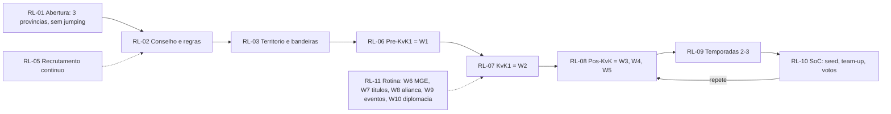

# Mapa de processo — Reino

Mapa do que a liderança (rei, conselho, R5/R4, oficiais funcionais) faz ao longo da vida do reino, e dos 10 fluxos de administração recorrentes. Base da árvore de funcionalidades (`produto/arvore-funcionalidades.md`). IDs: `RL-` (ciclo de vida) e `Wn-m` (fluxo n, passo m).

## Como ler

Mesmos campos e siglas de apoio do mapa de conta (`processos/conta.md`): **Inf**, **Calc**, **Plan**, **Acomp**, **Coord**, **Ident**.

Coluna extra **"No jogo?"**: o que as ferramentas oficiais já cobrem (T1, notas 1.0.74–1.1.09):
- **Sim** = coberto; o hub **não** duplica (no máximo explica).
- **Parcial** = o jogo faz parte; o hub cobre o resto (critério, registro, transparência).
- **Não** = sem ferramenta oficial.
- **?** = depende do **ROK Toolkit** oficial (B08-0007), cujo conteúdo e exportação são desconhecidos (L-B08-01).

**Restrições:** nada de scan automatizado, leitura de cliente/tráfego, credenciais ou assets da Lilith. Dados de reino entram por **import** de exports que o reino já tem (scanners de terceiros, planilhas) ou por print do próprio jogador; dados de terceiros exigem atestado da liderança e opt-out do membro (ToS 17.1.13; LGPD/GDPR). Links do hub nunca são colados no chat do jogo (D-0022).

**Viés de amostra:** líderes são sub-representados nas fontes; passos comunitários são prática (T3/T4) e variam por reino. Tempo por passo não foi medido (só "2–3 h de planilha por evento", B08-0003).

## Ciclo de vida (visão da liderança)

| ID | Estágio / passo | Ator | Gatilho / freq. | Decisão | Informação necessária | Dores | Fatos / contexto | Como é hoje | No jogo? | Apoio | F-xx |
|---|---|---|---|---|---|---|---|---|---|---|---|
| RL-01 | Abertura do reino: primeiras alianças, mínimo de poder para entrar | R5/R4 das primeiras alianças | dias 0–14 | quem aceitar; que mínimo de poder; quem expulsar | atividade e poder dos candidatos | D-0511, D-0018, D-0005 | C04-0033, C04-0026; relatos T4 (pack lifecycle, Stage 0) | chat, convites, expulsões diárias | Parcial: Quick Approval, blocklist/passlist, motivo de remoção (B04-0006) | Coord, Inf | F-33, F-45 |
| RL-02 | Formar conselho e escrever regras do reino | R5s das alianças grandes; rei | antes do KvK1; revisto por temporada | uma liderança só; regras de MGE/DKP; como decidir | modelos de regra, regras de outros reinos | **D-0513**, D-0518, D-0525 | B03-0004 (baixa), pack governance | Discord, Google Docs/Sites | Parcial: Bugle fixa uma frase no chat (B07-0004) | Coord, Inf | F-33, F-36 |
| RL-03 | Dividir território e bandeiras entre alianças | conselho | pré-KvK1; quando muda o mapa | quem fica com o quê; academias/vassalas | mapa, acordos | D-0521, D-0513 | B09-0001 (baixa) | DMs, prints | Não | Coord | F-36 |
| RL-04 | Rei, corte e títulos | rei, Rainha/General/PM | Lost Temple; contínuo | quem recebe títulos | — | D-0523 (**descartada**) | B03-0001, B03-0002, B03-0003 | jogo | **Sim** (reserva com autoaprovação, 1.0.91; skills compartilhadas, 1.0.96) | — (não construir) | — |
| RL-05 | Recrutar membros e papéis (rally, guarnição, R4) | R5/R4, oficial de migração | contínuo | quem buscar; onde anunciar | vagas, requisitos, estilo do reino | D-0510, D-0037 | B06-0004, C04-0025 | Reddit, Discord | Parcial: Recruitment Plaza (C04-0025) | Coord, Ident | F-42, F-43 |
| RL-06 | Pré-KvK1 | conselho | ~dia 70–100 | ver **W1** | ver W1 | D-0501, D-0513 | B01-0500 | ver W1 | ver W1 | ver W1 | ver W1 |
| RL-07 | KvK1 | conselho, oficiais | ~dia 100+ | ver **W2** | ver W2 | D-0500, D-0526 | B02-0001, B02-0005 | ver W2 | ver W2 | ver W2 | ver W2 |
| RL-08 | Pós-KvK: DKP, expurgo, migração | conselho | fim de cada KvK | ver **W3, W4, W5** | ver W3–W5 | D-0507, D-0508 | B06-0005 | ver W3–W5 | ver W3–W5 | ver W3–W5 | ver W3–W5 |
| RL-09 | Temporadas 2–3: mais títulos de oficial; seed começa a pesar | conselho | por temporada | mirar Imperium ou seed baixo; T5 | regras de seed, novidades da temporada | D-0520 | B04-0001, C04-0007 | Discord | Parcial: 8 novos títulos de oficial (1.0.96) | Inf, Calc | F-39, F-50 |
| RL-10 | Season of Conquest: seed, team-up, voto de match, coalizões, Vacation Permit, Army Groups | rei, conselho | cada SoC | aceitar match; quem recebe Vacation Permit; coalizões | poder em faixas dos top 300, limiar Imperium 23,5B, cota de permits | D-0520, D-0513, D-0521 | B08-0008, B03-0007, B09-0002, B09-0003, B04-0005, C04-0014 | contas manuais, Hero Scrolls seeds | Parcial alto: votos, coalizões, permits, Army Groups, proteção de território (T1) | Calc, Coord | F-39, F-36 |
| RL-11 | Rotina contínua da liderança | todos os líderes | semanal | ver **W6–W10** | ver W6–W10 | **D-0519**, D-0040 | B04-0007 | "segundo emprego" | Parcial | Acomp, Coord | F-46 |

## Os 10 fluxos de administração

### W1. Preparação do KvK (≈ 2–4 semanas antes da inscrição / Eve of the Crusade)

| ID | Passo | Ator | Gatilho / freq. | Decisão | Informação necessária | Dores | Fatos / contexto | Como é hoje | No jogo? | Apoio | F-xx |
|---|---|---|---|---|---|---|---|---|---|---|---|
| W1-1 | Acordar regras do reino: liderança única, zonas, política de MGE, fórmula de DKP e requisito | conselho, rei | por KvK | qual fórmula; qual requisito; quem lidera | modelos de fórmula, regras anteriores, seed | **D-0513**, **D-0501** | B08-0001, B08-0002, B03-0004 (baixa) | Discord, Google Docs/Sites | Não | Coord, Calc, Inf | F-33, F-34, F-50 |
| W1-2 | Scan de linha de base (top 300/600/1000) | oficial de dados | por KvK | qual ferramenta; pagar serviço? | export do scanner | D-0504, D-0500 | B08-0003, B08-0004, C01-0021, C02-0003 | RokTracker (emulador+ADB+OCR), ROKSTATS/Hero Scrolls/Botals, scanner contratado | **?** ROK Toolkit (B08-0007) | Coord (import) | F-37 |
| W1-3 | Publicar requisitos por governador | conselho | por KvK | metas por faixa de poder; exceções (farms) | linha de base, fórmula | D-0501, D-0518, D-0522 | B08-0002 | Sheets, ROK Steward, bots `/stats` | Não | Calc, Coord, Inf | F-34, F-30 |
| W1-4 | Roster de papéis (rally/guarnição por tropa, bandeiras, planejadores); recrutar lacunas | líder de guerra, R4s | por KvK | quem faz o quê; quem recrutar | disponibilidade por fuso, papéis | D-0510, D-0517 | B02-0003 (baixa) | Discord, anúncios no Reddit | Parcial: Recruitment Plaza | Coord | F-44, F-42 |
| W1-5 | Checagem de seed (SoC) | rei, conselho | por SoC | cortar ou somar poder | soma em faixas dos top 300 | D-0520 | B08-0008, B03-0007 | Hero Scrolls seeds, somas manuais | Parcial: fórmula oficial; Vacation Permit | Calc | F-39 |
| W1-6 | Inscrição: domínios, battle roster, Watchlist | rei | por KvK | quem entra no Lost Kingdom | critério publicado | D-0524 | B02-0001, B02-0002, B08-0007 | jogo | **Sim** (T1; import de roster via ROK Toolkit) | Inf (publicar critério) | F-40 (critério de LK) |
| W1-7 | Linha do tempo de portões/passes/ruínas | conselho | por KvK | quando lutar | tabela da história | D-0516 (gravidade baixa; possivelmente obsoleta) | B02-0005 | Sheets, Codex Helper, APO | Parcial: tempo de passe ligado às Chronicles; calendário prometido (abr/2025) | Plan | F-47 (congelada) |

### W2. Durante o KvK (cada estágio / luta de passe)

| ID | Passo | Ator | Gatilho / freq. | Decisão | Informação necessária | Dores | Fatos / contexto | Como é hoje | No jogo? | Apoio | F-xx |
|---|---|---|---|---|---|---|---|---|---|---|---|
| W2-1 | Anunciar horários (UTC) e alvos | líder de guerra | por luta | horário que inclua mais fusos | disponibilidade por fuso | D-0526 | B07-0004, B04-0005 | Discord, mail, chat | **Sim** em grande parte: marcadores com contagem (1.0.90), mail de raid (1.1.01), Bugle, voz | Coord (fuso) | F-44 |
| W2-2 | Coordenação ao vivo de rally/guarnição | líderes de rally/guarnição | por luta | — | — | D-0527 (fraca) | B04-0005, B04-0002 | jogo + voz | **Sim**: Army Groups (SoC), Quick Checks | — (não construir) | — |
| W2-3 | Snapshots por estágio (scan início/fim → deltas; honra à parte) | oficial de dados | por estágio | o que medir | exports do scanner | D-0500, D-0502, D-0503 | B08-0004 (scan de honra sem ID) | scanners, ROK Steward | **?** ROK Toolkit | Calc, Acomp | F-37, F-38 |
| W2-4 | Revisões no meio do KvK: avisos, exceções (dia zerado = mortes 0) | conselho | semanal no KvK | avisar; abrir exceção | parcial por governador, registro de exceções | D-0503 | B08-0001, B08-0006 | sheets, DMs | Não | Acomp, Coord | F-38, F-36 |

### W3. Cálculo de DKP e revisão pós-KvK

| ID | Passo | Ator | Gatilho / freq. | Decisão | Informação necessária | Dores | Fatos / contexto | Como é hoje | No jogo? | Apoio | F-xx |
|---|---|---|---|---|---|---|---|---|---|---|---|
| W3-1 | Scan final; juntar com a linha de base por governor ID; limpar erros de OCR; somar alts na principal | oficial de dados | fim do KvK | como tratar nulos, negativos, IDs faltando, alts | dois exports + declaração alt↔principal | D-0500, D-0503, D-0522 | B08-0004, B08-0006 | planilha, "2–3 h de conta por evento" | **?** ROK Toolkit | Calc | F-37, F-38 |
| W3-2 | Calcular DKP e % do requisito; tiers | oficial de dados | fim do KvK | fórmula final; cortes de tier | fórmula versionada | D-0500, D-0502 | B08-0001, B08-0002 | Sheets, ROK Steward | Não (só Acclaim, C04-0015) | Calc | F-38, F-34 |
| W3-3 | Publicar ranking | conselho | fim do KvK | formato; quanto expor | ranking, fórmula, exceções | D-0525, D-0518 | ex.: 200+ governadores publicados no Google Docs (pack workflows) | Sheets/Docs/PDF | Não | Coord, Inf | F-38, F-36 |
| W3-4 | Decidir consequências: recompensas, MGE, cabeças, leilão de DKP, probação, remoção | conselho | fim do KvK | quem ganha, quem sai | tiers + regra pública | D-0506, D-0507, D-0525 | B08-0006, B05-0004 | Discord | Não | Coord | F-35, F-40, F-36 |

### W4. Expurgo / gestão de saída ("lista de migração obrigatória")

| ID | Passo | Ator | Gatilho / freq. | Decisão | Informação necessária | Dores | Fatos / contexto | Como é hoje | No jogo? | Apoio | F-xx |
|---|---|---|---|---|---|---|---|---|---|---|---|
| W4-1 | Selecionar (DKP baixo no top 300 de poder; inativos; farms) | conselho | pós-KvK | quem entra na lista | tiers de W3, seed | **D-0507**, D-0520 | B06-0005, B03-0005 | planilha | Não | Calc, Coord | F-40, F-38 |
| W4-2 | Notificar com prazo; oferecer redenção | conselho | pós-KvK | prazo; condição de redenção | contato, regra citada | D-0507, D-0525 | B03-0005 | DM/mail/Discord | Não | Coord | F-40 |
| W4-3 | Fazer cumprir: kick → Watchlist → zeragem | conselho, alianças do topo | após prazo | escalar ou não | registro da decisão | D-0507, D-0514 | B02-0002, C04-0014 | jogo + violência | Parcial: Watchlist, Banish, proteção de território no SoC (T1) | Coord (registro) | F-36, F-40 |
| W4-4 | Consequências: vingança, células adormecidas, posts "UNSAFE" | conselho | semanas depois | — | histórico de decisões | D-0514, D-0525 | — | — | Não | Coord (registro) | F-36 |

### W5. Entrada de migrantes

| ID | Passo | Ator | Gatilho / freq. | Decisão | Informação necessária | Dores | Fatos / contexto | Como é hoje | No jogo? | Apoio | F-xx |
|---|---|---|---|---|---|---|---|---|---|---|---|
| W5-1 | Anunciar janela e requisitos | rei, oficial de migração | janela de migração | requisitos; vagas por papel | regras do jogo vigentes, seed | D-0508, D-0510, D-0518 | B06-0004 | Reddit/Discord | Parcial: Recruitment Plaza | Coord, Ident | F-42, F-43, F-33 |
| W5-2 | Avaliar formulário e prints do candidato | oficial de migração | por candidato | aceitar; alocar | stats, comandantes, risco de espião, impacto no seed | D-0508, D-0514 | B06-0004 | prints no Discord, bots de print | Não | Coord, Calc | F-41 |
| W5-3 | Checar restrições do jogo (CH16, passaportes, cooldown de 30 dias, idade, trava de temporada, teto do rei) | oficial de migração; candidato | por candidato | é elegível? | regras versionadas por patch | **D-0509**, D-0019 | B06-0001, B06-0002, B06-0003, C04-0008 | memória; regras mudam (mar/2026) | **Parcial**: o jogo aplica a elegibilidade, mas não explica; aprovação especial do rei | Calc, Inf | F-31, F-50 |
| W5-4 | Alocar aliança (principal/academia/farm) e verificar no Discord | R5/R4 | por candidato | onde colocar | — | D-0508 | B07-0001 | bots de print | Parcial: Quick Approval, passlist (B04-0006) | Coord | F-41 |
| W5-5 | Policiar chegadas não anunciadas | conselho | contínuo | avisar, zerar | regra publicada | D-0518 | B03-0006 (baixa) | localizar, avisar, zerar | Não | Inf (regra pública) | F-33 |

### W6. Ciclo de MGE (a cada MGE)

| ID | Passo | Ator | Gatilho / freq. | Decisão | Informação necessária | Dores | Fatos / contexto | Como é hoje | No jogo? | Apoio | F-xx |
|---|---|---|---|---|---|---|---|---|---|---|---|
| W6-1 | Escolher o modelo de alocação (fixo por DKP/papel, leilão de DKP, livre, "rotação") | conselho | por MGE | modelo e critérios | histórico de quem já ganhou | **D-0506**, D-0505 | B05-0002, B05-0004 | Discord | Não | Coord | F-35, F-33 |
| W6-2 | Coletar candidaturas; publicar lista top-N e tetos de pontos | conselho | por MGE | quem entra | candidaturas, histórico | D-0506 | B07-0001 (Codex Helper, 11 idiomas) | Codex Helper, Discord | Não | Coord | F-35 |
| W6-3 | Monitorar o ranking nos 6 estágios; contatar quem passou do teto | conselho | durante | intervir | ranking (in-game), lista publicada | D-0505 | B05-0003 | olho no ranking | Parcial: o ranking é visível no jogo | Acomp | F-35 |
| W6-4 | Punir quem quebrou (kick, migrar, zerar, multa) | conselho | após | punição | regra, registro | D-0505, D-0522 | B05-0003 | Discord | Não | Coord | F-35, F-36 |

### W7. Títulos (contínuo) — **absorvido pelo jogo**

| ID | Passo | Ator | Gatilho / freq. | Decisão | Informação necessária | Dores | Fatos / contexto | Como é hoje | No jogo? | Apoio | F-xx |
|---|---|---|---|---|---|---|---|---|---|---|---|
| W7-1 | Pedir e conceder títulos de corte | governadores; rei/rulers | contínuo | aprovar | — | D-0523 (**descartada**) | B03-0002 | reserva in-game; alguns bots OCR | **Sim** (1.0.91, 1.0.94) | — (não construir) | — |
| W7-2 | Títulos de liderança (Rainha/General/PM) em fusos diferentes | rei | por reinado | quem nomear | cobertura de fuso | D-0519, D-0526 | B03-0003 | jogo | Sim (skills compartilhadas, 1.0.96) | Inf (boa prática) | F-46 |

### W8. Manutenção da aliança (semanal)

| ID | Passo | Ator | Gatilho / freq. | Decisão | Informação necessária | Dores | Fatos / contexto | Como é hoje | No jogo? | Apoio | F-xx |
|---|---|---|---|---|---|---|---|---|---|---|---|
| W8-1 | Revisar atividade (helps, doações, fortes, crescimento) → kick ou mover para academia | R5/R4 | semanal | quem sai, quem move | definição de "ativo" combinada, histórico | D-0511, D-0512 | B08-0005 (baixa), B04-0002 | sheet ou bot | **Parcial**: Quick Checks (Season 1+), Alliance Notes (**públicas aos membros**), busca, motivo de remoção | Acomp, Coord | F-45 |
| W8-2 | Revisar permissões de oficiais; blocklist | R5 | mensal | tirar permissão | quem tem o quê desde quando | D-0514 | B04-0001, B04-0006 | jogo | **Sim** (6 categorias, contagem de desmonte cancelável) | Inf (boa prática) | F-46 |
| W8-3 | Participação em fortes/rallies de bárbaro | R4 | semanal | quem cumpre | registro de participação | D-0502, D-0512 | — (sem log oficial) | ROKSTATS fort tracker, prints | Não | Acomp | F-45 |

### W9. Inscrições em eventos (Ark of Osiris e outros)

| ID | Passo | Ator | Gatilho / freq. | Decisão | Informação necessária | Dores | Fatos / contexto | Como é hoje | No jogo? | Apoio | F-xx |
|---|---|---|---|---|---|---|---|---|---|---|---|
| W9-1 | Coletar inscrições por papel e disponibilidade (slot UTC) | R4 de eventos | ~quinzenal (Ark) | quem vai | disponibilidade por fuso, papel | **D-0517**, D-0526 | B07-0001 | reações/Forms no Discord | Parcial: marcadores do coordenador de Ark (1.0.90) | Coord | F-44 |
| W9-2 | Montar times e lembrar (1/4/8 h antes) | R4 de eventos | por evento | balanceamento | roster | D-0517 | B07-0001 | Codex Helper | Não | Coord, Acomp | F-44, F-58 |

### W10. Diplomacia (contínuo)

| ID | Passo | Ator | Gatilho / freq. | Decisão | Informação necessária | Dores | Fatos / contexto | Como é hoje | No jogo? | Apoio | F-xx |
|---|---|---|---|---|---|---|---|---|---|---|---|
| W10-1 | Dentro do reino: território, bandeiras, academias/vassalas | conselho, R5s | contínuo | termos do acordo | acordos anteriores | **D-0513**, D-0521 | B09-0001 (baixa) | DMs, prints | Não | Coord | F-36, F-33 |
| W10-2 | Entre reinos (SoC): team-up, voto de match, Rest Mode, coalizões, Camp Treaty | rei, líderes de coalizão | por SoC | votar; com quem coalizar | regras oficiais | D-0521 | B09-0002, B09-0003 | jogo + Discord | **Sim** em grande parte (T1; Camp Treaty pioneiro) | Inf | F-50 |
| W10-3 | Registrar pactos (NAP etc.) | conselho | quando fechados | — | texto do pacto, signatários | D-0521, D-0525 | prática de NAP não documentada (lacuna) | só DMs/prints | Não | Coord | F-36 |

## Matriz de cobertura: onde o hub entra

| Fluxo | Coberto pelo jogo | O que fica para o hub | F-xx principais |
|---|---|---|---|
| Ciclo de vida pré-KvK1 (RL-01..03) | baixo (Quick Approval, Bugle) | **regras escritas, carta do reino, registro de acordos** — o reino novo tem o mínimo de ferramenta oficial justo quando a hierarquia se forma | F-33, F-36 |
| W1 | alto só na inscrição/roster | fórmula e requisitos transparentes; import de linha de base | F-34, F-37 |
| W2 | médio-alto (Army Groups, marcadores, voz) | deltas por estágio, exceções; disponibilidade por fuso | F-38, F-44 |
| W3 | **nenhum** (só Acclaim) — salvo ROK Toolkit | import, join por ID, fórmula versionada, publicação | F-37, F-38 |
| W4 | baixo (Watchlist, Banish) | aviso com prazo, apelação, registro da decisão | F-40, F-36 |
| W5 | baixo (elegibilidade aplicada, sem explicação) | checador de elegibilidade, pipeline de candidatura | F-31, F-41 |
| W6 | **nenhum** | ledger de MGE, candidaturas, tetos publicados, log de violações | F-35 |
| W7 | **alto** | nada (não construir) | — |
| W8 | médio (Quick Checks, Notes públicas, permissões) | definição de atividade combinada; notas privadas de oficial; histórico | F-45 |
| W9 | baixo | inscrição por papel e slot UTC | F-44 |
| W10 | médio no SoC | registro de acordos intra-reino e pactos | F-36 |

## Pontos únicos de falha (risco transversal)

O oficial de dados, o autor do bot e o rei (D-0504, D-0519). Funcionalidades de reino devem permitir **passagem de bastão**: regras, fórmulas e históricos vivem no hub, não na cabeça ou na planilha de uma pessoa (F-33, F-34, F-36, F-46).

## Lacunas que afetam este mapa

| Lacuna | Passos afetados | Como fecha |
|---|---|---|
| Conteúdo e exportação do ROK Toolkit (L-B08-01) | W1-2, W2-3, W3-1 | T0 na conta do Victor quando o reino entrar no Season 1 + entrevista com líderes |
| Tempo por fluxo; stack de ferramentas por reino | todos | entrevistas (`research/raw/pains-leaders/_interview-guide.md`) |
| Regras reais de "rotação" de MGE | W6-1 | entrevistas; coleta de 15–20 regras |
| Prática de NAP | W10-3 | entrevistas |
| Agendamento entre fusos | W2-1, W9-1 | entrevistas |
| Notas oficiais 1.1.10–1.1.12 (migração, Camp Treaty) | W5-3, W10-2 | frente de patches |
